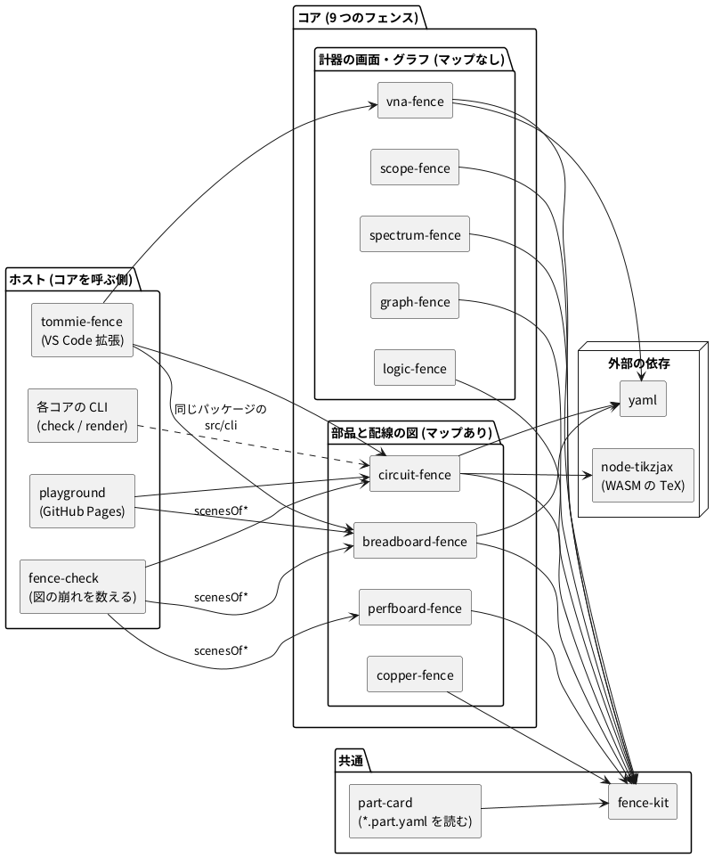
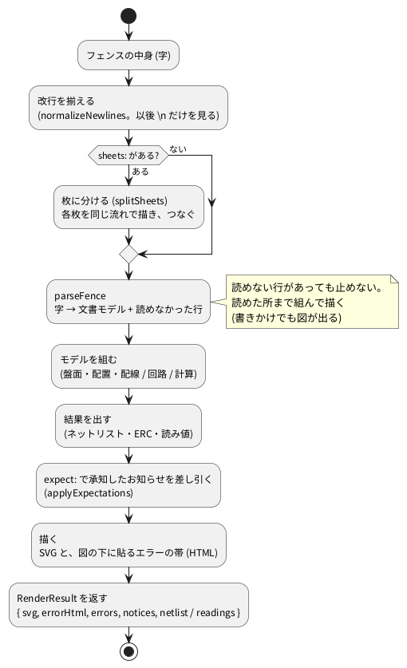
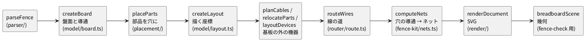
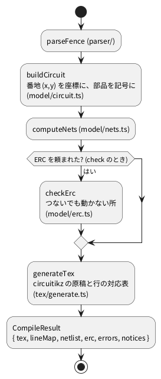
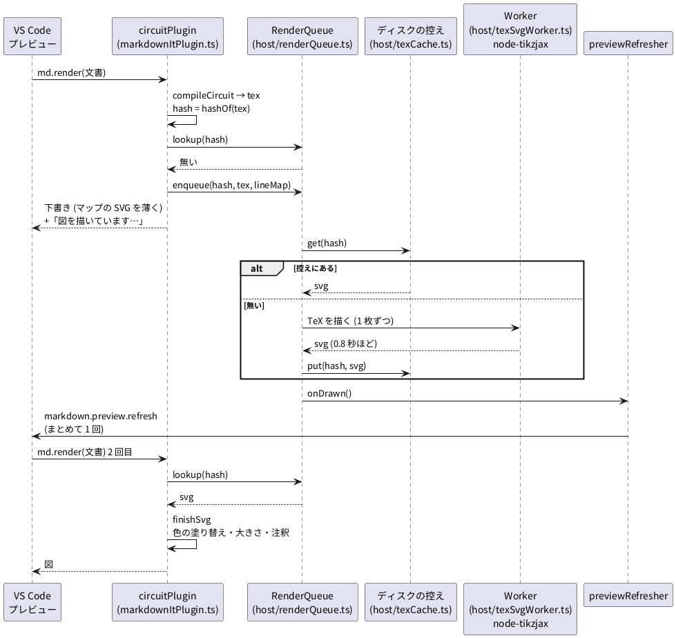
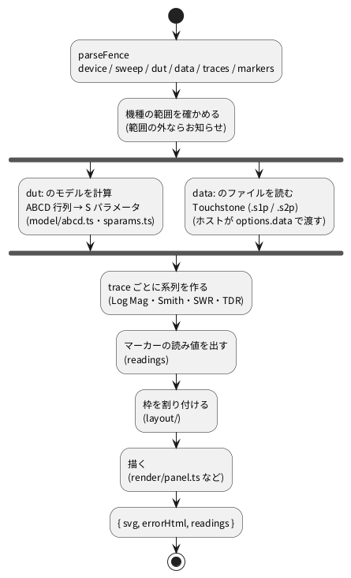
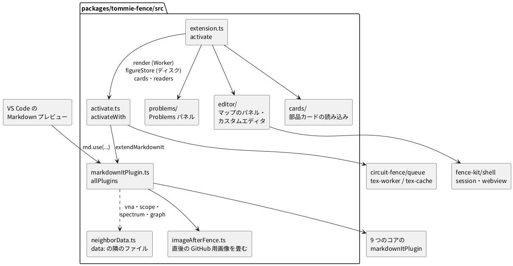
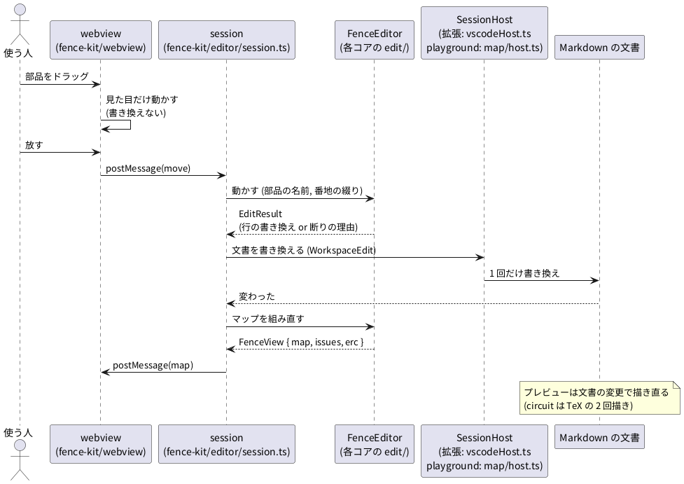
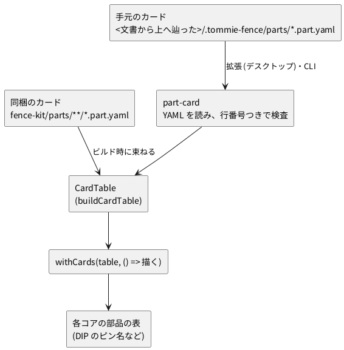
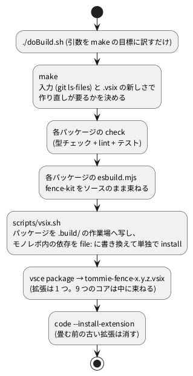

# tommie-fence のしくみ

このリポジトリが Markdown のフェンスをどうやって図にしているかの案内。
コードを読み始める人が、どのパッケージのどのファイルから読めばよいかを
掴むために書いた (2026-11-16 の main 時点)。

図は PlantUML で書いた。VS Code の PlantUML 拡張か `plantuml` コマンドで描ける。
横断の作法は直下の [CLAUDE.md](../CLAUDE.md)、各パッケージの細かい約束は
`packages/*/CLAUDE.md` が正で、ここはその地図に当たる。

## 1. 9 つの関数と、それを呼ぶホスト

**フェンスは 9 つあり、どれも 1 つの純粋な関数で図になる。** 関数はフェンスの字
(YAML に近い) を受け取り、3 つの物を返す。外の資源を参照しない SVG、読めなかった
行の報告、数で突き合わせられる結果 (ネットリストや読み値) である。
VS Code 拡張・CLI・ブラウザの playground は、どれもこの関数を呼ぶホストにすぎない。

| フェンス | パッケージ | 描くもの | 描き方 |
| --- | --- | --- | --- |
| ` ```circuit ` | circuit-fence | 回路図 | circuitikz の TeX を組み、WASM の TeX で SVG にする |
| ` ```bread ` | breadboard-fence | ブレッドボードの実体配線図 | SVG を自分で組む |
| ` ```perf ` | perfboard-fence | ユニバーサル基板の実体配線図 | SVG を自分で組む |
| ` ```copper ` | copper-fence | 銅張り基板の寸法図 (mm) | SVG を自分で組む |
| ` ```vna ` | vna-fence | NanoVNA の画面 | モデルを ABCD 行列で計算し、Touchstone を重ねる |
| ` ```scope ` | scope-fence | オシロスコープの画面 | 理想の波を 8192 点で計算し、CSV を重ねる |
| ` ```spectrum ` | spectrum-fence | スペクトラムの画面 | `device:` で FFT 型と掃引型を選ぶ |
| ` ```graph ` | graph-fence | 教科書の x-y グラフ | 式か点列を破線、CSV を ○ |
| ` ```logic ` | logic-fence | ロジックアナライザの画面 | 0 / 1 のレーンとバス |

前の 4 つ (circuit・bread・perf・copper) は**部品と配線を置く図**で、ネットリストと
マップ (ドラッグで直せるエディタ) を持つ。後の 5 つは**計器の画面とグラフ**で、
マップを持たず、`data:` で実測のファイルを重ねられる (logic はまだ)。

## 2. パッケージの構成



(矢印は代表だけを引いた。拡張と playground は 9 つ全部を呼ぶ。)

依存の決まりは 3 つ。

- **fence-kit はソースのまま束ねる。** モノレポの中では npm に出さず、使う側の
  esbuild が中に取り込む。だから `devDependencies` に書く。入口は `fence-kit`
  (DOM も Node も使わない本体)、`fence-kit/cli` (Node を使ってよい CLI 用)、
  `fence-kit/webview` (マップの webview) の 3 つ
- **先回りして共通化しない。** fence-kit にあるのは、実際に 2 つ以上のフェンスで
  重複したものだけ (フェンスの取り出し・エスケープ・部品の胴とパッケージ・
  抵抗のカラーコード・ネットリストの組み立て・周波数の読み書き・波の計算・
  複数枚 (`sheets:`) の分け方・`expect:` など)
- **実行時の外部依存は `yaml` と `node-tikzjax` だけ。** node-tikzjax を使うのは
  circuit だけ

各コアのパッケージは同じ形をしている。

```text
packages/<名前>-fence/
  src/core/            図を描く本体 (DOM も Node も使わない)
    parser/            字 → 文書モデル
    model/             盤面・回路・ネット・計算 (計器系はここに物理の計算)
    placement/ router/ 置き方と線の引き方 (bread・perf)
    render/            モデル → SVG とエラーの帯
    edit/              マップのエディタ (FenceEditor の実装。マップのある 4 つ)
    write/             モデル → フェンスの字 (マップでの書き換え用)
    index.ts           公開する関数 (renderXxx / compileCircuit / scenesOfXxx)
  src/markdownItPlugin.ts  markdown-it に差し込む口
  src/cli/             CLI (check / render)
  docs/                文法リファレンスと早見表 (02-cheatsheet.md)
  examples/            例の .md と PNG
```

## 3. 1 枚の図ができるまで (共通の流れ)

どのフェンスも、入口の関数 (`renderBreadboard` `renderVna` など) の中は次の順に進む。



この流れは次の約束を守っている。

- **純粋関数。** 同じ入力なら同じ出力 (乱数は種を固定)。ファイルも DOM も触らない。
  外の物 (部品カード・`data:` のファイル) は引数か `withCards` で渡す
- **図は必ず描く。** 読めなかった行は `errors` に入れ、図からは抜いて描き続ける
- **報告は図の外。** `errorHtml` は SVG の外に置くので、書き出した SVG を貼っても
  エラーの帯は付いてこない
- **行番号はフェンスの中で数える。** Markdown の行へずらすのはホスト
  (markdown-it の口が `offset` を渡す)
- **エスケープはコアの中で済ませる。** VS Code のプレビューは返した HTML を
  サニタイズしないので、ホストは字をそのまま貼るだけにしてある

## 4. 盤面の図 (breadboard・perfboard)

ブレッドボードを例にとると、`renderBreadboard` の 1 枚ぶん (`renderOneSheet`) は
次の関数を順に呼ぶ。



- **盤面モデル** は「どの穴とどの穴が最初からつながっているか」を持つ。
  ブレッドボードには 5 穴の列と電源レールがあり、ユニバーサル基板は全穴が独立
  している。この違いのため、perfboard は breadboard の盤面モデル・配置・ルーターを
  使えない。perfboard が breadboard から引き継いだのは描画層の方
- **ネットリスト** は穴の導通・部品のピン・配線から `computeNets` が組む。
  これが `check` の出す「数で突き合わせられる結果」の中心
- **Scene** (`fence-kit/scene.ts`) は胴の長方形・ピンの点・線の折れ線だけの幾何。
  fence-check がこれを見て、胴の重なり・線の横切り・十字・名札の衝突を数える。
  図そのもの (SVG) を読み直さずに崩れを数えるための別の出口

## 5. 回路図 (circuit) — TeX を経由する唯一のフェンス

circuit だけは SVG を自分で組まない。`compileCircuit` が返すのは **TeX の原稿**で、
SVG にするのは WASM の TeX (node-tikzjax) の仕事になる。



TeX → SVG は 1 枚 0.8 秒ほど掛かる。ところが markdown-it の差し替えは**同期**で
返さなければならない。そこで circuit の口だけは 2 回に分けて描く。1 回目は、
控えに図が無ければ描く順番に積み、下書きを返す。図が描き上がるとプレビューに
描き直させ、2 回目で控えから図を出す。



この段取りで押さえておく点は 5 つある。

- **1 枚ずつ描く。** node-tikzjax はグローバルを書き換えるシングルトンなので、
  2 枚を同時に描くと壊れる。打ち切りも置かない (待つのをやめても WASM は止まらない)
- **控えは 2 段。** メモリ (既定 100 枚) とディスク (拡張の globalStorage の `tex/`。
  鍵は TeX の字のハッシュ、置き場は処理系の版ごと)。CLI も `--cache` で同じ控えを使う
- **下書きはマップの絵。** マップのエディタが使う自前の SVG (TeX を使わない) を
  薄く出すので、待つ間も部品の位置とつながりは見える
- **色は後から塗り替える。** TeX は黒で描き、`finishSvg` / `recolorSvg` がテーマの色に
  塗り替える。エディタの地の色に追従するのは CSS (`circuit-auto` のクラス)
- **web 版は描けない。** `extension.web.ts` は「描けない」と返すスタブの renderer を
  渡す。playground は WASM の TeX 一式 (8.5 MB) を初めて circuit を描くときに取りに行く

## 6. 計器の画面とグラフ (vna・scope・spectrum・graph・logic)

計器の画面とグラフには部品も配線も無い。かわりに、**理想のモデルを計算した線 (破線)** と
**測ったファイルの線 (実線や ○)** を同じ画面に重ねる。vna の `renderVna` を例にとると、
流れは次のようになる。



- **`data:` の読み込みはホストの仕事。** コアはファイルを開かない。拡張のデスクトップ版は
  `.md` の隣のファイルを読んで渡し (`neighborData.ts`)、CLI は `fence-kit/cli` の
  `readNeighbor` で読む。web 版は読めない
- scope と spectrum は **波の書き方を共有**する (fence-kit の `wave.ts`)。scope は
  理想の波を 8192 点で計算して `| rc 1ms` のような操作を通す。spectrum は
  `device:` で道が分かれる — `ad2` `ad3` は標本化 → 窓 → FFT、`tinysa` などは
  線スペクトルを受信機の RBW・ATT・フロアでなぞる
- graph は式を自前の再帰下降で読む (`eval` は使わない)
- **マップは無い。** 拡張に渡すのは Problems の口 (`problemsOf`) だけ

## 7. VS Code 拡張 (packages/tommie-fence) への組み込み

VS Code に入る拡張はこの 1 つだけ。中身のほとんどは入口で、図を描くのは 9 つのコアである。



- `extendMarkdownIt` は拡張ごとに 1 回しか呼ばれないので、`allPlugins` が 9 つの
  `md.use(...)` を重ねる。各プラグインは自分の言語のフェンス以外を素通しする
  (`isFenceOf`) ので、順番は関係ない
- **Problems パネル** (`problems/`) は文書の字からフェンスを切り出し、各コアの
  `problems` に行を訊いて診断に写す。マップの無い計器系もここに並ぶ
- **部品カード** (`cards/`) はデスクトップだけ。文書から上へ辿って
  `.tommie-fence/parts/*.part.yaml` を読み、文書ごとの表をプラグインへ渡す
- 移行の自動修正 (`problems/migrateFix.ts`) は古い綴りを新しい綴りに直す Code Action

## 8. マップ (殻) — ドラッグで直すエディタ

マップのある 4 つのフェンスは、図とは別の**升目の絵 (マップ)** を出し、部品を
ドラッグするとフェンスの字を書き換える。図そのもの (TeX の SVG) は意味の構造が
残らず、クリック位置から番地を引けないので、掴ませるのはマップの方。

殻 (fence-kit の `session.ts` と webview) は**フェンスの文法を知らない**。
フェンスごとの違いは、各コアの `src/core/edit/fenceEditor.ts` が実装する
`FenceEditor` の向こうに閉じ込めてある。殻と `FenceEditor` は文字列だけでやり取りし、
番地も書かれた綴りのまま渡す。だから同じ殻が、4 つのフェンスでも、playground でも、
VS Code の外のホストでも動く。



入口は 2 つあり、中身 (session) は同じ。

- コマンドで横に開く**パネル** (`editor/panel.ts`)
- `.md` のタブそのものをマップにする**カスタムエディタ** (`editor/customEditor.ts`)。
  戻す・やり直すは VS Code に任せる

**殻の型を変えたら、fence-kit と 4 つのコアの版を同じ日に切る。** `FenceEditor` などの
型は、`fence-kit/shell` の `.d.ts` と、4 つのコアの `./core` の `.d.ts` の両方に写されている。
VS Code の外のホストはこの 2 つを構造で突き合わせるので、片方だけ切るとホストの型チェックが割れる。

## 9. 部品カード

型番から引く部品の表 (ピンの並び・パッケージ・役割) は、TS のコードではなく
**`*.part.yaml` のファイル**に置いてある (fence-kit の `parts/` に約 160 枚、
`boards/` `chips/` `discretes/` `modules/`)。

```yaml
# fence-kit/parts/chips/74HC00.part.yaml (抜粋)
models: [74HC00, SN74HC00, SN74HC00N]
package: dip14
role: 2 入力 NAND ×4
pins: [1A, 1B, 1Y, 2A, 2B, 2Y, GND, 3Y, 3A, 3B, 4Y, 4A, 4B, VCC]
```



手元のカードを読めるのは、ファイルを開けるホスト (拡張のデスクトップ版と CLI) に限られる。
コアはファイルを開かず、`withCards` で渡された表を引く。

## 10. 同じコアを呼ぶほかのホスト

### CLI (各コアの `src/cli/`)

```bash
circuit-fence check  <ファイルかディレクトリ...>   # 読めなかった行・ネットリスト・ERC を出す。図は描かない
circuit-fence render <ファイルかディレクトリ...> --out <出力先>   # .svg (circuit は .tex も) を書き出す
```

`check` の役目は、**図を見なくても意図と突き合わせられる物** (ネットリスト・読み値・寸法)
を出すこと。AI が書いたフェンスを、本文の表と数で合わせるときに使う。
読めなかった行が 1 つでもあれば 0 以外で終わるので、CI にも乗る。

### playground (packages/playground)

ブラウザだけで 9 つのフェンスを試す静的なページ (GitHub Pages)。

- 9 つのコアを直に呼ぶ。描画の決め事は持たない
- circuit は WASM の TeX をブラウザで走らせる (要るときだけ資材を落とす)
- マップは **iframe を webview の代わりにする**。拡張と同じ `postMessage` の形を
  写したので、殻も文法も 1 行も変えずに動く。頁が肩代わりするのは送り口
  (`acquireVsCodeApi`)・色の変数 (`--vscode-*`)・カーソルの 3 つ

### fence-check (packages/fence-check)

circuit / breadboard / perfboard の `scenesOf*` が返す幾何を見て、図の崩れを数える。
自分では描かない。部品カードを検査する `part-card` コマンドも持つ。

## 11. ビルドと配布



- **`vsce` を直に呼ばない。** npm workspaces は依存を直下へ巻き上げるので、
  パッケージの中で `vsce package` を走らせると同じファイルを 2 通りの経路で拾って止まる
- **版はパッケージごとに独立**。タグはパッケージ名を接頭辞にする
  (`circuit-fence-v0.54.0`)。Release は直下の `./doRelease.sh` が出すべきものを
  まとめて push する
- ライブラリの出口は 9 つとも同じ形: `<パッケージ>/core` が dist (配る物)、
  `<パッケージ>/src/core` がソース (モノレポの中で型チェックを build 待ちにしないため)。
  型定義は `dts.mjs` が 1 ファイルに束ねる
- CI (`.github/workflows/`) は `ci.yml` (check)・`pages.yml` (playground)・
  `release.yml` の 3 本。`npm run check` には 3 つの見張り (例の PNG の追跡・
  1 ファイル 800 行・ESLint の非同期の取りこぼし) も乗る

## 12. 文法を決める方針

しくみの多くは次の前提から来ている。**フェンスを書くのは AI、図を読むのは人。**

1. 黙って別の意味に読まない (数には単位が要る。読めない値を既定で埋めない)
2. 補うのは既定値だけで、補ったらお知らせで言う
3. エラー文は直し方まで言う (受ける綴りの一覧か、正しい例を 1 つ)
4. 確かめは数で (`check` のネットリスト・読み値 → 最後に PNG を 1 度目で見る)
5. 正の書き方は 1 つ
6. 語彙は実物に揃える (計器のメニュー・部品の表記)
7. 同じ入力は同じ出力
8. 早見表 (`docs/02-cheatsheet.md`) を必ず置き、例は教科書の題から起こす

§3 の約束と `check` は、この方針を実装に落としたものである。純粋関数は 7 を、
`check` がネットリストや読み値を出すのは 4 を、エラーの帯に行番号と直し方を
添えるのは 3 を形にしている。

## 13. 読み始める順

| 知りたいこと | 最初に開くファイル |
| --- | --- |
| 全体と約束 | `CLAUDE.md`・`README.ja.md` |
| 1 つのフェンスの文法 | `packages/<名前>-fence/docs/02-cheatsheet.md` |
| 盤面の図の描き方 | `packages/breadboard-fence/src/core/index.ts` の `renderOneSheet` |
| 回路図の TeX の組み方 | `packages/circuit-fence/src/core/index.ts` の `compileCircuit` → `tex/generate.ts` |
| 回路図の非同期の描画 | `packages/circuit-fence/src/markdownItPlugin.ts` → `host/renderQueue.ts` |
| 計器の画面の計算 | `packages/vna-fence/src/core/index.ts` の `renderVna` |
| 拡張の組み立て | `packages/tommie-fence/src/extension.ts` → `activate.ts` → `markdownItPlugin.ts` |
| マップの殻 | `packages/fence-kit/src/editor/fenceEditor.ts` (型) → `session.ts` |
| 共通部品の一覧 | `packages/fence-kit/src/index.ts` |
| ビルドの段取り | `Makefile`・`scripts/vsix.sh` |
