# 部品ギャラリー

[English](parts-gallery.md) | [日本語](parts-gallery.ja.md)

**フェンスで描ける部品を全部**、ブレッドボード・ユニバーサル基板・回路図の 3 つで並べた図の入口。
部品の種類・姿と、型番の表 (ピンの名前・3 ピン・機器) にある型番が 1 つ残らず載っている。
各ページはフェンスの直後に描いた図が貼ってあるので、GitHub でもそのまま図で見られる。

どのページも部品の表から書き出した物で、部品を足すと書き出し直しが要る (各パッケージで `npm run gallery`)。

## 分類から探す

| 分類 | ブレッドボード (`bread`) | ユニバーサル基板 (`perf`) | 回路図 (`circuit`) |
| --- | --- | --- | --- |
| 穴を並べて置く部品・記号 | [18-gallery-leads](../packages/breadboard-fence/examples/18-gallery-leads.md) | [13-gallery-leads](../packages/perfboard-fence/examples/13-gallery-leads.md) | [19-gallery-symbols](../packages/circuit-fence/examples/19-gallery-symbols.md) |
| 型番のある IC (DIP・1 列) | [19-gallery-chips](../packages/breadboard-fence/examples/19-gallery-chips.md) | [14-gallery-chips](../packages/perfboard-fence/examples/14-gallery-chips.md) | [21-gallery-chips](../packages/circuit-fence/examples/21-gallery-chips.md) |
| 働きで並べた IC (`ic`) | — | — | [22-gallery-ic](../packages/circuit-fence/examples/22-gallery-ic.md) |
| トランジスタ・FET・レギュレータ | [20-gallery-discretes](../packages/breadboard-fence/examples/20-gallery-discretes.md) | [15-gallery-discretes](../packages/perfboard-fence/examples/15-gallery-discretes.md) | [23-gallery-modules](../packages/circuit-fence/examples/23-gallery-modules.md) |
| ボード・名前つきの部品・機器 | [21-gallery-boards](../packages/breadboard-fence/examples/21-gallery-boards.md) | [16-gallery-boards](../packages/perfboard-fence/examples/16-gallery-boards.md) | [20-gallery-boxes](../packages/circuit-fence/examples/20-gallery-boxes.md) |

## ブレッドボード

4 本・図 36 枚。

### [18-gallery-leads](../packages/breadboard-fence/examples/18-gallery-leads.md)

穴を並べて置く部品 (2 ピン・3 ピン・巻き物・スイッチ・USB・端子台) の全種類と全部の姿 (図 7 枚)

<a href="../packages/breadboard-fence/examples/18-gallery-leads.md">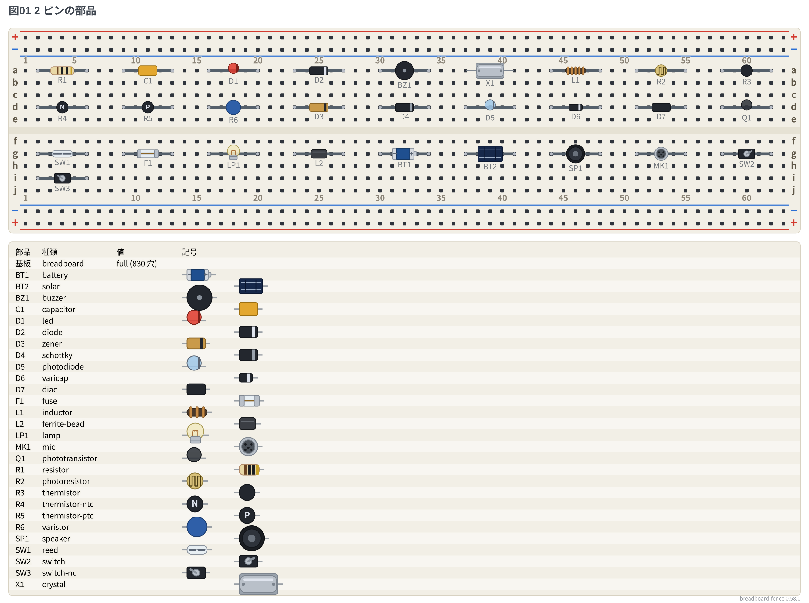</a>

### [19-gallery-chips](../packages/breadboard-fence/examples/19-gallery-chips.md)

ピンの名前の表にある型番 (DIP・1 列・DIP 化キット・変換基板) (図 20 枚)

<a href="../packages/breadboard-fence/examples/19-gallery-chips.md">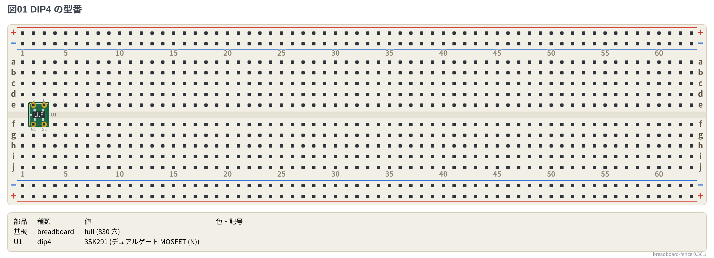</a>

### [20-gallery-discretes](../packages/breadboard-fence/examples/20-gallery-discretes.md)

型番のあるトランジスタ・FET・レギュレータ (図 3 枚)

<a href="../packages/breadboard-fence/examples/20-gallery-discretes.md">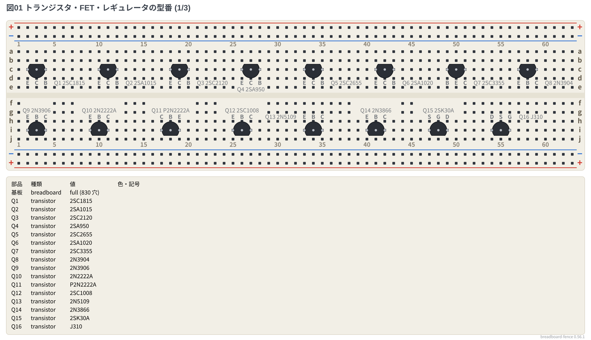</a>

### [21-gallery-boards](../packages/breadboard-fence/examples/21-gallery-boards.md)

マイコンボード・ピンに名前のある DIP 型・7 セグ・ボード外の機器 (図 6 枚)

<a href="../packages/breadboard-fence/examples/21-gallery-boards.md">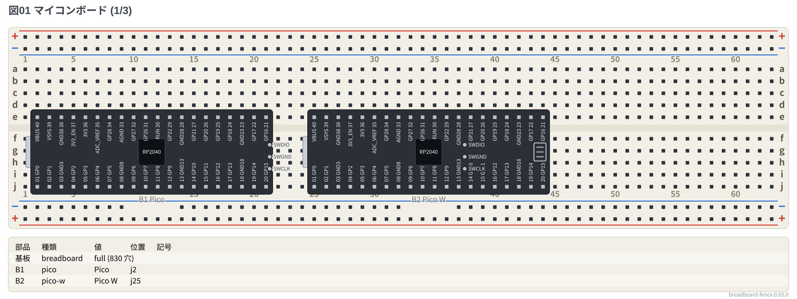</a>

## ユニバーサル基板

4 本・図 32 枚。

### [13-gallery-leads](../packages/perfboard-fence/examples/13-gallery-leads.md)

穴を並べて置く部品の全種類と全部の姿 (縁の SMA・直付けの面実装まで) (図 10 枚)

<a href="../packages/perfboard-fence/examples/13-gallery-leads.md">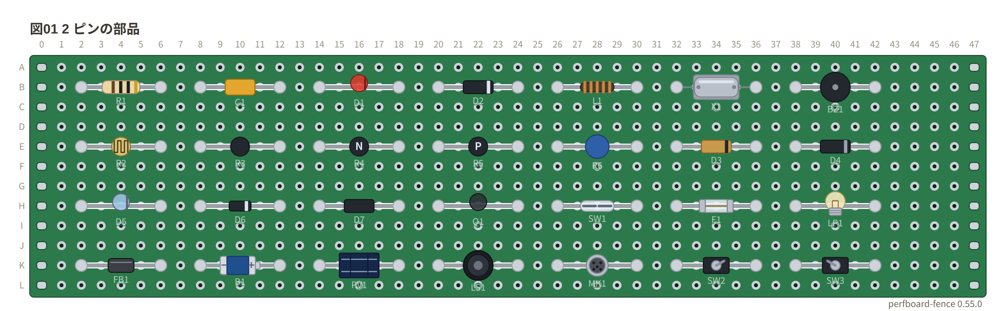</a>

### [14-gallery-chips](../packages/perfboard-fence/examples/14-gallery-chips.md)

ピンの名前の表にある型番、DIP 化キット、`dip8/sop` `tssop` `socket`、型番なしの `dipN` `sipN` (図 15 枚)

<a href="../packages/perfboard-fence/examples/14-gallery-chips.md">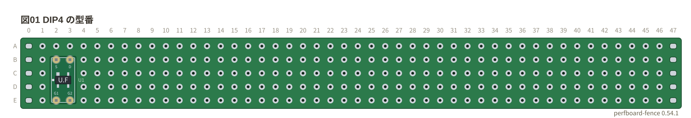</a>

### [15-gallery-discretes](../packages/perfboard-fence/examples/15-gallery-discretes.md)

型番のあるトランジスタ・FET・レギュレータ (図 2 枚)

<a href="../packages/perfboard-fence/examples/15-gallery-discretes.md">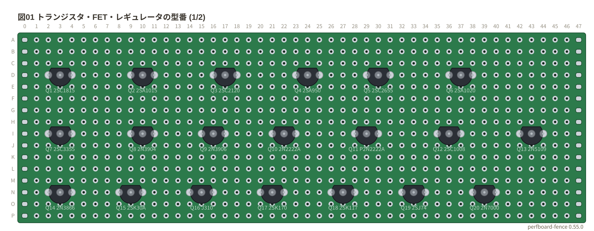</a>

### [16-gallery-boards](../packages/perfboard-fence/examples/16-gallery-boards.md)

マイコンボード・ピンに名前のある DIP 型・7 セグ・基板の外の機器 (図 5 枚)

<a href="../packages/perfboard-fence/examples/16-gallery-boards.md">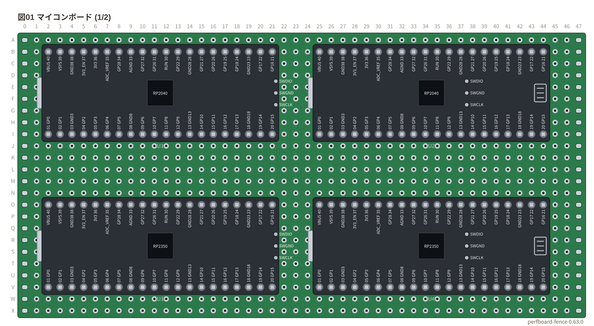</a>

## 回路図

5 本・図 25 枚。

### [19-gallery-symbols](../packages/circuit-fence/examples/19-gallery-symbols.md)

記号 (2 端子・1 端子・多端子・ゲート。`european` `jis` で形の変わる記号も) (図 7 枚)

<a href="../packages/circuit-fence/examples/19-gallery-symbols.md">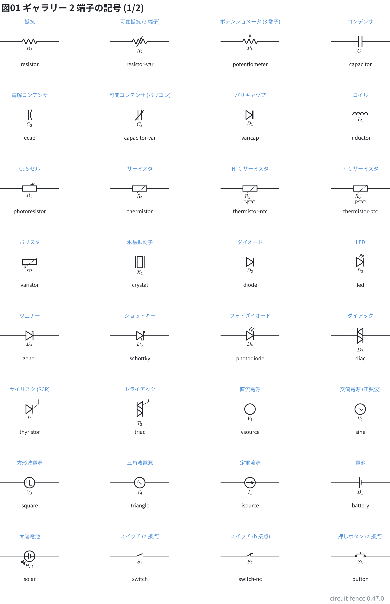</a>

### [20-gallery-boxes](../packages/circuit-fence/examples/20-gallery-boxes.md)

番号だけの DIP・ピンヘッダ・コネクタ・名前つきの部品・マイコンボード (図 5 枚)

<a href="../packages/circuit-fence/examples/20-gallery-boxes.md">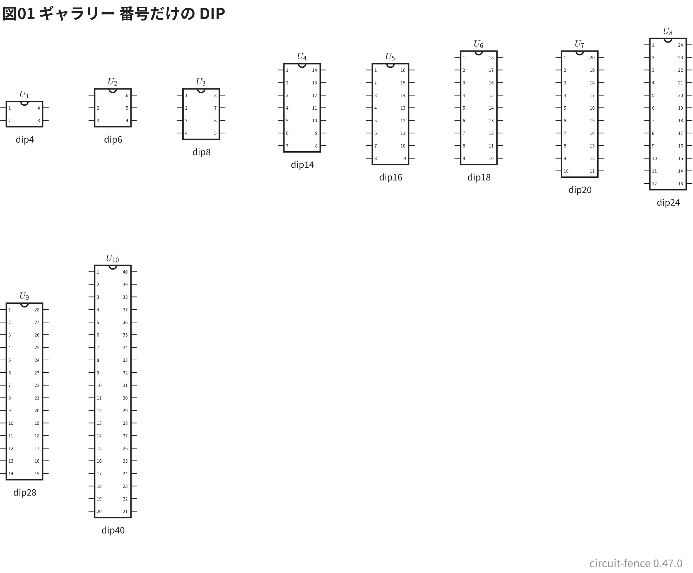</a>

### [21-gallery-chips](../packages/circuit-fence/examples/21-gallery-chips.md)

ピンの名前の表にある型番 (`dipN`) (図 5 枚)

<a href="../packages/circuit-fence/examples/21-gallery-chips.md">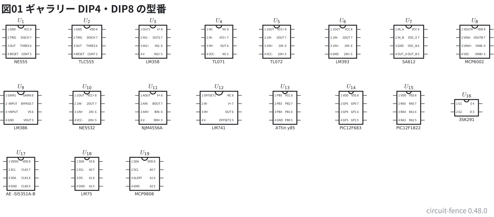</a>

### [22-gallery-ic](../packages/circuit-fence/examples/22-gallery-ic.md)

働きで並べた IC (`ic`) の型番 (図 4 枚)

<a href="../packages/circuit-fence/examples/22-gallery-ic.md">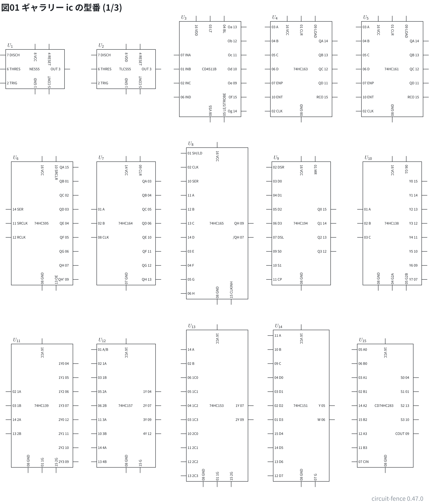</a>

### [23-gallery-modules](../packages/circuit-fence/examples/23-gallery-modules.md)

型番のあるトランジスタ・レギュレータ・機器 (図 4 枚)

<a href="../packages/circuit-fence/examples/23-gallery-modules.md">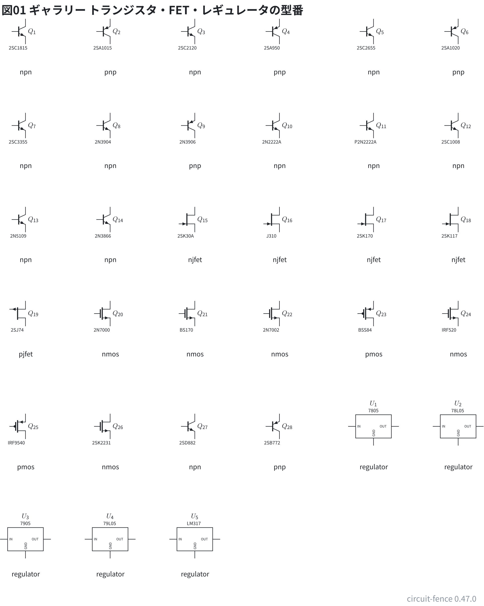</a>
