# Parts gallery

[English](parts-gallery.md) | [日本語](parts-gallery.ja.md)

The way in to **every part the fences can draw**, laid out three ways: breadboard, perfboard and schematic.
Every part type and look, and every model in the model tables (pin names, 3-pin parts, devices), is on these pages.
Each fence is followed by the drawing it produces, so the pages read as pictures on GitHub too.
The prose on the pages is Japanese.

The pages are generated from the part tables; add a part and regenerate them (`npm run gallery` in each package).

## By kind of part

| Kind | Breadboard (`bread`) | Perfboard (`perf`) | Schematic (`circuit`) |
| --- | --- | --- | --- |
| Leaded parts and symbols | [18-gallery-leads](../packages/breadboard-fence/examples/18-gallery-leads.md) | [13-gallery-leads](../packages/perfboard-fence/examples/13-gallery-leads.md) | [19-gallery-symbols](../packages/circuit-fence/examples/19-gallery-symbols.md) |
| ICs by model (DIP, single row) | [19-gallery-chips](../packages/breadboard-fence/examples/19-gallery-chips.md) | [14-gallery-chips](../packages/perfboard-fence/examples/14-gallery-chips.md) | [21-gallery-chips](../packages/circuit-fence/examples/21-gallery-chips.md) |
| ICs by function (`ic`) | — | — | [22-gallery-ic](../packages/circuit-fence/examples/22-gallery-ic.md) |
| Transistors, FETs, regulators | [20-gallery-discretes](../packages/breadboard-fence/examples/20-gallery-discretes.md) | [15-gallery-discretes](../packages/perfboard-fence/examples/15-gallery-discretes.md) | [23-gallery-modules](../packages/circuit-fence/examples/23-gallery-modules.md) |
| Boards, named parts, devices | [21-gallery-boards](../packages/breadboard-fence/examples/21-gallery-boards.md) | [16-gallery-boards](../packages/perfboard-fence/examples/16-gallery-boards.md) | [20-gallery-boxes](../packages/circuit-fence/examples/20-gallery-boxes.md) |

## Breadboard

4 pages, 36 drawings.

### [18-gallery-leads](../packages/breadboard-fence/examples/18-gallery-leads.md)

Parts placed by listing holes (2-pin, 3-pin, wound, switches, USB, terminal blocks): every type and every look (7 drawings)

<a href="../packages/breadboard-fence/examples/18-gallery-leads.md">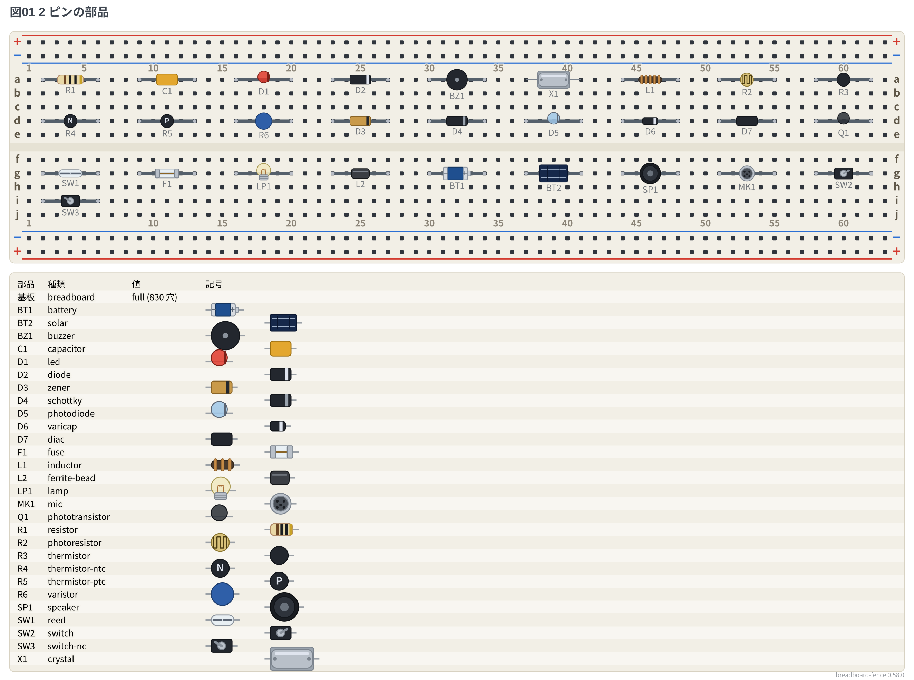</a>

### [19-gallery-chips](../packages/breadboard-fence/examples/19-gallery-chips.md)

Every model in the pin-name table (DIP, single row, DIP kits, adapter boards) (20 drawings)

<a href="../packages/breadboard-fence/examples/19-gallery-chips.md">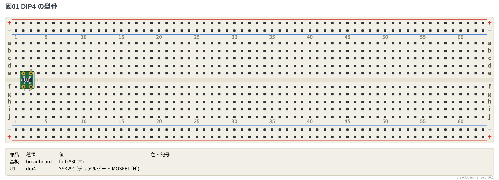</a>

### [20-gallery-discretes](../packages/breadboard-fence/examples/20-gallery-discretes.md)

Transistors, FETs and regulators by model (3 drawings)

<a href="../packages/breadboard-fence/examples/20-gallery-discretes.md">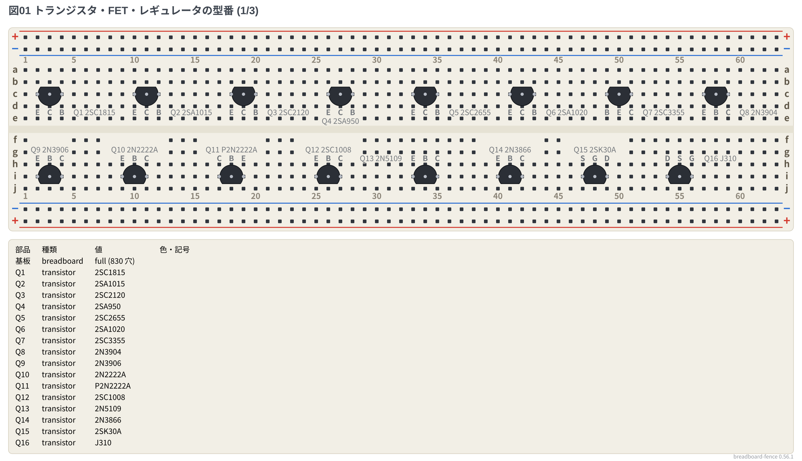</a>

### [21-gallery-boards](../packages/breadboard-fence/examples/21-gallery-boards.md)

Microcontroller boards, named DIP parts, 7-segment displays, off-board devices (6 drawings)

<a href="../packages/breadboard-fence/examples/21-gallery-boards.md">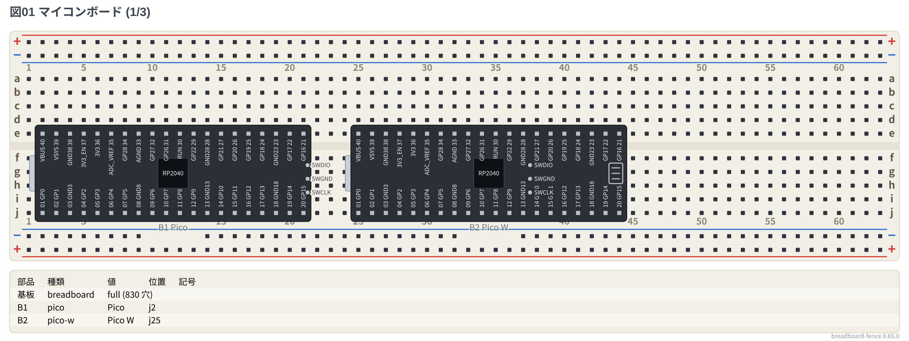</a>

## Perfboard

4 pages, 32 drawings.

### [13-gallery-leads](../packages/perfboard-fence/examples/13-gallery-leads.md)

Every type and look placed by holes (including edge SMA and direct-mount SMD) (10 drawings)

<a href="../packages/perfboard-fence/examples/13-gallery-leads.md">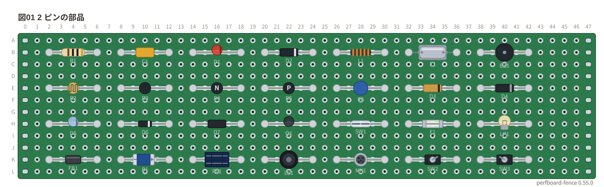</a>

### [14-gallery-chips](../packages/perfboard-fence/examples/14-gallery-chips.md)

Every pin-name model, DIP kits, `dip8/sop` `tssop` `socket`, plain `dipN` `sipN` (15 drawings)

<a href="../packages/perfboard-fence/examples/14-gallery-chips.md">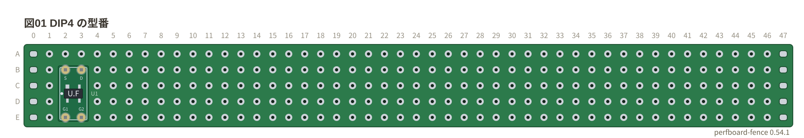</a>

### [15-gallery-discretes](../packages/perfboard-fence/examples/15-gallery-discretes.md)

Transistors, FETs and regulators by model (2 drawings)

<a href="../packages/perfboard-fence/examples/15-gallery-discretes.md">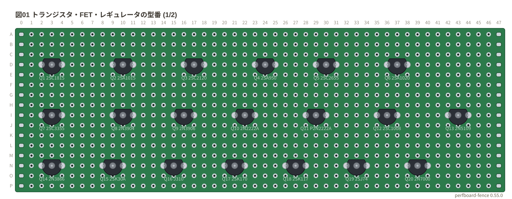</a>

### [16-gallery-boards](../packages/perfboard-fence/examples/16-gallery-boards.md)

Microcontroller boards, named DIP parts, 7-segment displays, off-board devices (5 drawings)

<a href="../packages/perfboard-fence/examples/16-gallery-boards.md">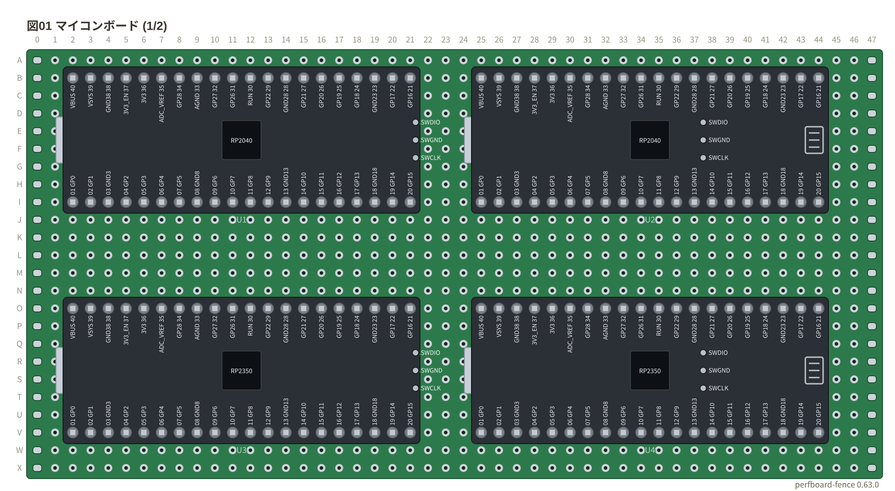</a>

## Schematic

5 pages, 25 drawings.

### [19-gallery-symbols](../packages/circuit-fence/examples/19-gallery-symbols.md)

Symbols (2-terminal, 1-terminal, multi-terminal, gates; also those that change with `european` / `jis`) (7 drawings)

<a href="../packages/circuit-fence/examples/19-gallery-symbols.md">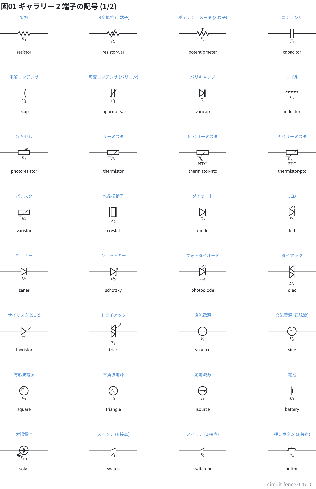</a>

### [20-gallery-boxes](../packages/circuit-fence/examples/20-gallery-boxes.md)

Numbered DIPs, pin headers, connectors, named parts, microcontroller boards (5 drawings)

<a href="../packages/circuit-fence/examples/20-gallery-boxes.md">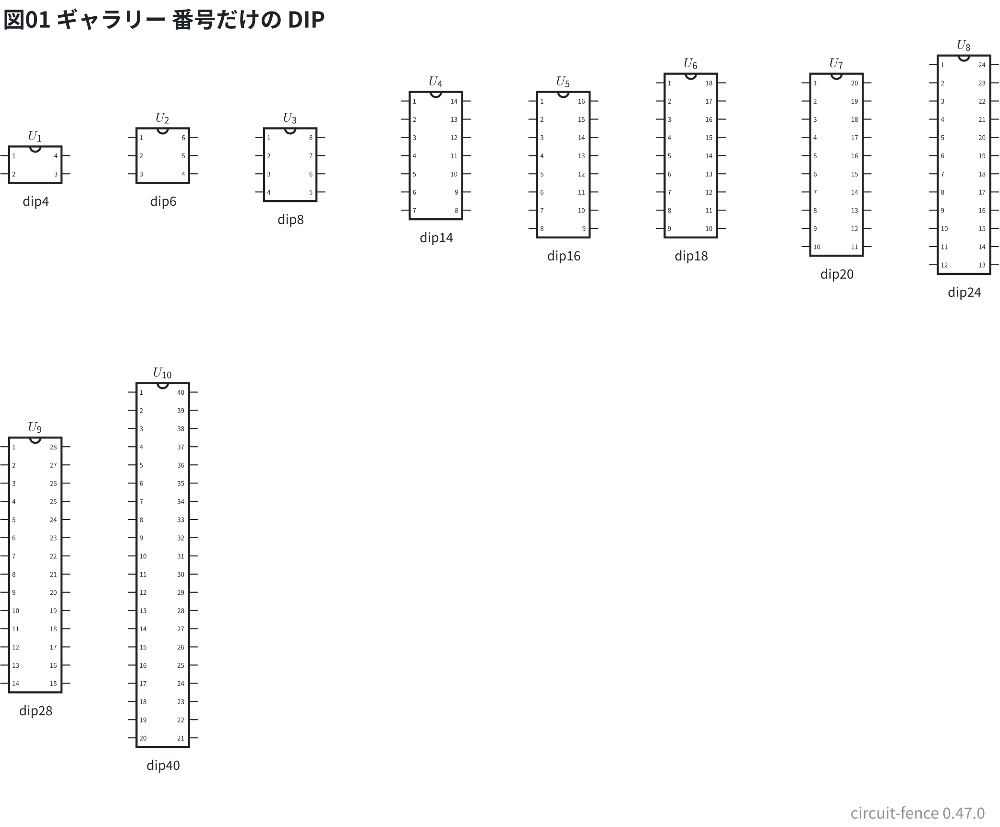</a>

### [21-gallery-chips](../packages/circuit-fence/examples/21-gallery-chips.md)

Every model in the pin-name table (`dipN`) (5 drawings)

<a href="../packages/circuit-fence/examples/21-gallery-chips.md">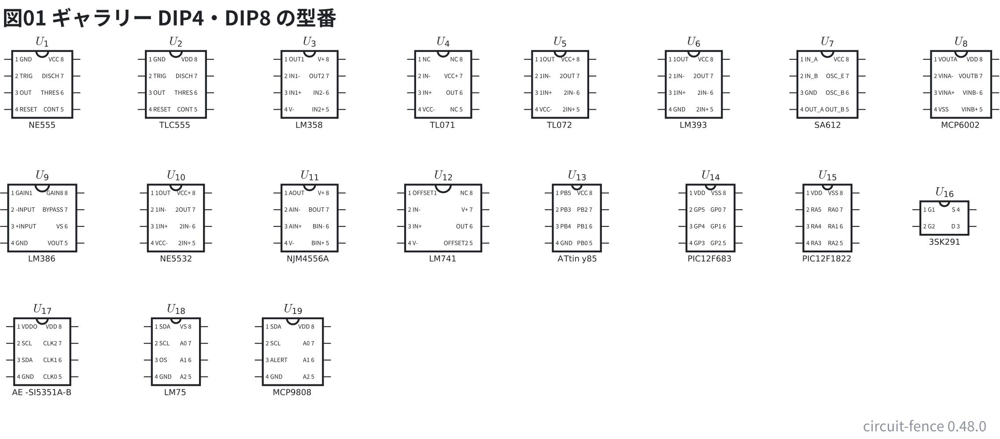</a>

### [22-gallery-ic](../packages/circuit-fence/examples/22-gallery-ic.md)

ICs laid out by function (`ic`) (4 drawings)

<a href="../packages/circuit-fence/examples/22-gallery-ic.md">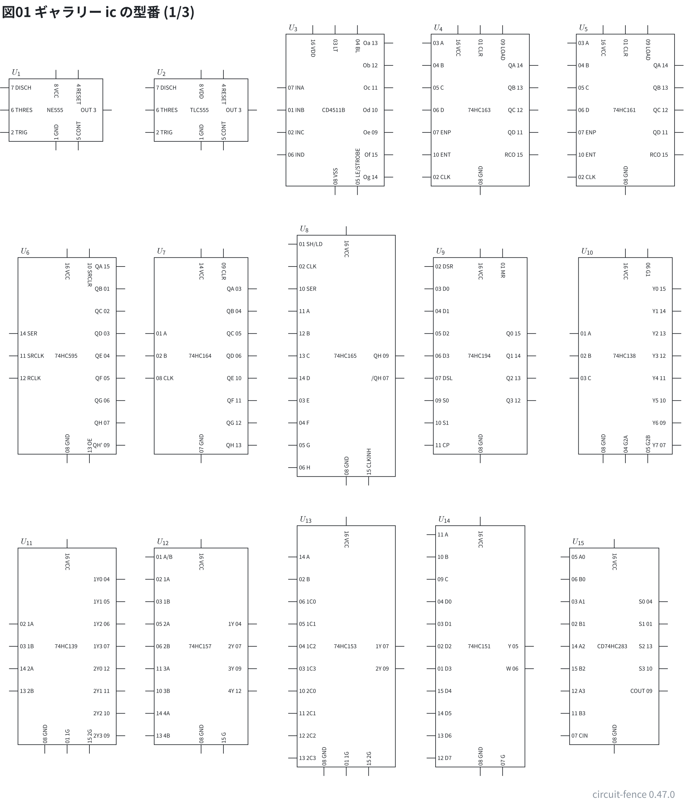</a>

### [23-gallery-modules](../packages/circuit-fence/examples/23-gallery-modules.md)

Transistors, regulators and devices by model (4 drawings)

<a href="../packages/circuit-fence/examples/23-gallery-modules.md">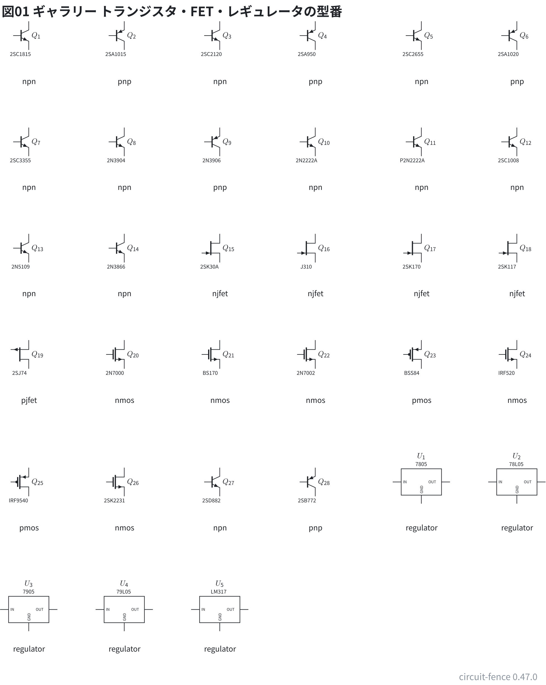</a>
