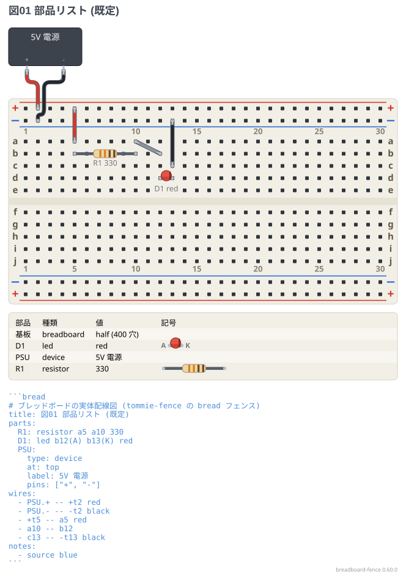
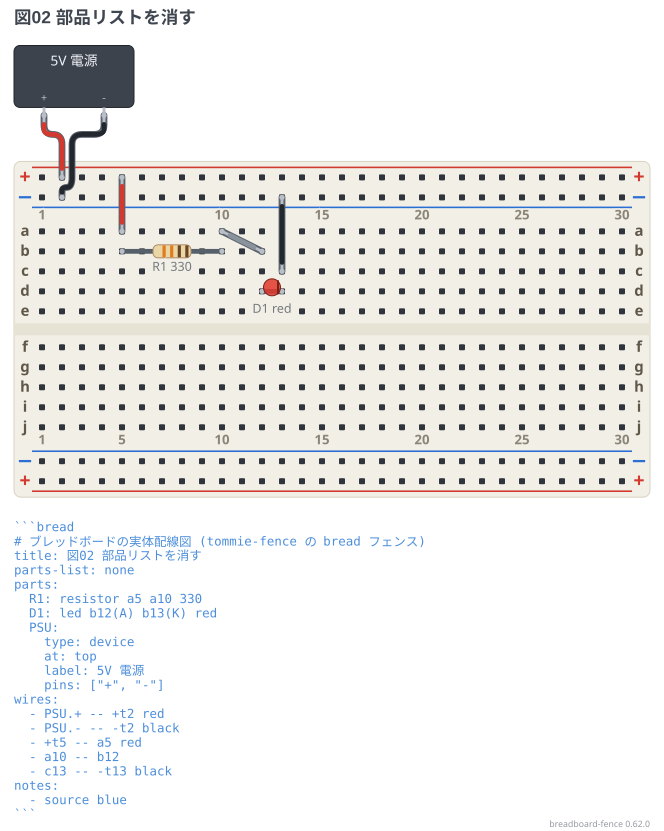
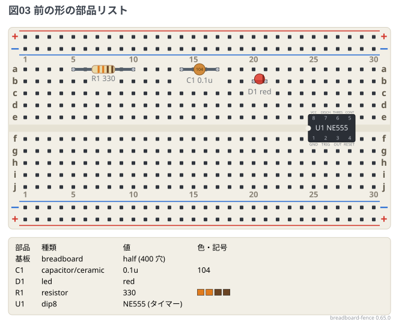

# 部品リスト

図の下に、見出しの行に続けて、書いた部品が部品・種類・値・記号の順に 1 行ずつ並ぶ。
記号の欄は図の中と同じ部品の絵で、抵抗の帯の色やコンデンサの刷り込みも値どおりに描く。
絵は 2 行ぶんの高さで 1 行ごとに左右を替え、奇数行の地を少し明るくする。
図だけを渡された人が、何を用意すればよいか図の外を見ずに分かるようにするため。

## 既定 (図の下に出る)

`parts-list:` を書かなければこうなる。値を書かなかった部品は 2 列だけになり、
`device` のように値の代わりにラベルを持つものはラベルが並ぶ。

```bread
# ブレッドボードの実体配線図 (tommie-fence の bread フェンス)
title: 図01 部品リスト (既定)
parts:
  R1: resistor a5 a10 330
  D1: led b12(A) b13(K) red
  PSU:
    type: device
    at: top
    label: 5V 電源
    pins: ["+", "-"]
wires:
  - PSU.+ -- +t2 red
  - PSU.- -- -t2 black
  - +t5 -- a5 red
  - a10 -- b12
  - c13 -- -t13 black
notes:
  - source blue
```



## `parts-list: none` で消す

部品が自明なときや、リストを本文側に自分で書くときは消せる。
図の高さもリストのぶんだけ縮む。

```bread
# ブレッドボードの実体配線図 (tommie-fence の bread フェンス)
title: 図02 部品リストを消す
parts-list: none
parts:
  R1: resistor a5 a10 330
  D1: led b12(A) b13(K) red
  PSU:
    type: device
    at: top
    label: 5V 電源
    pins: ["+", "-"]
wires:
  - PSU.+ -- +t2 red
  - PSU.- -- -t2 black
  - +t5 -- a5 red
  - a10 -- b12
  - c13 -- -t13 black
notes:
  - source blue
```



## 前の形の表 (below)

`parts-list: below` を書くと、最後の欄が `色・記号` になり、抵抗は帯の色を四角で、
コンデンサは胴の 3 桁の記号を字で出す (perfboard の部品表と同じ欄)。

```bread
# ブレッドボードの実体配線図 (tommie-fence の bread フェンス)
title: 図03 前の形の部品リスト
parts-list: below
parts:
  R1: resistor a5 a10 330
  C1: capacitor/ceramic a14 a17 0.1u
  D1: led b20(A) b21(K) red
  U1: dip8 @ e25 NE555
```


