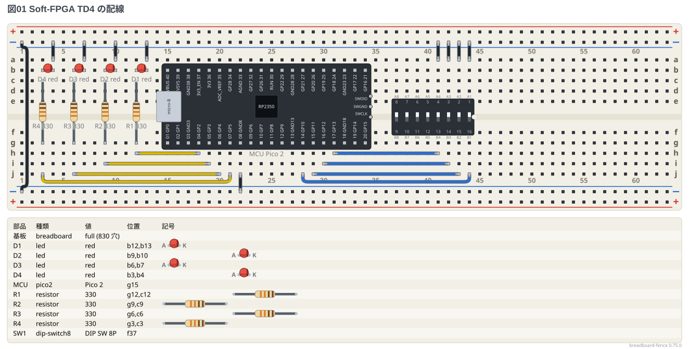
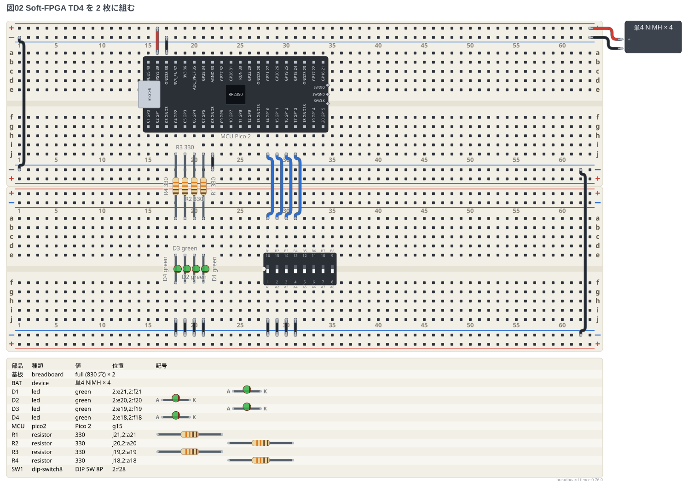

# Soft-FPGA TD4 (Pico 2 + DIP スイッチ + LED)

GitHub の [Soft-FPGA-TD4](https://github.com/tommie-jp/Soft-FPGA-TD4) (Verilog で書いた 4 ビット CPU
TD4 を Pico 2 の中で動かす) のブレッドボードを、このフェンスで描いたもの。
**入力は DIP スイッチ (8 連のうち 4 つ)、出力は LED 4 つ。** FPGA は要らない。

- IN_PORT: GP10〜GP13 ← DIP スイッチの 1〜4 番 (GP10 が最上位ビット)。反対のピンは GND。
  **プルアップ抵抗は要らない** (Pico 2 の内蔵プルアップを使う。スイッチを ON にするとピンは 0 で、
  `main.cpp` が反転して 1 と読む)
- OUT_PORT: GP2〜GP5 (GP2 が最上位ビット) → 330Ω → LED → GND

ピンの割り当ては Soft-FPGA-TD4 の `verilator-TD4/main.cpp` のとおり。

```bread
# ブレッドボードの実体配線図 (tommie-fence の bread フェンス)
title: 図01 Soft-FPGA TD4 の配線
board: full
parts:
  MCU: pico2 @ g15
  # LED は左。抵抗は溝をまたいで縦に、LED は上の段。左端が最下位ビット
  R4: resistor g3 c3 330
  D4: led b3(A) b4(K) red
  R3: resistor g6 c6 330
  D3: led b6(A) b7(K) red
  R2: resistor g9 c9 330
  D2: led b9(A) b10(K) red
  R1: resistor g12 c12 330
  D1: led b12(A) b13(K) red
  # DIP スイッチは右。r180 で 1 番を右端に置き、使う 1〜4 番を Pico 2 の側に寄せる
  SW1: dip-switch8 @ e37 r180
wires:
  # 電源は USB から。GND をレールへ (上下のレールは 1 列でつなぐ)
  - j22 -- -b22 black
  - -t1 -- -b1 black
  # OUT_PORT: GP2 GP3 GP4 GP5 (GP2 が最上位ビット) → 抵抗 → LED → GND
  - h18 -- h12 yellow
  - i19 -- i9 yellow
  - j20 -- j6 yellow
  - j21 -- j3 yellow [v15]
  - a4 -- -t4 black
  - a7 -- -t7 black
  - a10 -- -t10 black
  - a13 -- -t13 black
  # IN_PORT: GP10 GP11 GP12 GP13 (GP10 が最上位ビット) ← DIP スイッチ 1〜4 番、反対のピンは GND
  - j28 -- j44 blue [v15]
  - j29 -- j43 blue
  - i30 -- i42 blue
  - h31 -- h41 blue
  - a41 -- -t41 black
  - a42 -- -t42 black
  - a43 -- -t43 black
  - a44 -- -t44 black
```



- `dip-switch8 @ e37 r180` は溝をまたぐ 16 ピンの DIP。`r180` で 1 番が右端 (列 44) に来るので、
  使う 1〜4 番が Pico 2 の側に寄る。**k 番のスイッチは同じ列の `e` と `f` の間の接点**
  (`A1`〜`A4` が `e44`〜`e41`、`B1`〜`B4` が `f44`〜`f41`)。使わない 5〜8 番 (列 40〜37) はそのまま空けておく
- 4 本の線は `h` `i` `j` の行に分け、一番外の 1 本だけ迂回ヒント `[v15]` で深く通す。
  こうすると線どうしが交差せず、レールにも乗らない
- 図の上でスイッチの ON / OFF は決まらない (接点は開いたまま。実物は ON の向きが品ごとに違う)

## 2 枚を継いで組む (GitHub の図と同じ並び)

GitHub の図は**フルサイズ 2 枚を縦に継いで**組んである。上の基板に Pico 2、下の基板に LED と DIP スイッチを挿し、
抵抗 4 本は継ぎ目をまたいで上の基板から下の基板へ渡す。電源は右に置いた電池ボックス (単4 の NiMH 4 本、約 4.8 V) から
上の + レールへ入れ、Pico 2 の VSYS へ渡す。

```bread
# ブレッドボードの実体配線図 (tommie-fence の bread フェンス)
title: 図02 Soft-FPGA TD4 を 2 枚に組む
board:
  size: full
  stack: 2
parts:
  MCU: pico2 @ g15
  # 抵抗は継ぎ目をまたぐ (上の基板の j 行から下の基板の a 行へ)。名札は左右と上下に散らす
  R4: resistor j18 2:a18 330 cap=left
  R3: resistor j19 2:a19 330 cap=above
  R2: resistor j20 2:a20 330 cap=below
  R1: resistor j21 2:a21 330 cap=right
  # LED は下の基板の溝をまたぐ。左端が最上位ビット (GP2)
  D4: led 2:e18(A) 2:f18(K) green cap=left
  D3: led 2:e19(A) 2:f19(K) green cap=above
  D2: led 2:e20(A) 2:f20(K) green cap=below
  D1: led 2:e21(A) 2:f21(K) green cap=right
  # DIP スイッチは下の基板。1 番 (列 28) が GP10
  SW1: dip-switch8 @ 2:e28
  BAT:
    type: device
    at: right
    label: 単4 NiMH × 4
    pins: ["+", "-"]
wires:
  # 電源: 電池 → 上の基板のレール → Pico 2 の VSYS (39 番) と GND (38 番)
  - BAT.+ -- +t63 red
  - BAT.- -- -t63 black
  - +t16 -- a16 red
  - -t17 -- a17 black
  # GND を上の基板の上下のレールと、下の基板の下のレールへ
  - j22 -- -b22 black
  - -t1 -- -b1 black
  - -b62 -- 2:-b62 black
  # OUT_PORT: LED のカソードを下の基板の GND へ
  - 2:j18 -- 2:-b18 black
  - 2:j19 -- 2:-b19 black
  - 2:j20 -- 2:-b20 black
  - 2:j21 -- 2:-b21 black
  # IN_PORT: GP10〜GP13 → DIP スイッチ 1〜4 番、反対のピンは GND
  - j28 -- 2:a28 blue
  - j29 -- 2:a29 blue
  - j30 -- 2:a30 blue
  - j31 -- 2:a31 blue
  - 2:j28 -- 2:-b28 black
  - 2:j29 -- 2:-b29 black
  - 2:j30 -- 2:-b30 black
  - 2:j31 -- 2:-b31 black
```



- `board: stack: 2` で同じ基板を 2 枚、縁を接して縦に並べる。**2 枚めの穴は番地の頭に `2:` を付ける** (`2:a18` `2:-b62`)
- 継ぎ目をまたげるのは線と 2 ピンの部品だけ。**電気は継ぎ目を渡らない**ので、2 枚めの GND は線 (`-b62 -- 2:-b62`) でつなぐ
- `at: right` で電池ボックスを基板の右に置く。線は基板の右の外を縦に走り、レールへは行に沿って入る
- 単4 のアルカリ 4 本 (約 6 V) は VSYS の上限 (5.5 V) を超えるので、NiMH (1.2 V × 4) にする
