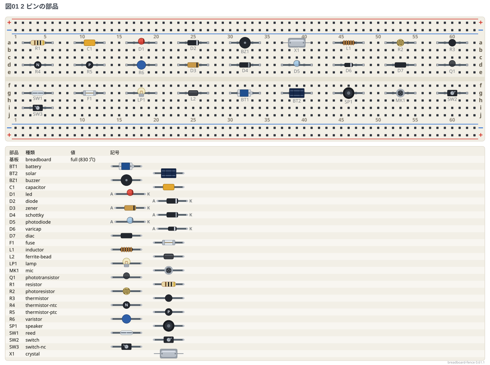
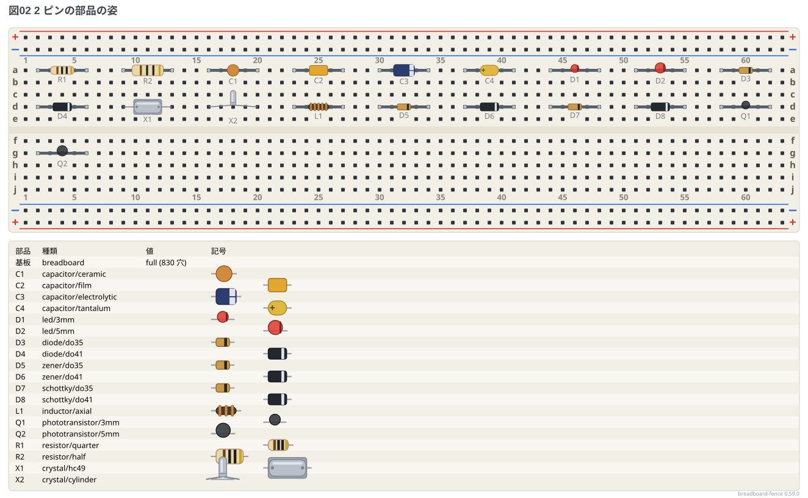
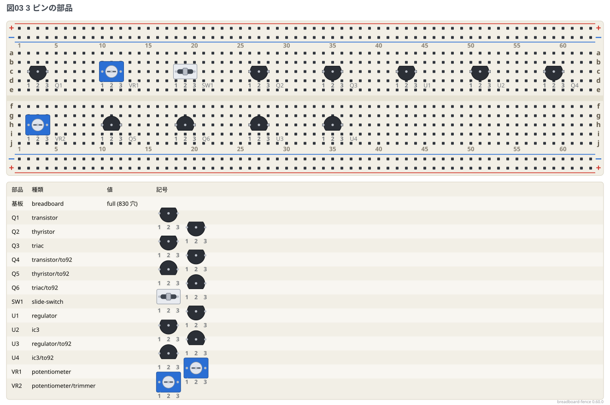
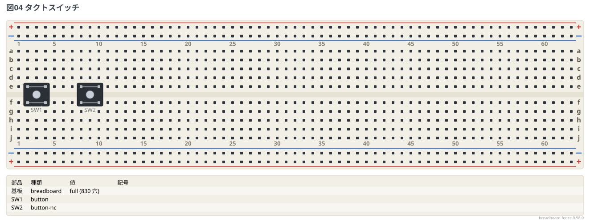
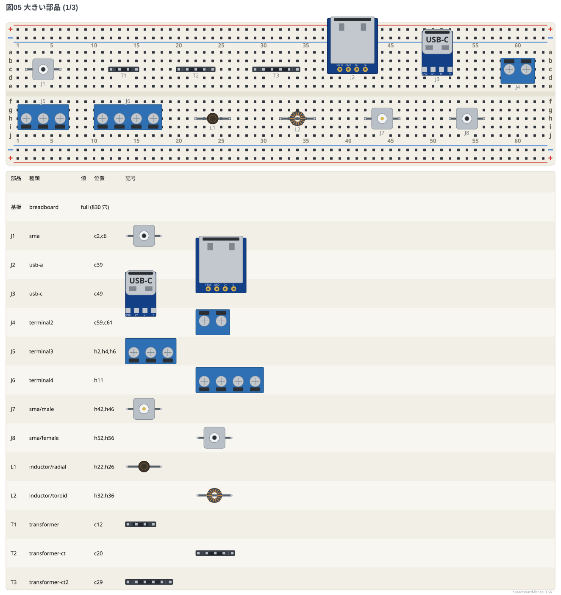
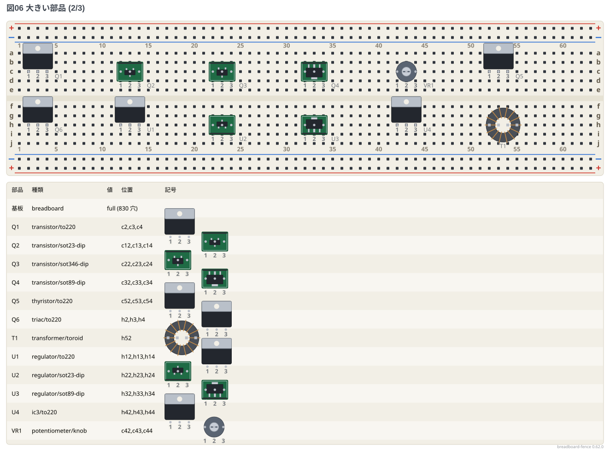
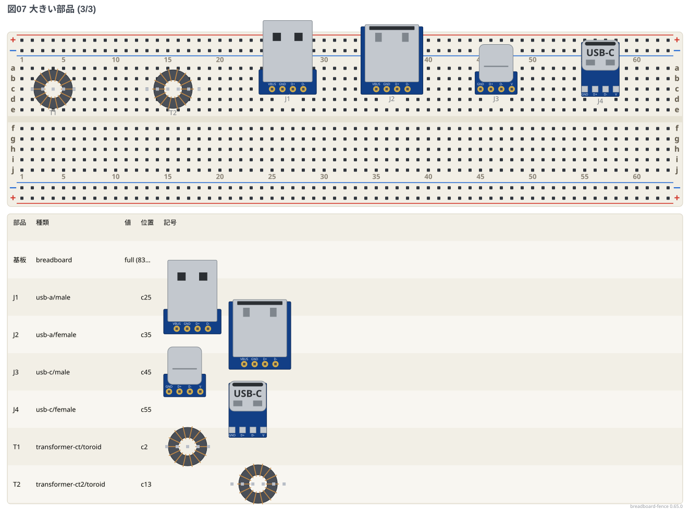

# 部品ギャラリー: 穴を並べて置く部品

ブレッドボードに**穴を並べて書く部品** (2 ピン・3 ピン・巻き物・スイッチ・USB・端子台) を、
種類ごとに 1 つずつ、姿 (`種類/姿`) ごとに 1 つずつ置いた。配線はしていない。
図の下の部品リストで、どの部品が何の種類と姿かを読める。

**このファイルは書き出した物** — 直すときは `src/gallery/gallery.ts` を直して `npm run gallery`。

## 2 ピンの部品

姿を書かないときの姿。4 穴の間に置いた。

```bread
# ブレッドボードの実体配線図 (tommie-fence の bread フェンス)
title: 図01 2 ピンの部品
board: full
parts:
  R1: resistor a2 a6
  C1: capacitor a9 a13
  D1: led a16 a20
  D2: diode a23 a27
  BZ1: buzzer a30 a34
  X1: crystal a37 a41
  L1: inductor a44 a48
  R2: photoresistor a51 a55
  R3: thermistor a58 a62
  R4: thermistor-ntc d2 d6
  R5: thermistor-ptc d9 d13
  R6: varistor d16 d20
  D3: zener d23 d27
  D4: schottky d30 d34
  D5: photodiode d37 d41
  D6: varicap d44 d48
  D7: diac d51 d55
  Q1: phototransistor d58 d62
  SW1: reed g2 g6
  F1: fuse g9 g13
  LP1: lamp g16 g20
  L2: ferrite-bead g23 g27
  BT1: battery g30 g34
  BT2: solar g37 g41
  SP1: speaker g44 g48
  MK1: mic g51 g55
  SW2: switch g58 g62
  SW3: switch-nc i2 i6
```



## 2 ピンの部品の姿

`種類/姿` で選べる姿。

```bread
# ブレッドボードの実体配線図 (tommie-fence の bread フェンス)
title: 図02 2 ピンの部品の姿
board: full
parts:
  R1: resistor/quarter a2 a6
  R2: resistor/half a9 a13
  C1: capacitor/ceramic a16 a20
  C2: capacitor/film a23 a27
  C3: capacitor/electrolytic a30 a34
  C4: capacitor/tantalum a37 a41
  D1: led/3mm a44 a48
  D2: led/5mm a51 a55
  D3: diode/do35 a58 a62
  D4: diode/do41 d2 d6
  X1: crystal/hc49 d9 d13
  X2: crystal/cylinder d16 d20
  L1: inductor/axial d23 d27
  D5: zener/do35 d30 d34
  D6: zener/do41 d37 d41
  D7: schottky/do35 d44 d48
  D8: schottky/do41 d51 d55
  Q1: phototransistor/3mm d58 d62
  Q2: phototransistor/5mm g2 g6
```



## 3 ピンの部品

姿を書かないときの姿と、`種類/姿` で選べる姿。隣どうしの 3 穴に置いた。

```bread
# ブレッドボードの実体配線図 (tommie-fence の bread フェンス)
title: 図03 3 ピンの部品
board: full
parts:
  Q1: transistor c2 c3 c4
  VR1: potentiometer c10 c11 c12
  SW1: slide-switch c18 c19 c20
  Q2: thyristor c26 c27 c28
  Q3: triac c34 c35 c36
  U1: regulator c42 c43 c44
  U2: ic3 c50 c51 c52
  Q4: transistor/to92 c58 c59 c60
  VR2: potentiometer/trimmer h2 h3 h4
  Q5: thyristor/to92 h10 h11 h12
  Q6: triac/to92 h18 h19 h20
  U3: regulator/to92 h26 h27 h28
  U4: ic3/to92 h34 h35 h36
```



## タクトスイッチ

溝をまたいで置く (a 接点の `button` と b 接点の `button-nc` は同じ形)。

```bread
# ブレッドボードの実体配線図 (tommie-fence の bread フェンス)
title: 図04 タクトスイッチ
board: full
parts:
  SW1: button @ e2
  SW2: button-nc @ e8
```



## 大きい部品

巻き物・USB・端子台・SMA と、胴の大きい姿 (TO-220・トロイダル・ボリューム・面実装の変換基板など)。

```bread
# ブレッドボードの実体配線図 (tommie-fence の bread フェンス)
title: 図05 大きい部品 (1/3)
board: full
parts:
  J1: sma c2 c6
  T1: transformer c12 c13 c14 c15
  T2: transformer-ct c20 c21 c22 c23 c24
  T3: transformer-ct2 c29 c30 c31 c32 c33 c34
  J2: usb-a c39 c40 c41 c42
  J3: usb-c c49 c50 c51 c52
  J4: terminal2 c59 c61
  J5: terminal3 h2 h4 h6
  J6: terminal4 h11 h13 h15 h17
  L1: inductor/radial h22 h26
  L2: inductor/toroid h32 h36
  J7: sma/male h42 h46
  J8: sma/female h52 h56
```



```bread
# ブレッドボードの実体配線図 (tommie-fence の bread フェンス)
title: 図06 大きい部品 (2/3)
board: full
parts:
  Q1: transistor/to220 c2 c3 c4
  Q2: transistor/sot23-dip c12 c13 c14
  Q3: transistor/sot346-dip c22 c23 c24
  Q4: transistor/sot89-dip c32 c33 c34
  VR1: potentiometer/knob c42 c43 c44
  Q5: thyristor/to220 c52 c53 c54
  Q6: triac/to220 h2 h3 h4
  U1: regulator/to220 h12 h13 h14
  U2: regulator/sot23-dip h22 h23 h24
  U3: regulator/sot89-dip h32 h33 h34
  U4: ic3/to220 h42 h43 h44
  T1: transformer/toroid h52 h53 h54 h55
```



```bread
# ブレッドボードの実体配線図 (tommie-fence の bread フェンス)
title: 図07 大きい部品 (3/3)
board: full
parts:
  T1: transformer-ct/toroid c2 c3 c4 c5 c6
  T2: transformer-ct2/toroid c13 c14 c15 c16 c17 c18
  J1: usb-a/male c25 c26 c27 c28
  J2: usb-a/female c35 c36 c37 c38
  J3: usb-c/male c45 c46 c47 c48
  J4: usb-c/female c55 c56 c57 c58
```


