# 部品ギャラリー: 型番のある IC とモジュール

[早見表](../docs/02-cheatsheet.md) の「DIP のピンの名前」の表にある**型番を全部**置いた。
型番を書くと、胴にピンの番号、胴の外にピンの名前が出る。配線はしていない。
62256 と 6116 は 600 mil の幅広 (`dipN/wide`) で置いた。

**このファイルは書き出した物** — 直すときは `src/gallery/gallery.ts` を直して `npm run gallery`。

## DIP4

型番の表にある 4 ピンの型番。胴にピンの番号、胴の外にピンの名前が出る。

```bread
# ブレッドボードの実体配線図 (tommie-fence の bread フェンス)
title: 図01 DIP4 の型番
board: full
parts:
  U1: dip4 @ e2 3SK291
```

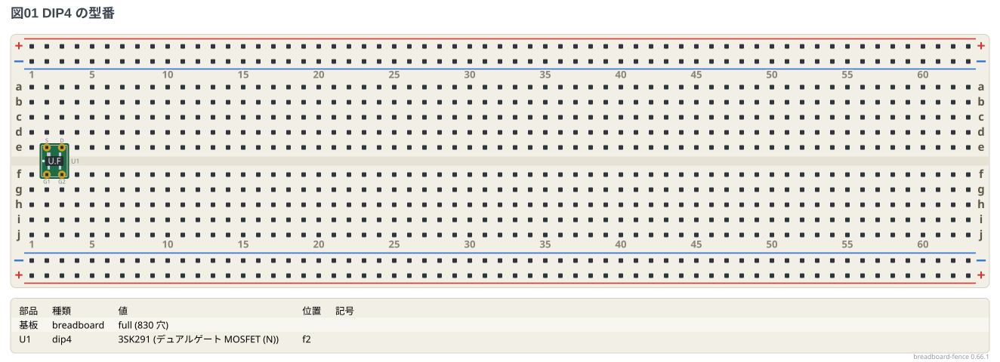

## DIP8

型番の表にある 8 ピンの型番。胴にピンの番号、胴の外にピンの名前が出る。

```bread
# ブレッドボードの実体配線図 (tommie-fence の bread フェンス)
title: 図02 DIP8 の型番 (1/2)
board: full
parts:
  U1: dip8 @ e2 NE555
  U2: dip8 @ e8 TLC555
  U3: dip8 @ e14 LM358
  U4: dip8 @ e20 TL071
  U5: dip8 @ e26 TL072
  U6: dip8 @ e32 LM393
  U7: dip8 @ e38 SA612
  U8: dip8 @ e44 MCP6002
  U9: dip8 @ e50 LM386
  U10: dip8 @ e56 NE5532
```

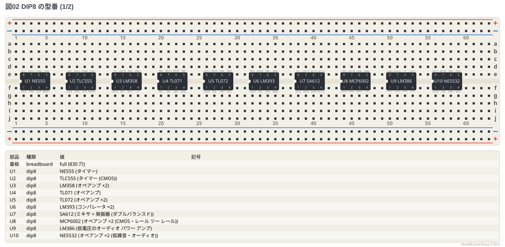

```bread
# ブレッドボードの実体配線図 (tommie-fence の bread フェンス)
title: 図03 DIP8 の型番 (2/2)
board: full
parts:
  U1: dip8 @ e2 NJM4556A
  U2: dip8 @ e8 LM741
  U3: dip8 @ e14 ATtiny85
  U4: dip8 @ e20 PIC12F683
  U5: dip8 @ e26 PIC12F1822
  U6: dip8 @ e32 AE-SI5351A-B
  U7: dip8 @ e38 LM75
  U8: dip8 @ e44 MCP9808
```

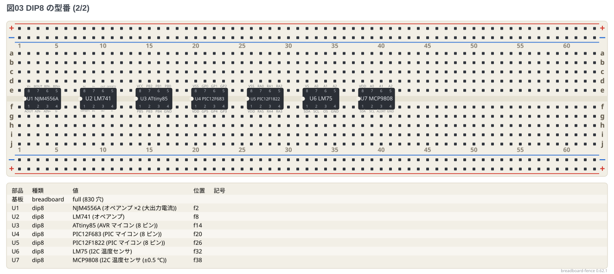

## DIP14

型番の表にある 14 ピンの型番。胴にピンの番号、胴の外にピンの名前が出る。

```bread
# ブレッドボードの実体配線図 (tommie-fence の bread フェンス)
title: 図04 DIP14 の型番 (1/4)
board: full
parts:
  U1: dip14 @ e2 CD4069UB
  U2: dip14 @ e11 CD4071B
  U3: dip14 @ e20 CD4081B
  U4: dip14 @ e29 CD4011B
  U5: dip14 @ e38 CD4001B
  U6: dip14 @ e47 CD4013B
  U7: dip14 @ e56 CD4070B
```

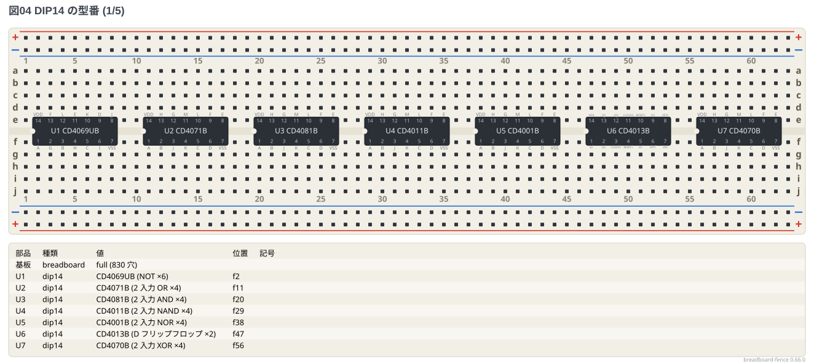

```bread
# ブレッドボードの実体配線図 (tommie-fence の bread フェンス)
title: 図05 DIP14 の型番 (2/4)
board: full
parts:
  U1: dip14 @ e2 CD40106B
  U2: dip14 @ e11 74HC04
  U3: dip14 @ e20 74HC08
  U4: dip14 @ e29 74HC32
  U5: dip14 @ e38 74HC86
  U6: dip14 @ e47 74HC02
  U7: dip14 @ e56 74HC74
```

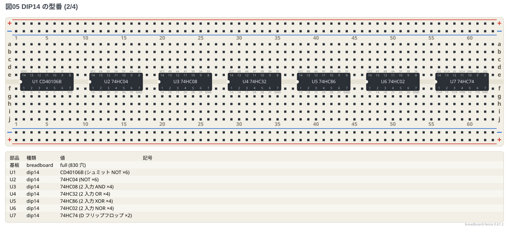

```bread
# ブレッドボードの実体配線図 (tommie-fence の bread フェンス)
title: 図06 DIP14 の型番 (3/4)
board: full
parts:
  U1: dip14 @ e2 74HC14
  U2: dip14 @ e11 74HC00
  U3: dip14 @ e20 74HC10
  U4: dip14 @ e29 74HC11
  U5: dip14 @ e38 74HC27
  U6: dip14 @ e47 74HC20
  U7: dip14 @ e56 74HC30
```

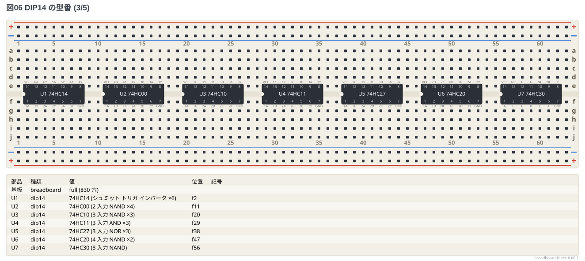

```bread
# ブレッドボードの実体配線図 (tommie-fence の bread フェンス)
title: 図07 DIP14 の型番 (4/4)
board: full
parts:
  U1: dip14 @ e2 74HC132
  U2: dip14 @ e11 74HC125
  U3: dip14 @ e20 74HC126
  U4: dip14 @ e29 74HC393
  U5: dip14 @ e38 74HC164
  U6: dip14 @ e47 74HC4066
  U7: dip14 @ e56 LM324
```

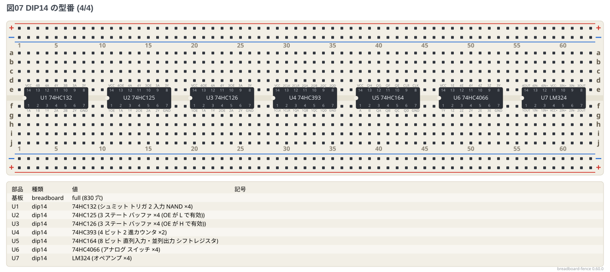

## DIP16

型番の表にある 16 ピンの型番。胴にピンの番号、胴の外にピンの名前が出る。

```bread
# ブレッドボードの実体配線図 (tommie-fence の bread フェンス)
title: 図08 DIP16 の型番 (1/5)
board: full
parts:
  U1: dip16 @ e2 CD4017B
  U2: dip16 @ e12 CD4040B
  U3: dip16 @ e22 L293D
  U4: dip16 @ e32 MCP3008
  U5: dip16 @ e42 74HC595
  U6: dip16 @ e52 CD4511B
```

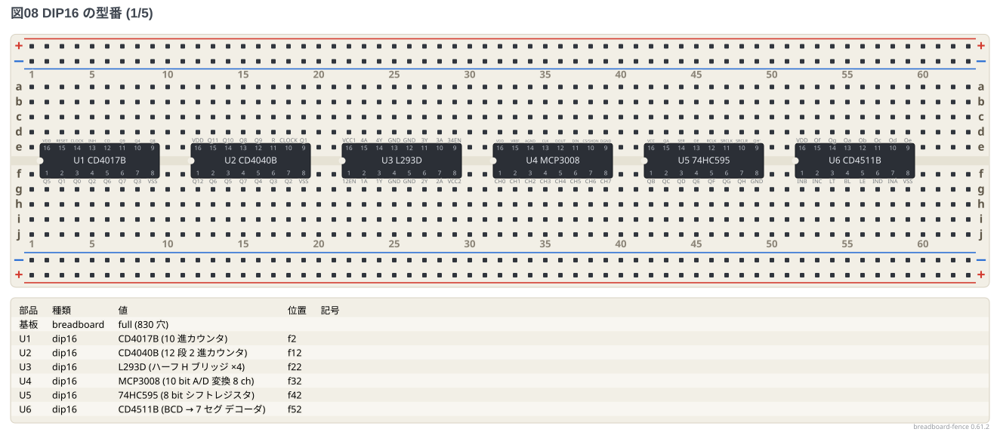

```bread
# ブレッドボードの実体配線図 (tommie-fence の bread フェンス)
title: 図09 DIP16 の型番 (2/5)
board: full
parts:
  U1: dip16 @ e2 CD74HC283
  U2: dip16 @ e12 74HC163
  U3: dip16 @ e22 74HC161
  U4: dip16 @ e32 74HC194
  U5: dip16 @ e42 74HC138
  U6: dip16 @ e52 74HC139
```


```bread
# ブレッドボードの実体配線図 (tommie-fence の bread フェンス)
title: 図10 DIP16 の型番 (3/5)
board: full
parts:
  U1: dip16 @ e2 74HC157
  U2: dip16 @ e12 74HC153
  U3: dip16 @ e22 74HC151
  U4: dip16 @ e32 74HC175
  U5: dip16 @ e42 74HC174
  U6: dip16 @ e52 74HC112
```

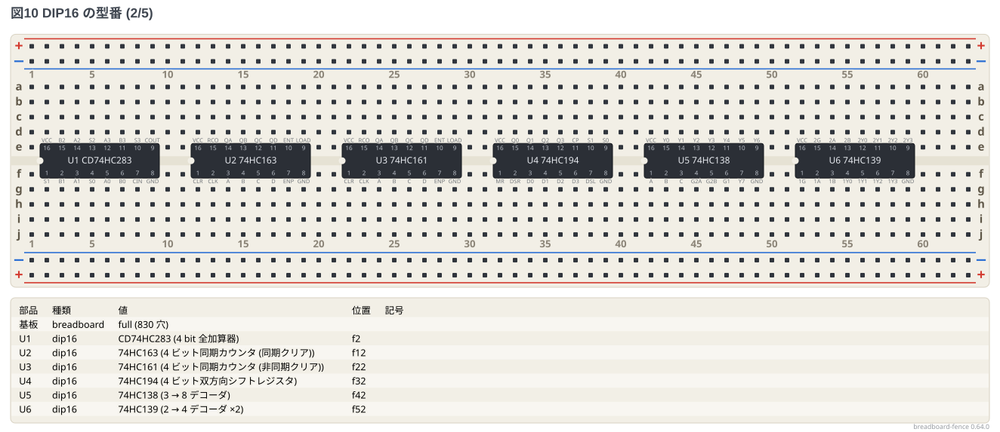

```bread
# ブレッドボードの実体配線図 (tommie-fence の bread フェンス)
title: 図11 DIP16 の型番 (4/5)
board: full
parts:
  U1: dip16 @ e2 74HC390
  U2: dip16 @ e12 74HC4040
  U3: dip16 @ e22 74HC4060
  U4: dip16 @ e32 74HC193
  U5: dip16 @ e42 74HC165
  U6: dip16 @ e52 74HC85
```

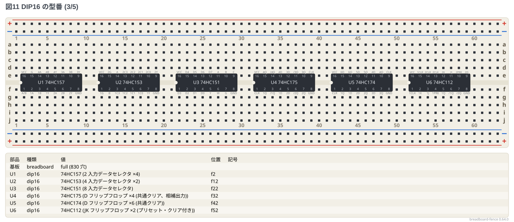

```bread
# ブレッドボードの実体配線図 (tommie-fence の bread フェンス)
title: 図12 DIP16 の型番 (5/5)
board: full
parts:
  U1: dip16 @ e2 74HC123
  U2: dip16 @ e12 74HC4051
  U3: dip16 @ e22 74HC4052
  U4: dip16 @ e32 74HC4053
  U5: dip16 @ e42 ULN2003A
```


## DIP18

型番の表にある 18 ピンの型番。胴にピンの番号、胴の外にピンの名前が出る。

```bread
# ブレッドボードの実体配線図 (tommie-fence の bread フェンス)
title: 図13 DIP18 の型番
board: full
parts:
  U1: dip18 @ e2 PIC16F84A
  U2: dip18 @ e13 PIC16F628A
```

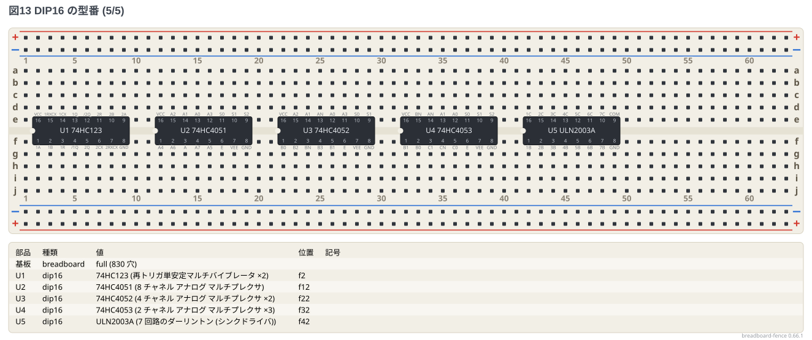

## DIP20

型番の表にある 20 ピンの型番。胴にピンの番号、胴の外にピンの名前が出る。

```bread
# ブレッドボードの実体配線図 (tommie-fence の bread フェンス)
title: 図14 DIP20 の型番 (1/2)
board: full
parts:
  U1: dip20 @ e2 74HC245
  U2: dip20 @ e14 74HC273
  U3: dip20 @ e26 74HC244
  U4: dip20 @ e38 74HC541
  U5: dip20 @ e50 74HC240
```

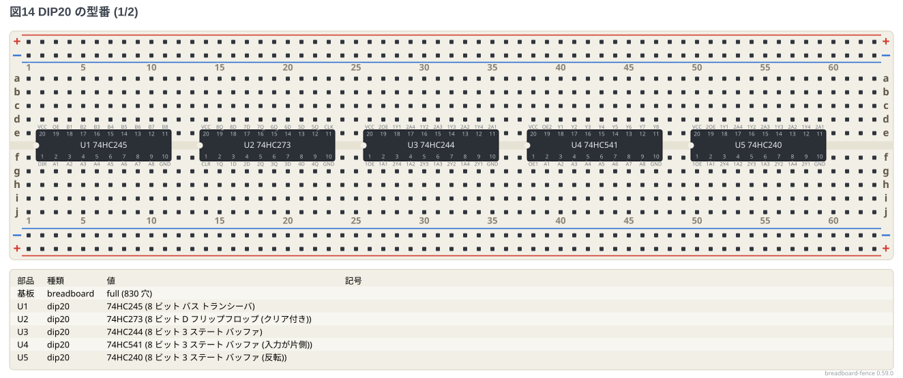

```bread
# ブレッドボードの実体配線図 (tommie-fence の bread フェンス)
title: 図15 DIP20 の型番 (2/2)
board: full
parts:
  U1: dip20 @ e2 74HC573
  U2: dip20 @ e14 74HC574
```

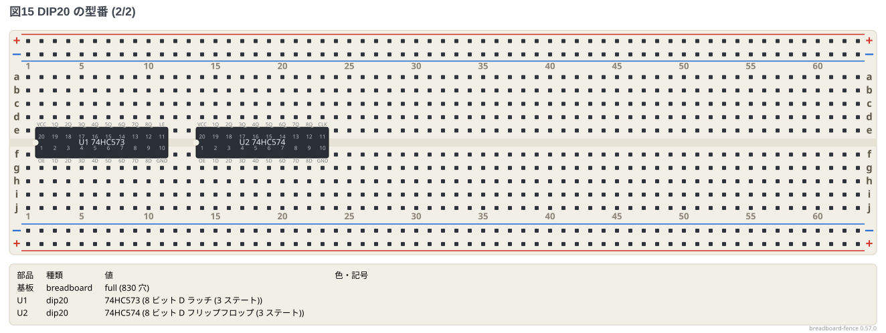

## DIP24

型番の表にある 24 ピンの型番。胴にピンの番号、胴の外にピンの名前が出る。

```bread
# ブレッドボードの実体配線図 (tommie-fence の bread フェンス)
title: 図16 DIP24 の型番
board: full
parts:
  U1: dip24 @ e2 74HC154
  U2: dip24/wide @ e16 6116
```

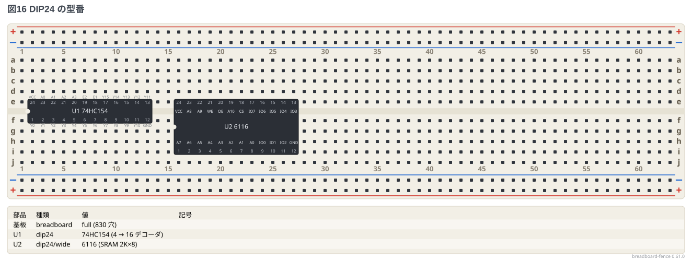

## DIP28

型番の表にある 28 ピンの型番。胴にピンの番号、胴の外にピンの名前が出る。

```bread
# ブレッドボードの実体配線図 (tommie-fence の bread フェンス)
title: 図17 DIP28 の型番
board: full
parts:
  U1: dip28/wide @ e2 62256
  U2: dip28 @ e18 ATmega328P
  U3: dip28 @ e34 PIC16F886
  U4: dip28 @ e50 PIC16F57
```

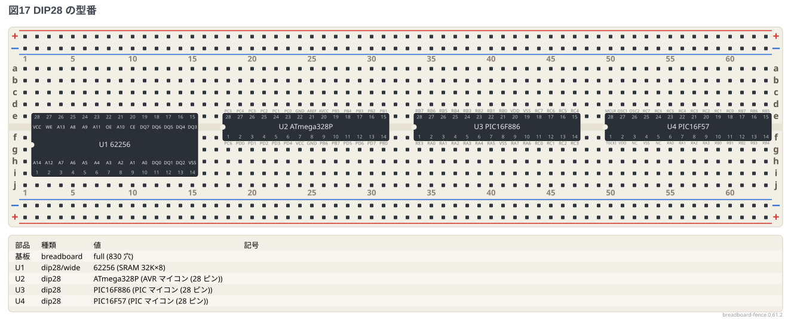

## 1 列の型番

1 列 (`sipN`) で描く型番 (センサ・フィルタ・モジュールのヘッダ・フルカラー LED など)。

```bread
# ブレッドボードの実体配線図 (tommie-fence の bread フェンス)
title: 図18 1 列の型番
board: full
parts:
  U1: sip3 @ a2 SFU455B
  U2: sip5 @ a8 KY-040
  U3: sip4 @ a15 HC-SR04
  U4: sip3 @ a21 SG90
  U5: sip4 @ a26 DHT11
  U6: sip3 @ a32 HC-SR501
  U7: sip7 @ a38 GY-9833
  U8: sip8 @ a47 ADAFRUIT-1782
  U9: sip7 @ a57 ADAFRUIT-2045
  U10: sip3 @ e2 TA7642
  U11: sip3 @ e7 A3144
  U12: sip3 @ e12 A1324
  U13: sip3 @ e17 LM35
  U14: sip3 @ e22 SFELF10M7
  U15: sip3 @ e28 CFULA455
  U16: sip4 @ e34 OSTA5131A
  U17: sip4 @ e40 OSTAMA5B31A
```

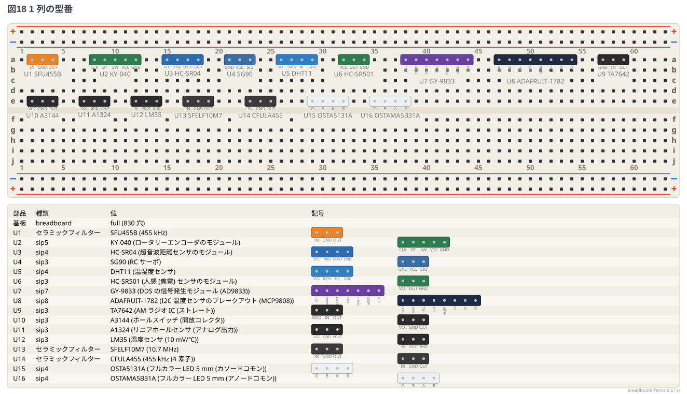

## DIP 化キット

基板とジャックの外形を帯の脇に描く型番。

```bread
# ブレッドボードの実体配線図 (tommie-fence の bread フェンス)
title: 図19 DIP 化キット
board: full
parts:
  U1: sip8 @ j2 AE-RJ-45-LAN-DIP-A
  U2: sip4 @ j18 AE-DC-POWER-JACK-DIP
  U3: sip4 @ j34 AE-PHONE-JACK-DIP
```

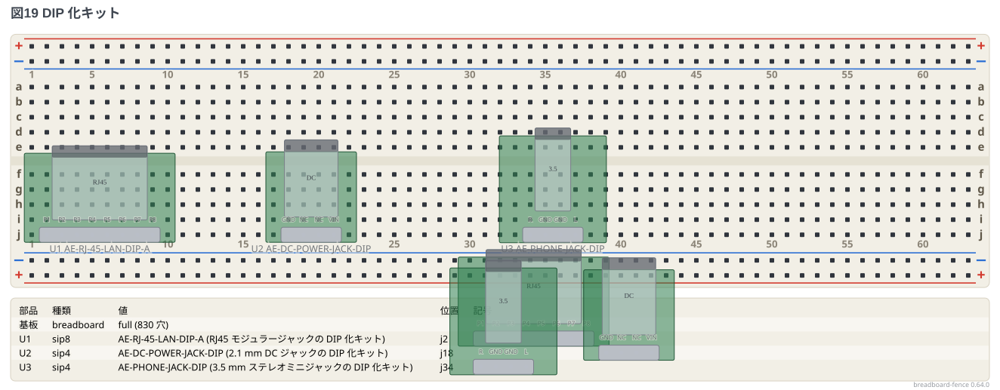

## DIP 化した変換基板の姿

`dipN/sop` `dipN/tssop` (面実装の IC を DIP 化した変換基板に載せた姿)。

```bread
# ブレッドボードの実体配線図 (tommie-fence の bread フェンス)
title: 図20 変換基板の姿
board: full
parts:
  U1: dip8/sop @ e2
  U2: dip8/tssop @ e10
```

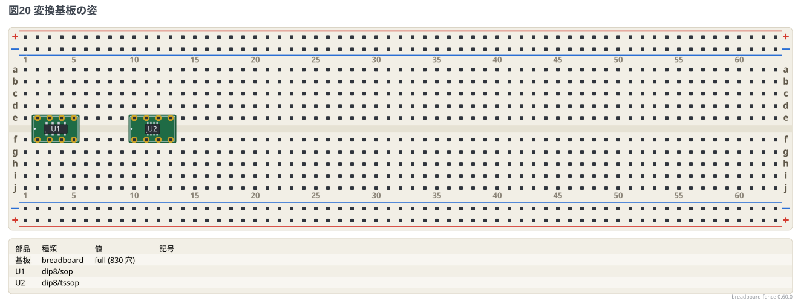
