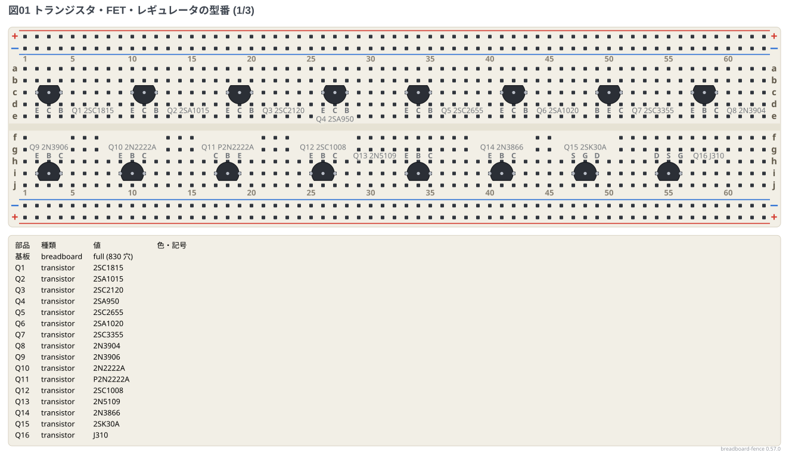
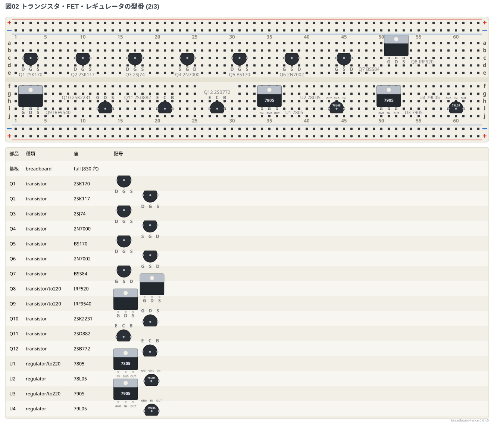
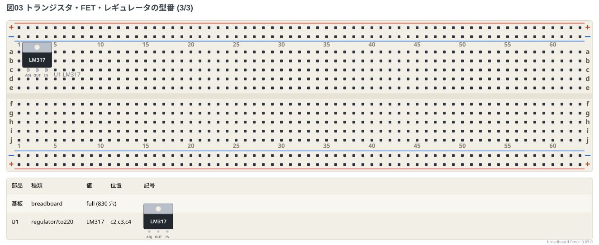

# 部品ギャラリー: 型番のあるトランジスタ・FET・レギュレータ

[早見表](../docs/02-cheatsheet.md) の「3 ピンのトランジスタ・FET・レギュレータの穴の順」の表にある**型番を全部**置いた。
型番を書くと、穴の順に表のピンの名前が付く。TO-220 の型番は `/to220` の姿で、ほかは TO-92 の姿で置いた。

**このファイルは書き出した物** — 直すときは `src/gallery/gallery.ts` を直して `npm run gallery`。

## 型番

印字面を手前、ピンを下にして左から右の並び。

```bread
# ブレッドボードの実体配線図 (tommie-fence の bread フェンス)
title: 図01 トランジスタ・FET・レギュレータの型番 (1/3)
board: full
parts:
  Q1: transistor c2 c3 c4 2SC1815
  Q2: transistor c10 c11 c12 2SA1015
  Q3: transistor c18 c19 c20 2SC2120
  Q4: transistor c26 c27 c28 2SA950
  Q5: transistor c33 c34 c35 2SC2655
  Q6: transistor c41 c42 c43 2SA1020
  Q7: transistor c49 c50 c51 2SC3355
  Q8: transistor c57 c58 c59 2N3904
  Q9: transistor i2 i3 i4 2N3906
  Q10: transistor i9 i10 i11 2N2222A
  Q11: transistor i17 i18 i19 P2N2222A
  Q12: transistor i25 i26 i27 2SC1008
  Q13: transistor i33 i34 i35 2N5109
  Q14: transistor i40 i41 i42 2N3866
  Q15: transistor i47 i48 i49 2SK30A
  Q16: transistor i54 i55 i56 J310
```



```bread
# ブレッドボードの実体配線図 (tommie-fence の bread フェンス)
title: 図02 トランジスタ・FET・レギュレータの型番 (2/3)
board: full
parts:
  Q1: transistor c2 c3 c4 2SK170
  Q2: transistor c9 c10 c11 2SK117
  Q3: transistor c16 c17 c18 2SJ74
  Q4: transistor c23 c24 c25 2N7000
  Q5: transistor c30 c31 c32 BS170
  Q6: transistor c37 c38 c39 2N7002
  Q7: transistor c44 c45 c46 BSS84
  Q8: transistor/to220 c51 c52 c53 IRF520
  Q9: transistor/to220 i2 i3 i4 IRF9540
  Q10: transistor i12 i13 i14 2SK2231
  Q11: transistor i20 i21 i22 2SD882
  Q12: transistor i27 i28 i29 2SB772
  U1: regulator/to220 i34 i35 i36 7805
  U2: regulator i43 i44 i45 78L05
  U3: regulator/to220 i50 i51 i52 7905
  U4: regulator i59 i60 i61 79L05
```



```bread
# ブレッドボードの実体配線図 (tommie-fence の bread フェンス)
title: 図03 トランジスタ・FET・レギュレータの型番 (3/3)
board: full
parts:
  U1: regulator/to220 c2 c3 c4 LM317
```


