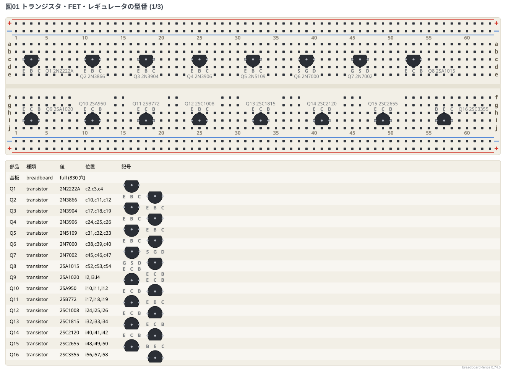
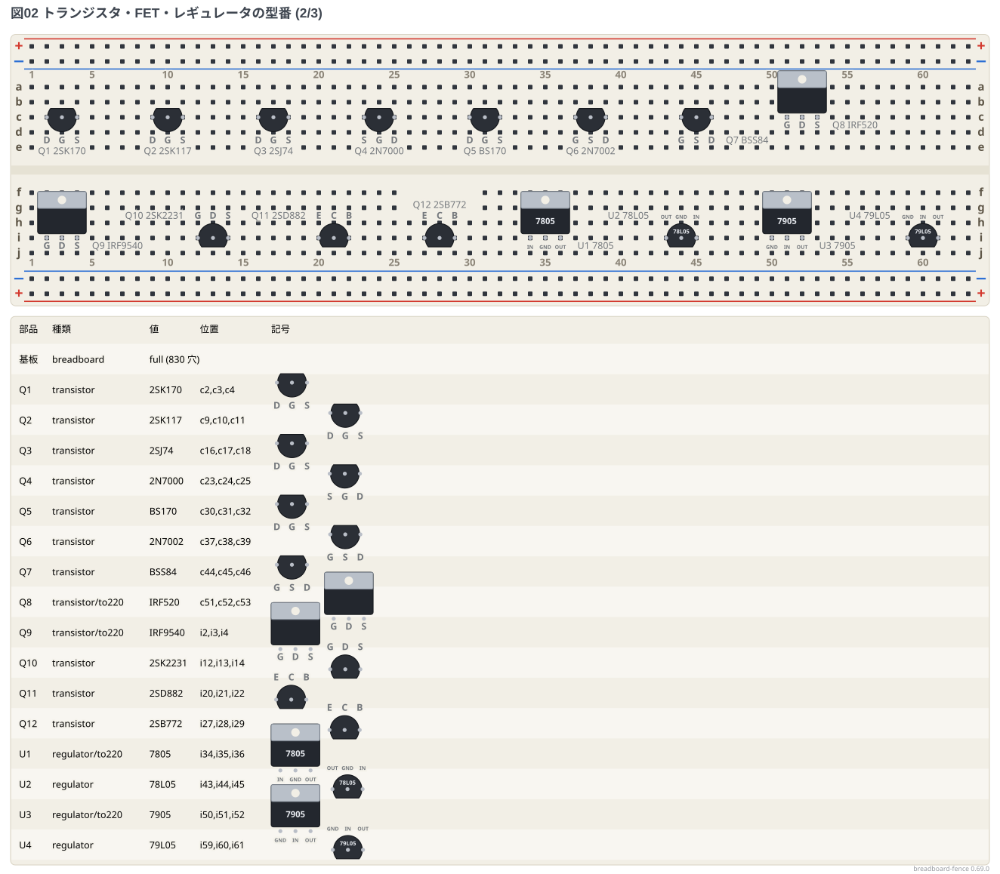
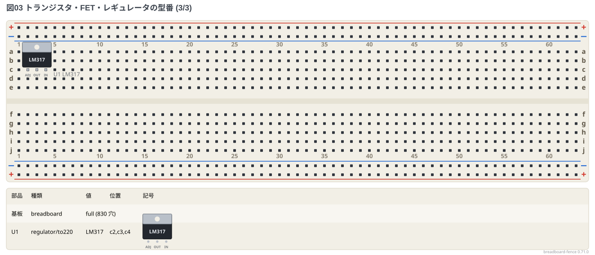

# 部品ギャラリー: 型番のあるトランジスタ・FET・レギュレータ

[早見表](../docs/02-cheatsheet.md) の「3 ピンのトランジスタ・FET・レギュレータの穴の順」の表にある**型番を全部**置いた。
型番を書くと、穴の順に表のピンの名前が付く。TO-220 の型番は `/to220` の姿で、ほかは TO-92 の姿で置いた。

**このファイルは書き出した物** — 直すときは `src/gallery/gallery.ts` を直して `npm run gallery`。

## 型番

印字面を手前、ピンを下にして左から右の並び。

```bread
# ブレッドボードの実体配線図 (tommie-fence の bread フェンス)
title: 図01 トランジスタ・FET・レギュレータの型番 (1/3)
board: full
parts:
  Q1: transistor c2 c3 c4 2N2222A
  Q2: transistor c10 c11 c12 2N3866
  Q3: transistor c17 c18 c19 2N3904
  Q4: transistor c24 c25 c26 2N3906
  Q5: transistor c31 c32 c33 2N5109
  Q6: transistor c38 c39 c40 2N7000
  Q7: transistor c45 c46 c47 2N7002
  Q8: transistor c52 c53 c54 2SA1015
  Q9: transistor i2 i3 i4 2SA1020
  Q10: transistor i10 i11 i12 2SA950
  Q11: transistor i17 i18 i19 2SB772
  Q12: transistor i24 i25 i26 2SC1008
  Q13: transistor i32 i33 i34 2SC1815
  Q14: transistor i40 i41 i42 2SC2120
  Q15: transistor i48 i49 i50 2SC2655
  Q16: transistor i56 i57 i58 2SC3355
```



```bread
# ブレッドボードの実体配線図 (tommie-fence の bread フェンス)
title: 図02 トランジスタ・FET・レギュレータの型番 (2/3)
board: full
parts:
  Q1: transistor c2 c3 c4 2SD882
  Q2: transistor c9 c10 c11 2SJ74
  Q3: transistor c16 c17 c18 2SK117
  Q4: transistor c23 c24 c25 2SK170
  Q5: transistor c30 c31 c32 2SK2231
  Q6: transistor c38 c39 c40 2SK30A
  U1: regulator/to220 c45 c46 c47 7805
  U2: regulator c54 c55 c56 78L05
  U3: regulator/to220 i2 i3 i4 7905
  U4: regulator i11 i12 i13 79L05
  Q7: transistor i18 i19 i20 BS170
  Q8: transistor i25 i26 i27 BSS84
  Q9: transistor/to220 i32 i33 i34 IRF520
  Q10: transistor/to220 i41 i42 i43 IRF9540
  Q11: transistor i51 i52 i53 J310
```



```bread
# ブレッドボードの実体配線図 (tommie-fence の bread フェンス)
title: 図03 トランジスタ・FET・レギュレータの型番 (3/3)
board: full
parts:
  U1: regulator/to220 c2 c3 c4 LM317
  Q1: transistor c11 c12 c13 P2N2222A
```


