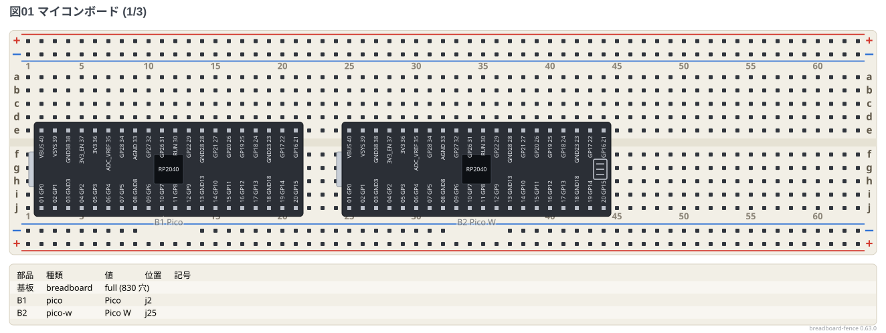
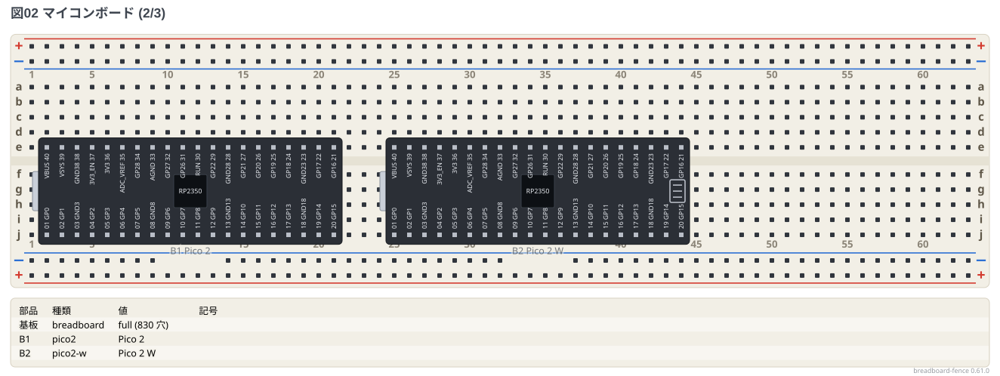
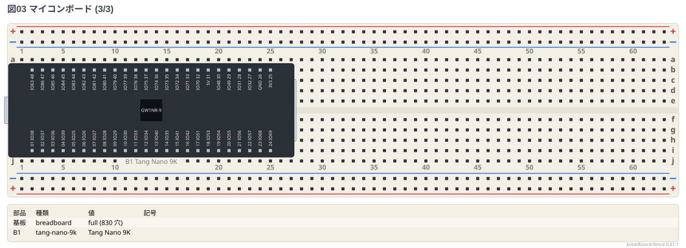
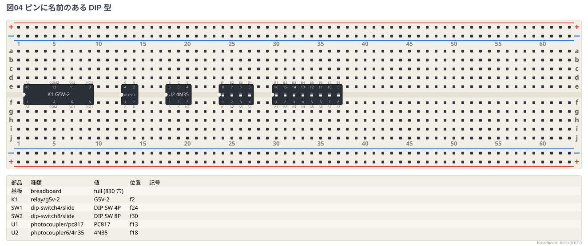
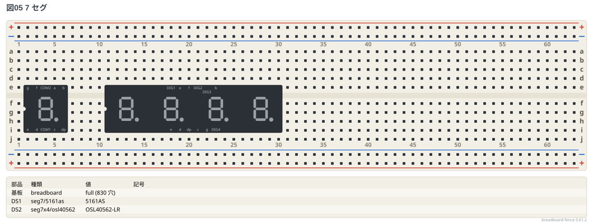
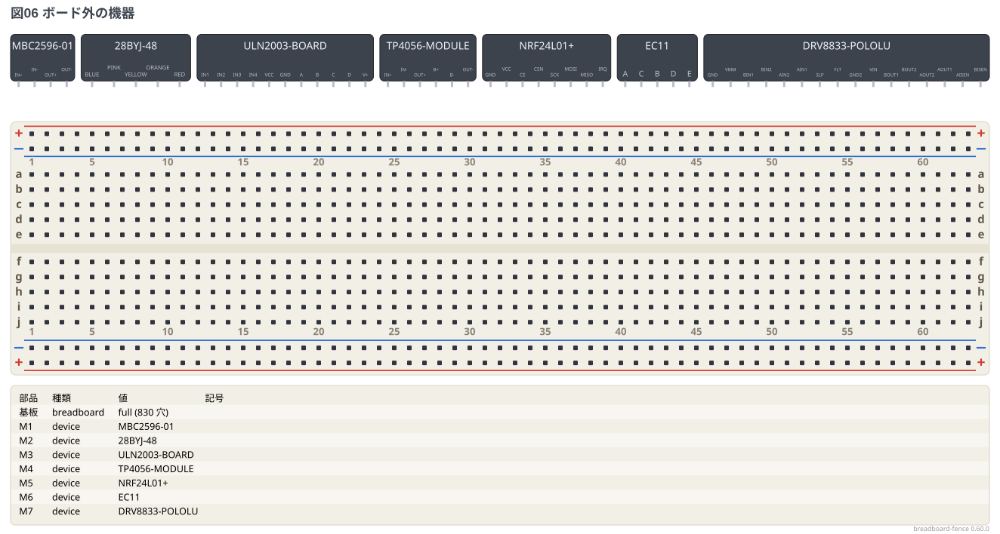

# 部品ギャラリー: マイコンボード・名前つきの部品・ボード外の機器

マイコンボード、ピンに名前のある DIP 型 (リレー・フォトカプラ・7 セグ・DIP スイッチ)、
型番で書くボード外の機器 (`type: device` の `model:`) を全部置いた。配線はしていない。

**このファイルは書き出した物** — 直すときは `src/gallery/gallery.ts` を直して `npm run gallery`。

## マイコンボード

溝をまたいで置くボード。

```bread
# ブレッドボードの実体配線図 (tommie-fence の bread フェンス)
title: 図01 マイコンボード (1/3)
board: full
parts:
  B1: pico @ e2
  B2: pico-w @ e25
```



```bread
# ブレッドボードの実体配線図 (tommie-fence の bread フェンス)
title: 図02 マイコンボード (2/3)
board: full
parts:
  B1: pico2 @ e2
  B2: pico2-w @ e25
```



```bread
# ブレッドボードの実体配線図 (tommie-fence の bread フェンス)
title: 図03 マイコンボード (3/3)
board: full
parts:
  B1: tang-nano-9k @ b2
```



## ピンに名前のある DIP 型

溝をまたいで置く。ピンは名前でも番号でも呼べる。

```bread
# ブレッドボードの実体配線図 (tommie-fence の bread フェンス)
title: 図04 ピンに名前のある DIP 型
board: full
parts:
  K1: relay/g5v-2 @ e2
  U1: photocoupler/pc817 @ e13
  U2: photocoupler6/4n35 @ e18
  SW1: dip-switch4/slide @ e24
  SW2: dip-switch8/slide @ e30
```



## 7 セグ

列の間が 6 穴なので、i 行と e 行の組に置く。

```bread
# ブレッドボードの実体配線図 (tommie-fence の bread フェンス)
title: 図05 7 セグ
board: full
parts:
  DS1: seg7/5161as @ i2
  DS2: seg7x4/osl40562 @ i18
```



## ボード外の機器

`model:` に型番を書くと、ピンの名前が表から出る。

```bread
# ブレッドボードの実体配線図 (tommie-fence の bread フェンス)
title: 図06 ボード外の機器
board: full
parts:
  M1:
      type: device
      model: MBC2596-01
  M2:
      type: device
      model: 28BYJ-48
  M3:
      type: device
      model: ULN2003-BOARD
  M4:
      type: device
      model: TP4056-MODULE
  M5:
      type: device
      model: NRF24L01+
  M6:
      type: device
      model: EC11
  M7:
      type: device
      model: DRV8833-POLOLU
```


