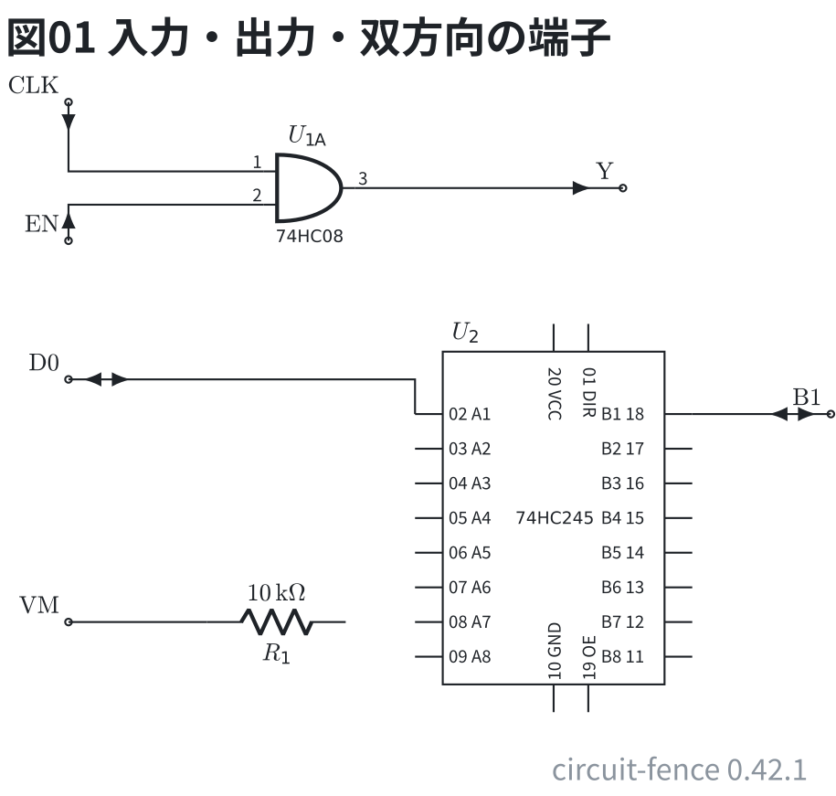

# 端子の向き

端子 (`port`) の番地のあとに `in` / `out` / `inout` を書くと、端子に触れた線に矢が付く。
入力は回路へ、出力は端子へ、双方向は両向き。書かない端子は今までどおり白丸だけ。

```circuit
# 回路図 (tommie-fence の circuit フェンス)
title: 図01 入力・出力・双方向の端子
parts:
  CLK: port 1,2 in
  EN: port 1,4 in
  U1A: and 5,3.24 74HC08
  Y: port 9,3.24 out
  D0: port 1,6 inout
  U2: ic 8,8 74HC245
  B1: port 12,6.5 inout
  VM: port 1,9.5
  R1: resistor 3,9.5 5,9.5 10k
wires:
  - 1,2 |- U1A.a
  - 1,4 |- U1A.b
  - U1A.out -- 9,3.24
  - 1,6 -| U2.A1
  - U2.B1 -| 12,6.5
  - 1,9.5 -- 3,9.5
style:
  pitch: 1
```



- 矢は**端子に触れた線**に描く。CLK・EN は `|-` で先に縦へ出るので、矢も縦向き (線に沿って測る)
- 出力の Y は、回路から端子へ向く矢。双方向の D0・B1 は両向き
- 向きを書かない VM は白丸だけ (分圧の中点や測定点のように、向きを言えない節点)
