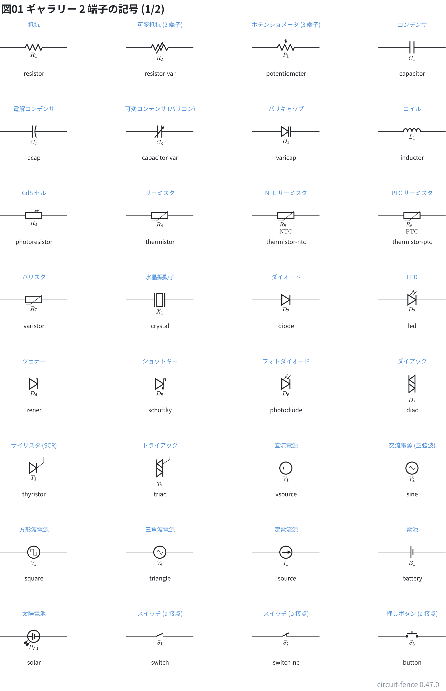
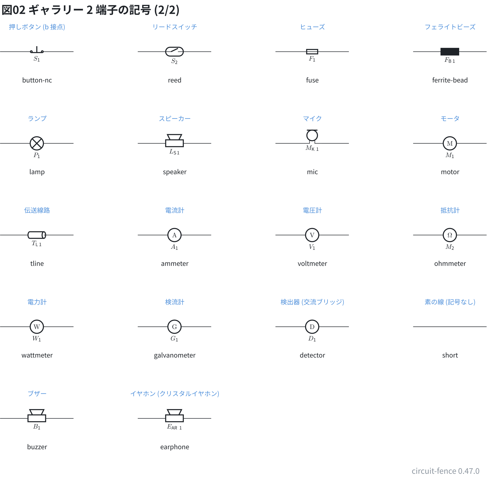
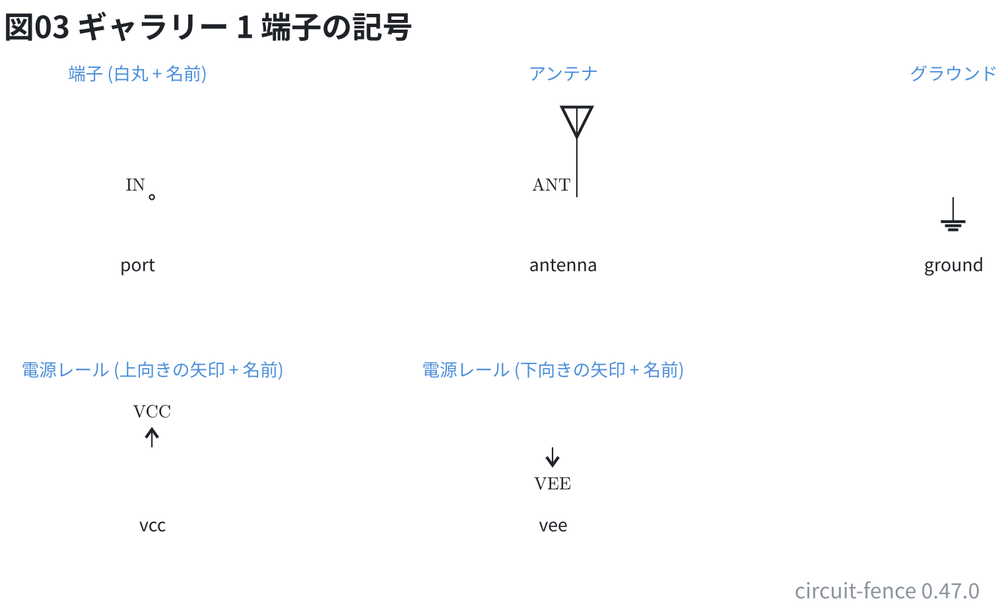
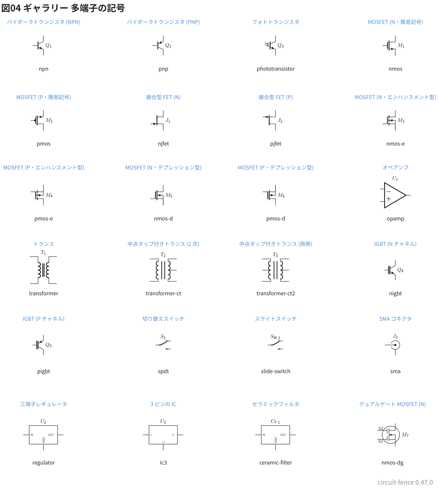
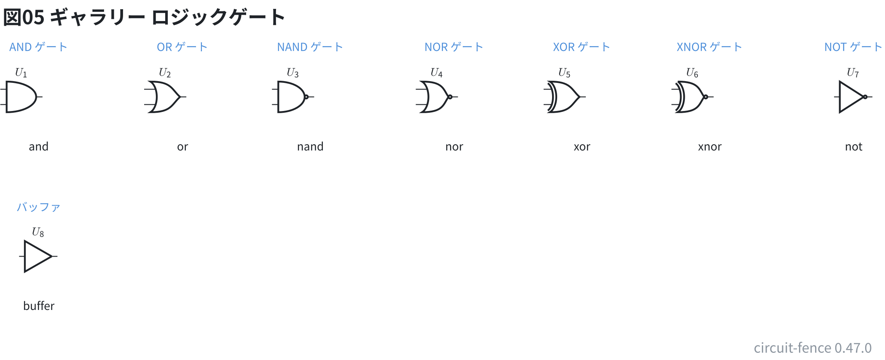
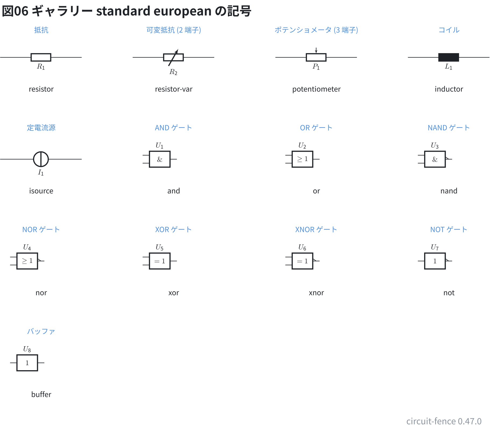
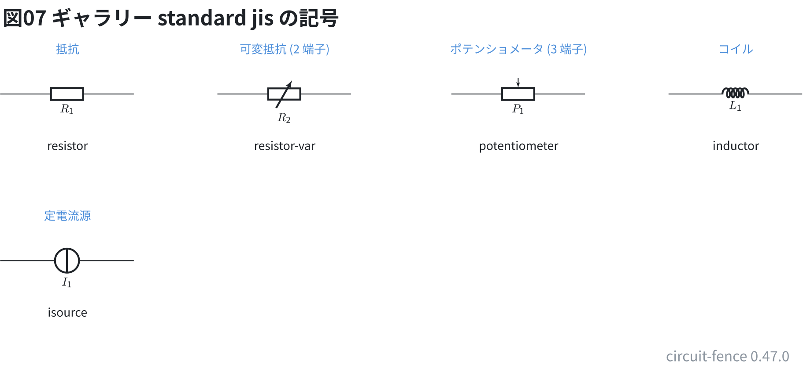

# 部品ギャラリー: 記号

回路図に描ける**記号を種類ごとに 1 つずつ**置いた。配線はしていない。
記号の上の青い字が和名、下の字が `parts:` に書く種類の名前。
ピンの多い箱 (DIP・ヘッダ・コネクタ・ボード) と型番で描く部品は、続きのファイル (20〜23) に置いた。

**このファイルは書き出した物** — 直すときは `src/gallery/gallery.ts` を直して `npm run gallery`。

## 2 端子の部品

`ID: 種類 番地 番地` の 1 行。先に書いた番地 (左) が + 側。

```circuit
# 回路図 (tommie-fence の circuit フェンス)
title: 図01 ギャラリー 2 端子の記号 (1/2)
parts:
  R1: resistor 1.75,2 3.75,2
  R2: resistor-var 5.5,2 7.5,2
  P1: potentiometer 9.25,2 11.25,2
  C1: capacitor 13,2 15,2
  C2: ecap 1.75,4.5 3.75,4.5
  C3: capacitor-var 5.5,4.5 7.5,4.5
  D1: varicap 9.25,4.5 11.25,4.5
  L1: inductor 13,4.5 15,4.5
  R3: photoresistor 1.75,7 3.75,7
  R4: thermistor 5.5,7 7.5,7
  R5: thermistor-ntc 9.25,7 11.25,7
  R6: thermistor-ptc 13,7 15,7
  R7: varistor 1.75,9.5 3.75,9.5
  X1: crystal 5.5,9.5 7.5,9.5
  D2: diode 9.25,9.5 11.25,9.5
  D3: led 13,9.5 15,9.5
  D4: zener 1.75,12 3.75,12
  D5: schottky 5.5,12 7.5,12
  D6: photodiode 9.25,12 11.25,12
  D7: diac 13,12 15,12
  T1: thyristor 1.75,14.5 3.75,14.5
  T2: triac 5.5,14.5 7.5,14.5
  V1: vsource 9.25,14.5 11.25,14.5
  V2: sine 13,14.5 15,14.5
  V3: square 1.75,17 3.75,17
  V4: triangle 5.5,17 7.5,17
  I1: isource 9.25,17 11.25,17
  B1: battery 13,17 15,17
  PV1: solar 1.75,19.5 3.75,19.5
  S1: switch 5.5,19.5 7.5,19.5
  S2: switch-nc 9.25,19.5 11.25,19.5
  S3: button 13,19.5 15,19.5
notes:
  - text 2.75,1.33 small blue center: 抵抗
  - text 2.75,2.78 small center: resistor
  - text 6.5,1.33 small blue center: 可変抵抗 (2 端子)
  - text 6.5,2.78 small center: resistor-var
  - text 10.25,1.33 small blue center: ポテンショメータ (3 端子)
  - text 10.25,2.78 small center: potentiometer
  - text 14,1.33 small blue center: コンデンサ
  - text 14,2.78 small center: capacitor
  - text 2.75,3.83 small blue center: 電解コンデンサ
  - text 2.75,5.28 small center: ecap
  - text 6.5,3.83 small blue center: 可変コンデンサ (バリコン)
  - text 6.5,5.28 small center: capacitor-var
  - text 10.25,3.83 small blue center: バリキャップ
  - text 10.25,5.28 small center: varicap
  - text 14,3.83 small blue center: コイル
  - text 14,5.28 small center: inductor
  - text 2.75,6.33 small blue center: CdS セル
  - text 2.75,7.78 small center: photoresistor
  - text 6.5,6.33 small blue center: サーミスタ
  - text 6.5,7.78 small center: thermistor
  - text 10.25,6.33 small blue center: NTC サーミスタ
  - text 10.25,7.78 small center: thermistor-ntc
  - text 14,6.33 small blue center: PTC サーミスタ
  - text 14,7.78 small center: thermistor-ptc
  - text 2.75,8.83 small blue center: バリスタ
  - text 2.75,10.28 small center: varistor
  - text 6.5,8.83 small blue center: 水晶振動子
  - text 6.5,10.28 small center: crystal
  - text 10.25,8.83 small blue center: ダイオード
  - text 10.25,10.28 small center: diode
  - text 14,8.83 small blue center: LED
  - text 14,10.28 small center: led
  - text 2.75,11.33 small blue center: ツェナー
  - text 2.75,12.78 small center: zener
  - text 6.5,11.33 small blue center: ショットキー
  - text 6.5,12.78 small center: schottky
  - text 10.25,11.33 small blue center: フォトダイオード
  - text 10.25,12.78 small center: photodiode
  - text 14,11.33 small blue center: ダイアック
  - text 14,12.78 small center: diac
  - text 2.75,13.83 small blue center: サイリスタ (SCR)
  - text 2.75,15.28 small center: thyristor
  - text 6.5,13.83 small blue center: トライアック
  - text 6.5,15.28 small center: triac
  - text 10.25,13.83 small blue center: 直流電源
  - text 10.25,15.28 small center: vsource
  - text 14,13.83 small blue center: 交流電源 (正弦波)
  - text 14,15.28 small center: sine
  - text 2.75,16.33 small blue center: 方形波電源
  - text 2.75,17.78 small center: square
  - text 6.5,16.33 small blue center: 三角波電源
  - text 6.5,17.78 small center: triangle
  - text 10.25,16.33 small blue center: 定電流源
  - text 10.25,17.78 small center: isource
  - text 14,16.33 small blue center: 電池
  - text 14,17.78 small center: battery
  - text 2.75,18.83 small blue center: 太陽電池
  - text 2.75,20.28 small center: solar
  - text 6.5,18.83 small blue center: スイッチ (a 接点)
  - text 6.5,20.28 small center: switch
  - text 10.25,18.83 small blue center: スイッチ (b 接点)
  - text 10.25,20.28 small center: switch-nc
  - text 14,18.83 small blue center: 押しボタン (a 接点)
  - text 14,20.28 small center: button
```



```circuit
# 回路図 (tommie-fence の circuit フェンス)
title: 図02 ギャラリー 2 端子の記号 (2/2)
parts:
  S1: button-nc 1.75,2 3.75,2
  S2: reed 5.5,2 7.5,2
  F1: fuse 9.25,2 11.25,2
  FB1: ferrite-bead 13,2 15,2
  P1: lamp 1.75,4.5 3.75,4.5
  LS1: speaker 5.5,4.5 7.5,4.5
  MK1: mic 9.25,4.5 11.25,4.5
  M1: motor 13,4.5 15,4.5
  TL1: tline 1.75,7 3.75,7
  A1: ammeter 5.5,7 7.5,7
  V1: voltmeter 9.25,7 11.25,7
  M2: ohmmeter 13,7 15,7
  W1: wattmeter 1.75,9.5 3.75,9.5
  G1: galvanometer 5.5,9.5 7.5,9.5
  D1: detector 9.25,9.5 11.25,9.5
  SH1: short 13,9.5 15,9.5
  B1: buzzer 1.75,12 3.75,12
  EAR1: earphone 5.5,12 7.5,12
notes:
  - text 2.75,1.33 small blue center: 押しボタン (b 接点)
  - text 2.75,2.78 small center: button-nc
  - text 6.5,1.33 small blue center: リードスイッチ
  - text 6.5,2.78 small center: reed
  - text 10.25,1.33 small blue center: ヒューズ
  - text 10.25,2.78 small center: fuse
  - text 14,1.33 small blue center: フェライトビーズ
  - text 14,2.78 small center: ferrite-bead
  - text 2.75,3.83 small blue center: ランプ
  - text 2.75,5.28 small center: lamp
  - text 6.5,3.83 small blue center: スピーカー
  - text 6.5,5.28 small center: speaker
  - text 10.25,3.83 small blue center: マイク
  - text 10.25,5.28 small center: mic
  - text 14,3.83 small blue center: モータ
  - text 14,5.28 small center: motor
  - text 2.75,6.33 small blue center: 伝送線路
  - text 2.75,7.78 small center: tline
  - text 6.5,6.33 small blue center: 電流計
  - text 6.5,7.78 small center: ammeter
  - text 10.25,6.33 small blue center: 電圧計
  - text 10.25,7.78 small center: voltmeter
  - text 14,6.33 small blue center: 抵抗計
  - text 14,7.78 small center: ohmmeter
  - text 2.75,8.83 small blue center: 電力計
  - text 2.75,10.28 small center: wattmeter
  - text 6.5,8.83 small blue center: 検流計
  - text 6.5,10.28 small center: galvanometer
  - text 10.25,8.83 small blue center: 検出器 (交流ブリッジ)
  - text 10.25,10.28 small center: detector
  - text 14,8.83 small blue center: 素の線 (記号なし)
  - text 14,10.28 small center: short
  - text 2.75,11.33 small blue center: ブザー
  - text 2.75,12.78 small center: buzzer
  - text 6.5,11.33 small blue center: イヤホン (クリスタルイヤホン)
  - text 6.5,12.78 small center: earphone
```



## 1 端子の部品

`ID: 種類 番地`。`port` `antenna` `vcc` `vee` は ID がそのままネットの名前になる。

```circuit
# 回路図 (tommie-fence の circuit フェンス)
title: 図03 ギャラリー 1 端子の記号
parts:
  IN: port 3,2.5
  ANT: antenna 7.25,2.5
  G1: ground 11,2.5
  VCC: vcc 3,5
  VEE: vee 7,5
notes:
  - text 2.85,1.27 small blue center: 端子 (白丸 + 名前)
  - text 2.85,3.18 small center: port
  - text 7.1,1.27 small blue center: アンテナ
  - text 7.1,3.18 small center: antenna
  - text 11,1.27 small blue center: グラウンド
  - text 11,3.18 small center: ground
  - text 3,4.23 small blue center: 電源レール (上向きの矢印 + 名前)
  - text 3,5.78 small center: vcc
  - text 7,4.23 small blue center: 電源レール (下向きの矢印 + 名前)
  - text 7,5.78 small center: vee
```



## トランジスタ・FET・オペアンプ・トランスなど

`ID: 種類 番地` の 1 行。置いた番地が記号の真ん中。

```circuit
# 回路図 (tommie-fence の circuit フェンス)
title: 図04 ギャラリー 多端子の記号
parts:
  Q1: npn 2.75,2
  Q2: pnp 6.75,2
  Q3: phototransistor 10.5,2
  M1: nmos 14.5,2
  M2: pmos 2.75,4.5
  J1: njfet 6.75,4.5
  J2: pjfet 10.5,4.5
  M3: nmos-e 14.5,4.5
  M4: pmos-e 2.75,7
  M5: nmos-d 6.75,7
  M6: pmos-d 10.5,7
  U1: opamp 14.5,7
  T1: transformer 2.75,9.5
  T2: transformer-ct 6.75,9.5
  T3: transformer-ct2 10.5,9.5
  Q4: nigbt 14.5,9.5
  Q5: pigbt 2.75,12
  S1: spdt 6.75,12
  SW1: slide-switch 10.5,12
  J3: sma 14.5,12
  U2: regulator 2.75,15
  U3: ic3 6.75,15
  CF1: ceramic-filter 10.5,15
  M7: nmos-dg 14.5,15
notes:
  - text 2.75,1.22 small blue center: バイポーラトランジスタ (NPN)
  - text 2.75,2.78 small center: npn
  - text 6.75,1.22 small blue center: バイポーラトランジスタ (PNP)
  - text 6.75,2.78 small center: pnp
  - text 10.5,1.22 small blue center: フォトトランジスタ
  - text 10.5,2.78 small center: phototransistor
  - text 14.5,1.22 small blue center: MOSFET (N・簡易記号)
  - text 14.5,2.78 small center: nmos
  - text 2.75,3.73 small blue center: MOSFET (P・簡易記号)
  - text 2.75,5.28 small center: pmos
  - text 6.75,3.73 small blue center: 接合型 FET (N)
  - text 6.75,5.28 small center: njfet
  - text 10.5,3.73 small blue center: 接合型 FET (P)
  - text 10.5,5.28 small center: pjfet
  - text 14.5,3.73 small blue center: MOSFET (N・エンハンスメント型)
  - text 14.5,5.28 small center: nmos-e
  - text 2.75,6.08 small blue center: MOSFET (P・エンハンスメント型)
  - text 2.75,7.78 small center: pmos-e
  - text 6.75,6.08 small blue center: MOSFET (N・デプレッション型)
  - text 6.75,7.78 small center: nmos-d
  - text 10.5,6.08 small blue center: MOSFET (P・デプレッション型)
  - text 10.5,7.78 small center: pmos-d
  - text 14.5,6.08 small blue center: オペアンプ
  - text 14.5,7.78 small center: opamp
  - text 2.75,8.63 small blue center: トランス
  - text 2.75,10.28 small center: transformer
  - text 6.75,8.63 small blue center: 中点タップ付きトランス (2 次)
  - text 6.75,10.28 small center: transformer-ct
  - text 10.5,8.63 small blue center: 中点タップ付きトランス (両側)
  - text 10.5,10.28 small center: transformer-ct2
  - text 14.5,8.63 small blue center: IGBT (N チャネル)
  - text 14.5,10.28 small center: nigbt
  - text 2.75,11.13 small blue center: IGBT (P チャネル)
  - text 2.75,12.88 small center: pigbt
  - text 6.75,11.13 small blue center: 切り替えスイッチ
  - text 6.75,12.88 small center: spdt
  - text 10.5,11.13 small blue center: スライドスイッチ
  - text 10.5,12.88 small center: slide-switch
  - text 14.5,11.13 small blue center: SMA コネクタ
  - text 14.5,12.88 small center: sma
  - text 2.75,13.98 small blue center: 三端子レギュレータ
  - text 2.75,15.93 small center: regulator
  - text 6.75,13.98 small blue center: 3 ピンの IC
  - text 6.75,15.93 small center: ic3
  - text 10.5,13.98 small blue center: セラミックフィルタ
  - text 10.5,15.93 small center: ceramic-filter
  - text 14.4,13.98 small blue center: デュアルゲート MOSFET (N)
  - text 14.4,15.93 small center: nmos-dg
```



## ロジックゲート

`style:` を書かないときの形 (`american`、MIL 記号)。

```circuit
# 回路図 (tommie-fence の circuit フェンス)
title: 図05 ギャラリー ロジックゲート
parts:
  U1: and 1.75,2
  U2: or 4,2
  U3: nand 6,2
  U4: nor 8.25,2
  U5: xor 10.25,2
  U6: xnor 12.25,2
  U7: not 14.5,2
  U8: buffer 1.75,4.5
notes:
  - text 1.75,1.22 small blue center: AND ゲート
  - text 1.75,2.78 small center: and
  - text 4,1.22 small blue center: OR ゲート
  - text 4,2.78 small center: or
  - text 6,1.22 small blue center: NAND ゲート
  - text 6,2.78 small center: nand
  - text 8.25,1.22 small blue center: NOR ゲート
  - text 8.25,2.78 small center: nor
  - text 10.25,1.22 small blue center: XOR ゲート
  - text 10.25,2.78 small center: xor
  - text 12.25,1.22 small blue center: XNOR ゲート
  - text 12.25,2.78 small center: xnor
  - text 14.5,1.22 small blue center: NOT ゲート
  - text 14.5,2.78 small center: not
  - text 1.75,3.73 small blue center: バッファ
  - text 1.75,5.28 small center: buffer
```



## 流儀 `standard: european`

`style: standard: european` で形の変わる記号。種類は同じで、描き方だけが変わる。

```circuit
# 回路図 (tommie-fence の circuit フェンス)
title: 図06 ギャラリー standard european の記号
parts:
  R1: resistor 1.5,2 3.5,2
  R2: resistor-var 4.75,2 6.75,2
  P1: potentiometer 8.25,2 10.25,2
  L1: inductor 11.5,2 13.5,2
  I1: isource 1.5,4.5 3.5,4.5
  U1: and 5.75,4.5
  U2: or 9.25,4.5
  U3: nand 12.5,4.5
  U4: nor 2.5,7
  U5: xor 5.75,7
  U6: xnor 9.25,7
  U7: not 12.5,7
  U8: buffer 2.5,9.5
notes:
  - text 2.5,1.33 small blue center: 抵抗
  - text 2.5,2.78 small center: resistor
  - text 5.75,1.33 small blue center: 可変抵抗 (2 端子)
  - text 5.75,2.78 small center: resistor-var
  - text 9.25,1.33 small blue center: ポテンショメータ (3 端子)
  - text 9.25,2.78 small center: potentiometer
  - text 12.5,1.33 small blue center: コイル
  - text 12.5,2.78 small center: inductor
  - text 2.5,3.73 small blue center: 定電流源
  - text 2.5,5.28 small center: isource
  - text 5.75,3.73 small blue center: AND ゲート
  - text 5.75,5.28 small center: and
  - text 9.25,3.73 small blue center: OR ゲート
  - text 9.25,5.28 small center: or
  - text 12.5,3.73 small blue center: NAND ゲート
  - text 12.5,5.28 small center: nand
  - text 2.5,6.23 small blue center: NOR ゲート
  - text 2.5,7.78 small center: nor
  - text 5.75,6.23 small blue center: XOR ゲート
  - text 5.75,7.78 small center: xor
  - text 9.25,6.23 small blue center: XNOR ゲート
  - text 9.25,7.78 small center: xnor
  - text 12.5,6.23 small blue center: NOT ゲート
  - text 12.5,7.78 small center: not
  - text 2.5,8.73 small blue center: バッファ
  - text 2.5,10.28 small center: buffer
style:
  standard: european
```



## 流儀 `standard: jis`

`style: standard: jis` で形の変わる記号。種類は同じで、描き方だけが変わる。

```circuit
# 回路図 (tommie-fence の circuit フェンス)
title: 図07 ギャラリー standard jis の記号
parts:
  R1: resistor 1.5,2 3.5,2
  R2: resistor-var 4.75,2 6.75,2
  P1: potentiometer 8.25,2 10.25,2
  L1: inductor 11.5,2 13.5,2
  I1: isource 1.5,4.5 3.5,4.5
notes:
  - text 2.5,1.33 small blue center: 抵抗
  - text 2.5,2.78 small center: resistor
  - text 5.75,1.33 small blue center: 可変抵抗 (2 端子)
  - text 5.75,2.78 small center: resistor-var
  - text 9.25,1.33 small blue center: ポテンショメータ (3 端子)
  - text 9.25,2.78 small center: potentiometer
  - text 12.5,1.33 small blue center: コイル
  - text 12.5,2.78 small center: inductor
  - text 2.5,3.83 small blue center: 定電流源
  - text 2.5,5.28 small center: isource
style:
  standard: jis
```


