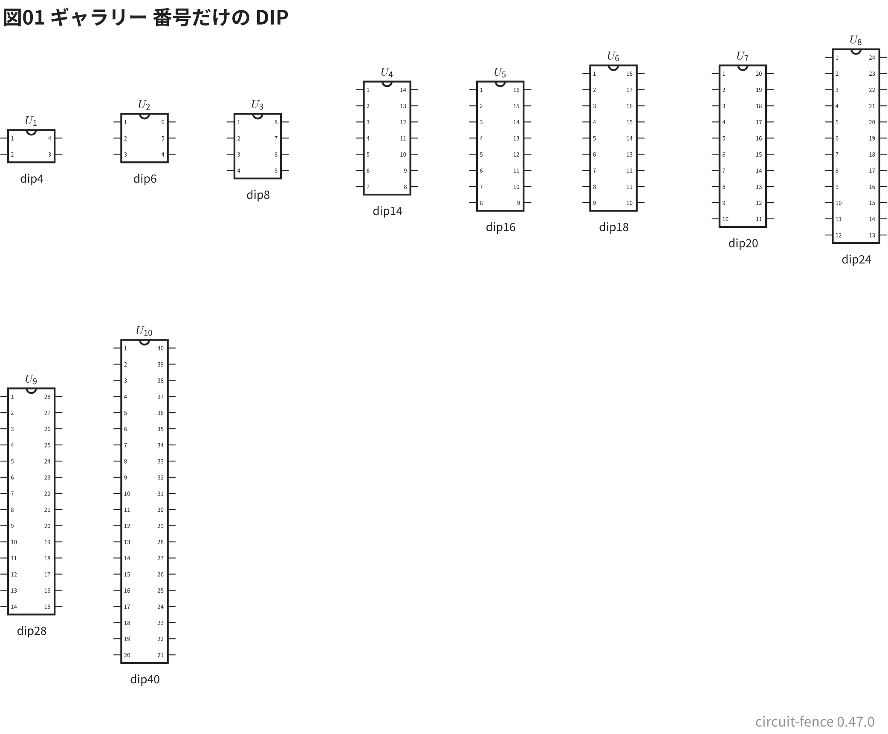
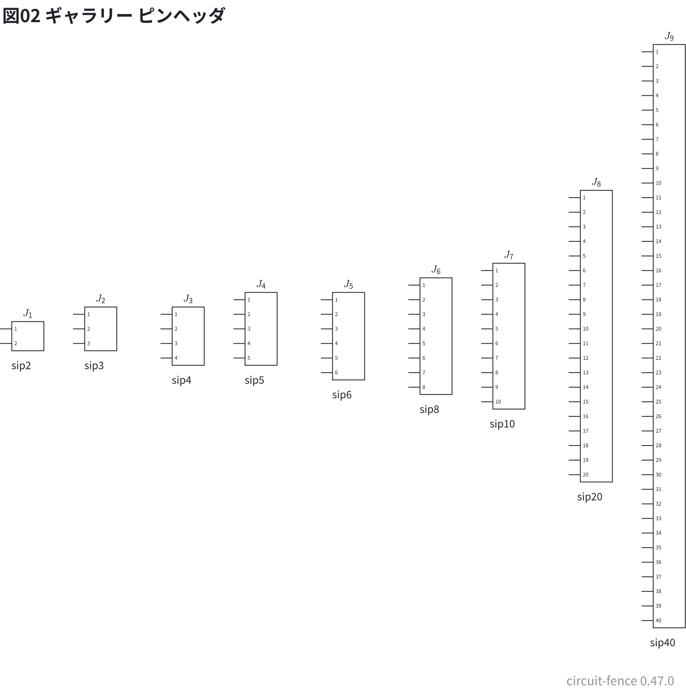
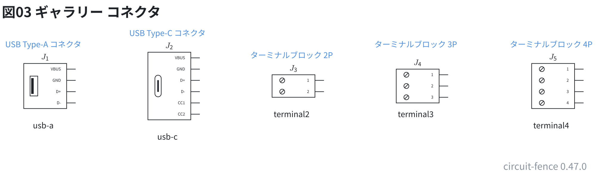
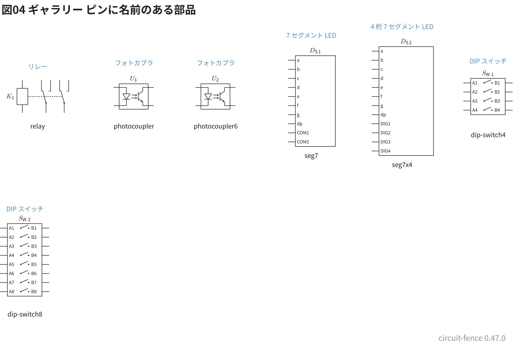
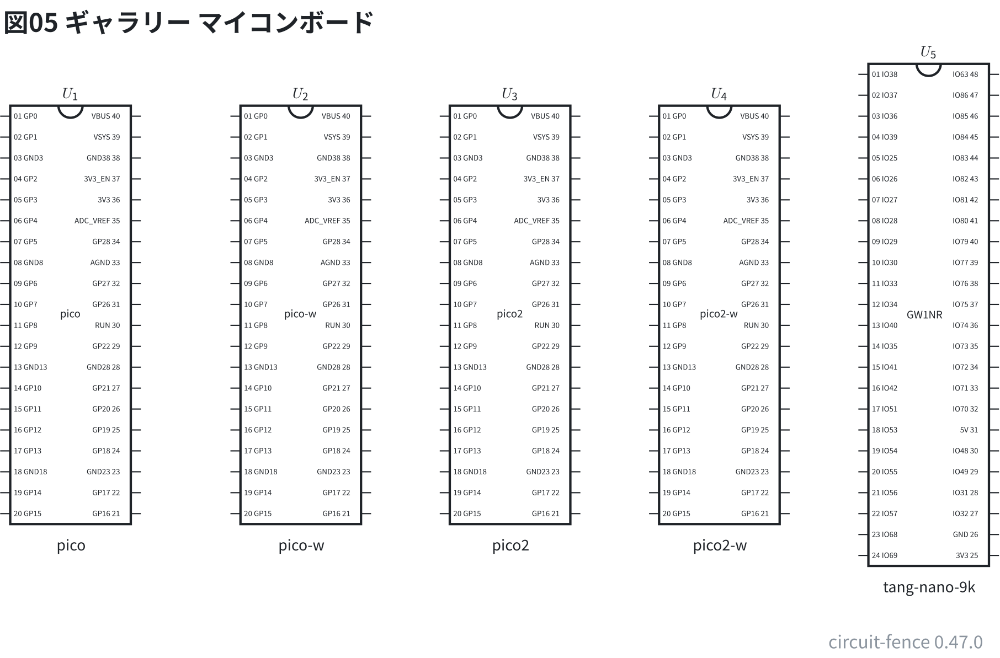

# 部品ギャラリー: ピンの多い箱 (DIP・ヘッダ・コネクタ・ボード)

箱にピンが並ぶ記号を種類ごとに 1 つずつ置いた。配線はしていない。
DIP とピンヘッダは型番を書かない形 (ピンは番号)。型番を書いた DIP は [21-gallery-chips.md](21-gallery-chips.md)。

**このファイルは書き出した物** — 直すときは `src/gallery/gallery.ts` を直して `npm run gallery`。

## DIP の IC

`dip4`〜`dip40`。ピンは `U1.1` 〜 の番号で呼ぶ。

```circuit
# 回路図 (tommie-fence の circuit フェンス)
title: 図01 ギャラリー 番号だけの DIP
parts:
  U1: dip4 1.75,3
  U2: dip6 3.5,3
  U3: dip8 5.25,3
  U4: dip14 7.25,3
  U5: dip16 9,3
  U6: dip18 10.75,3
  U7: dip20 12.75,3
  U8: dip24 14.5,3
  U9: dip28 1.75,8.5
  U10: dip40 3.5,8.5
notes:
  - text 1.75,3.63 small center: dip4
  - text 3.5,3.63 small center: dip6
  - text 5.25,3.88 small center: dip8
  - text 7.25,4.13 small center: dip14
  - text 9,4.38 small center: dip16
  - text 10.75,4.38 small center: dip18
  - text 12.75,4.63 small center: dip20
  - text 14.5,4.88 small center: dip24
  - text 1.75,10.63 small center: dip28
  - text 3.5,11.38 small center: dip40
```



## ピンヘッダ

`sip2`〜`sip40`。ピンは番号で呼ぶ。

```circuit
# 回路図 (tommie-fence の circuit フェンス)
title: 図02 ギャラリー ピンヘッダ
parts:
  J1: sip2 1.75,6.5
  J2: sip3 3,6.5
  J3: sip4 4.5,6.5
  J4: sip5 5.75,6.5
  J5: sip6 7.25,6.5
  J6: sip8 8.75,6.5
  J7: sip10 10,6.5
  J8: sip20 11.5,6.5
  J9: sip40 12.75,6.5
notes:
  - text 1.63,7.13 small center: sip2
  - text 2.88,7.13 small center: sip3
  - text 4.38,7.38 small center: sip4
  - text 5.63,7.38 small center: sip5
  - text 7.13,7.63 small center: sip6
  - text 8.63,7.88 small center: sip8
  - text 9.88,8.13 small center: sip10
  - text 11.38,9.38 small center: sip20
  - text 12.63,11.88 small center: sip40
```



## コネクタ

USB とターミナルブロック。ピンは名前でも番号でも呼べる。

```circuit
# 回路図 (tommie-fence の circuit フェンス)
title: 図03 ギャラリー コネクタ
parts:
  J1: usb-a 2.25,2.5
  J2: usb-c 5,2.5
  J3: terminal2 7.75,2.5
  J4: terminal3 10.5,2.5
  J5: terminal4 13.5,2.5
notes:
  - text 2.2,1.58 small blue center: USB Type-A コネクタ
  - text 2.2,3.38 small center: usb-a
  - text 4.95,1.33 small blue center: USB Type-C コネクタ
  - text 4.95,3.63 small center: usb-c
  - text 7.7,1.82 small blue center: ターミナルブロック 2P
  - text 7.7,3.13 small center: terminal2
  - text 10.45,1.58 small blue center: ターミナルブロック 3P
  - text 10.45,3.13 small center: terminal3
  - text 13.45,1.58 small blue center: ターミナルブロック 4P
  - text 13.45,3.38 small center: terminal4
```



## ピンに名前のある部品

リレー・フォトカプラ・7 セグ・DIP スイッチ。ピンは名前でも実物の番号でも呼べる。

```circuit
# 回路図 (tommie-fence の circuit フェンス)
title: 図04 ギャラリー ピンに名前のある部品
parts:
  K1: relay 2.25,3.5
  U1: photocoupler 4.75,3.5
  U2: photocoupler6 7,3.5
  DS1: seg7 9.75,3.5
  DS2: seg7x4 12.25,3.5
  SW1: dip-switch4 14.5,3.5
  SW2: dip-switch8 1.75,8
notes:
  - text 2.1,2.68 small blue center: リレー
  - text 2.1,4.32 small center: relay
  - text 4.75,2.58 small blue center: フォトカプラ
  - text 4.75,4.32 small center: photocoupler
  - text 7,2.58 small blue center: フォトカプラ
  - text 7,4.32 small center: photocoupler6
  - text 9.63,1.82 small blue center: 7 セグメント LED
  - text 9.63,5.13 small center: seg7
  - text 12.13,1.58 small blue center: 4 桁 7 セグメント LED
  - text 12.13,5.38 small center: seg7x4
  - text 14.5,2.53 small blue center: DIP スイッチ
  - text 14.5,4.56 small center: dip-switch4
  - text 1.75,6.6 small blue center: DIP スイッチ
  - text 1.75,9.5 small center: dip-switch8
```



## マイコンボード

ピンは実物の印字で呼ぶ (`U1.GP0`)。図には番号も出る。

```circuit
# 回路図 (tommie-fence の circuit フェンス)
title: 図05 ギャラリー マイコンボード
parts:
  U1: pico 2,4.5
  U2: pico-w 4.75,4.5
  U3: pico2 7.25,4.5
  U4: pico2-w 9.75,4.5
  U5: tang-nano-9k 12.25,4.5
notes:
  - text 2,7.38 small center: pico
  - text 4.75,7.38 small center: pico-w
  - text 7.25,7.38 small center: pico2
  - text 9.75,7.38 small center: pico2-w
  - text 12.25,7.88 small center: tang-nano-9k
```


