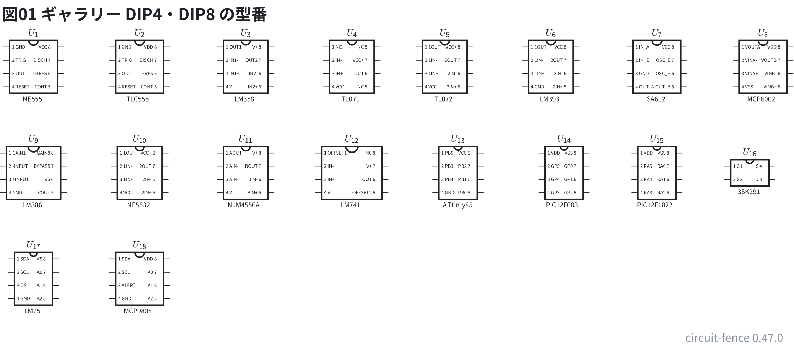
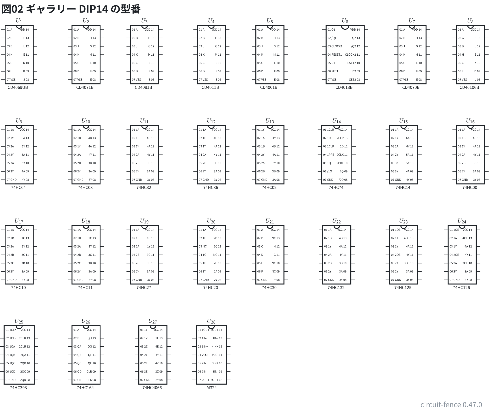
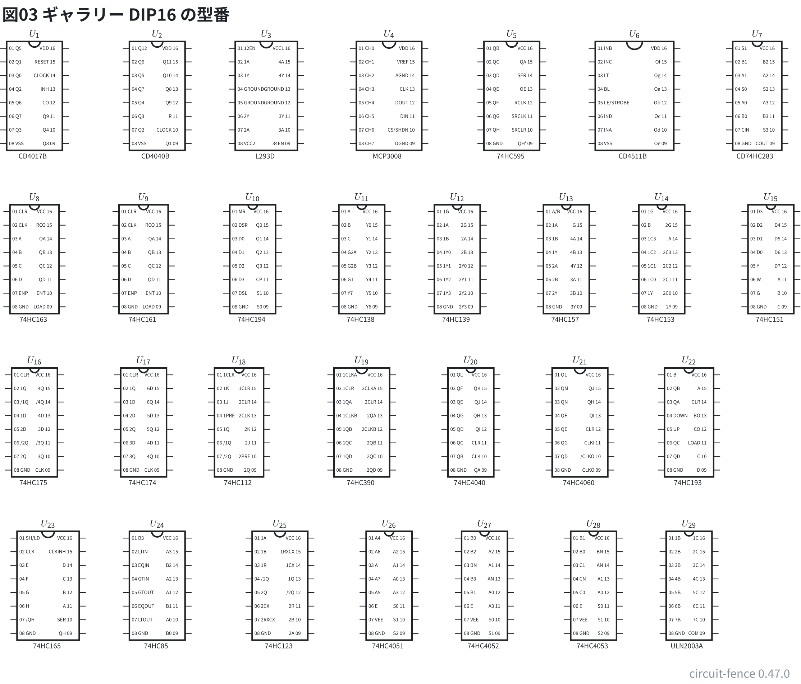
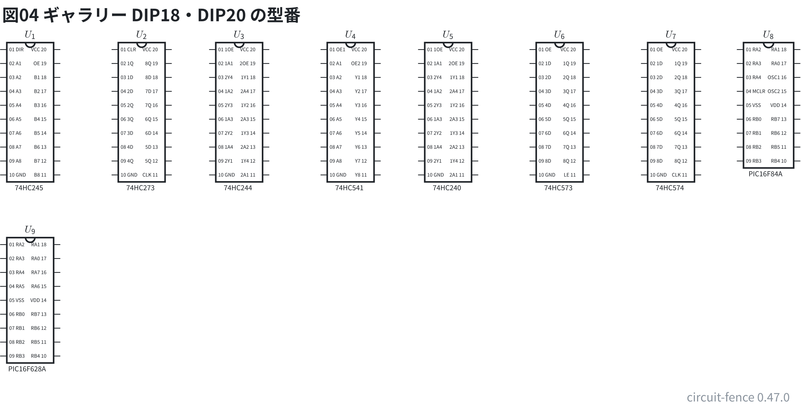
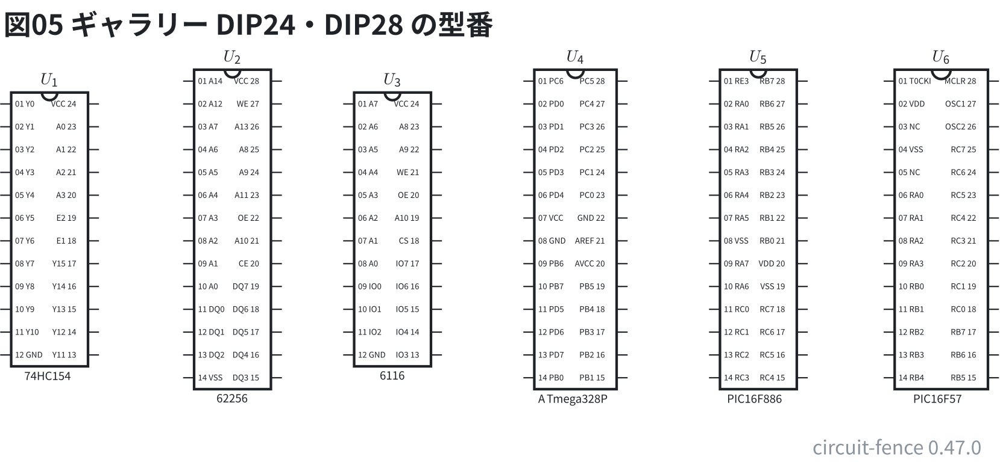

# 部品ギャラリー: 型番のある DIP

[早見表](../docs/02-cheatsheet.md) の「DIP のピンの名前の表」の**型番を全部**、`dipN` に書いて置いた。
型番を書くと、箱の中にピンの名前と番号が出る。配線はしていない。
1 列のヘッダや外形を持つ型番 (センサ・モジュール・フィルタなど) は [23-gallery-modules.md](23-gallery-modules.md) に機器の箱で置いた。

**このファイルは書き出した物** — 直すときは `src/gallery/gallery.ts` を直して `npm run gallery`。

## DIP4・DIP8

表にある 4・8 ピンの型番 (`dip4` `dip8`)。

```circuit
# 回路図 (tommie-fence の circuit フェンス)
title: 図01 ギャラリー DIP4・DIP8 の型番
parts:
  U1: dip8 1.75,2 NE555
  U2: dip8 3.75,2 TLC555
  U3: dip8 5.75,2 LM358
  U4: dip8 7.75,2 TL071
  U5: dip8 9.5,2 TL072
  U6: dip8 11.5,2 LM393
  U7: dip8 13.5,2 SA612
  U8: dip8 15.5,2 MCP6002
  U9: dip8 1.75,4 LM386
  U10: dip8 3.75,4 NE5532
  U11: dip8 5.75,4 NJM4556A
  U12: dip8 7.75,4 LM741
  U13: dip8 9.75,4 ATtiny85
  U14: dip8 11.75,4 PIC12F683
  U15: dip8 13.5,4 PIC12F1822
  U16: dip4 15.25,4 3SK291
  U17: dip8 1.75,6 LM75
  U18: dip8 3.75,6 MCP9808
```



## DIP14

表にある 14 ピンの型番 (`dip14`)。

```circuit
# 回路図 (tommie-fence の circuit フェンス)
title: 図02 ギャラリー DIP14 の型番
parts:
  U1: dip14 1.75,2.5 CD4069UB
  U2: dip14 3.75,2.5 CD4071B
  U3: dip14 5.5,2.5 CD4081B
  U4: dip14 7.5,2.5 CD4011B
  U5: dip14 9.25,2.5 CD4001B
  U6: dip14 11.5,2.5 CD4013B
  U7: dip14 13.5,2.5 CD4070B
  U8: dip14 15.25,2.5 CD40106B
  U9: dip14 1.75,5.5 74HC04
  U10: dip14 3.75,5.5 74HC08
  U11: dip14 5.5,5.5 74HC32
  U12: dip14 7.5,5.5 74HC86
  U13: dip14 9.25,5.5 74HC02
  U14: dip14 11.25,5.5 74HC74
  U15: dip14 13.25,5.5 74HC14
  U16: dip14 15.25,5.5 74HC00
  U17: dip14 1.75,8.5 74HC10
  U18: dip14 3.75,8.5 74HC11
  U19: dip14 5.5,8.5 74HC27
  U20: dip14 7.5,8.5 74HC20
  U21: dip14 9.25,8.5 74HC30
  U22: dip14 11.25,8.5 74HC132
  U23: dip14 13.25,8.5 74HC125
  U24: dip14 15,8.5 74HC126
  U25: dip14 1.75,11.5 74HC393
  U26: dip14 3.75,11.5 74HC164
  U27: dip14 5.75,11.5 74HC4066
  U28: dip14 7.5,11.5 LM324
```



## DIP16

表にある 16 ピンの型番 (`dip16`)。

```circuit
# 回路図 (tommie-fence の circuit フェンス)
title: 図03 ギャラリー DIP16 の型番
parts:
  U1: dip16 1.75,2.5 CD4017B
  U2: dip16 4,2.5 CD4040B
  U3: dip16 6,2.5 L293D
  U4: dip16 8.25,2.5 MCP3008
  U5: dip16 10.5,2.5 74HC595
  U6: dip16 12.75,2.5 CD4511B
  U7: dip16 15,2.5 CD74HC283
  U8: dip16 1.75,5.5 74HC163
  U9: dip16 3.75,5.5 74HC161
  U10: dip16 5.75,5.5 74HC194
  U11: dip16 7.75,5.5 74HC138
  U12: dip16 9.5,5.5 74HC139
  U13: dip16 11.5,5.5 74HC157
  U14: dip16 13.25,5.5 74HC153
  U15: dip16 15.25,5.5 74HC151
  U16: dip16 1.75,8.5 74HC175
  U17: dip16 3.75,8.5 74HC174
  U18: dip16 5.5,8.5 74HC112
  U19: dip16 7.75,8.5 74HC390
  U20: dip16 9.75,8.5 74HC4040
  U21: dip16 11.75,8.5 74HC4060
  U22: dip16 13.75,8.5 74HC193
  U23: dip16 2,11.5 74HC165
  U24: dip16 4,11.5 74HC85
  U25: dip16 6.25,11.5 74HC123
  U26: dip16 8.25,11.5 74HC4051
  U27: dip16 10,11.5 74HC4052
  U28: dip16 12,11.5 74HC4053
  U29: dip16 13.75,11.5 ULN2003A
```



## DIP18・DIP20

表にある 18・20 ピンの型番 (`dip18` `dip20`)。

```circuit
# 回路図 (tommie-fence の circuit フェンス)
title: 図04 ギャラリー DIP18・DIP20 の型番
parts:
  U1: dip20 1.75,2.5 74HC245
  U2: dip20 3.75,2.5 74HC273
  U3: dip20 5.5,2.5 74HC244
  U4: dip20 7.5,2.5 74HC541
  U5: dip20 9.25,2.5 74HC240
  U6: dip20 11.25,2.5 74HC573
  U7: dip20 13.25,2.5 74HC574
  U8: dip18 15,2.5 PIC16F84A
  U9: dip18 1.75,6 PIC16F628A
```



## DIP24・DIP28

表にある 24・28 ピンの型番 (`dip24` `dip28`)。

```circuit
# 回路図 (tommie-fence の circuit フェンス)
title: 図05 ギャラリー DIP24・DIP28 の型番
parts:
  U1: dip24 1.75,3 74HC154
  U2: dip28 3.75,3 62256
  U3: dip24 5.5,3 6116
  U4: dip28 7.5,3 ATmega328P
  U5: dip28 9.5,3 PIC16F886
  U6: dip28 11.5,3 PIC16F57
```


