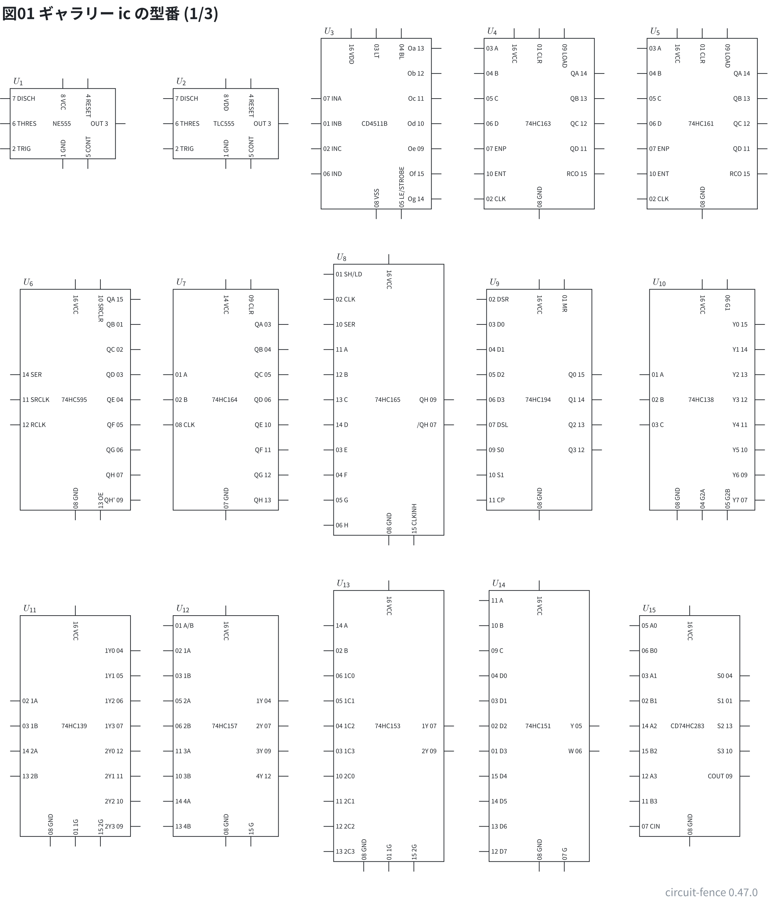
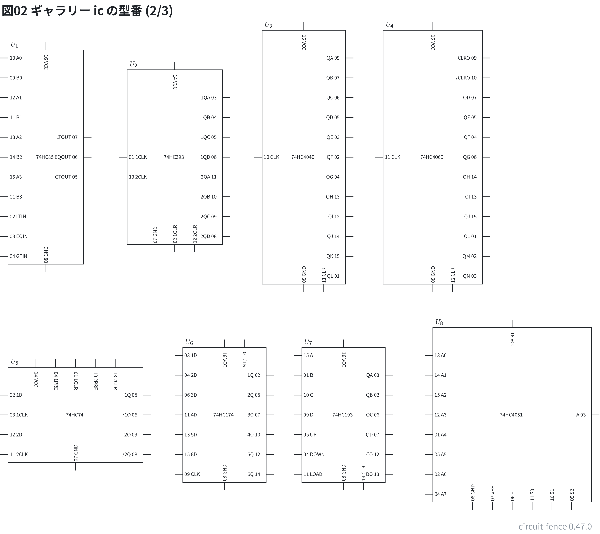
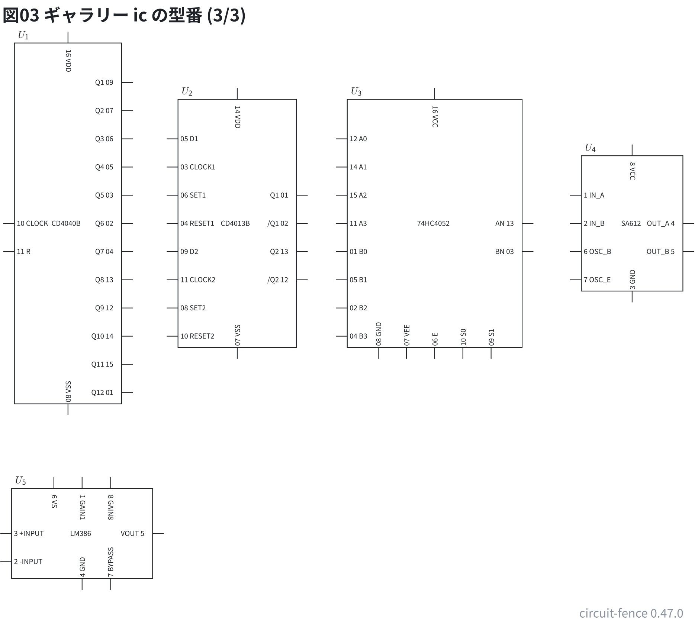
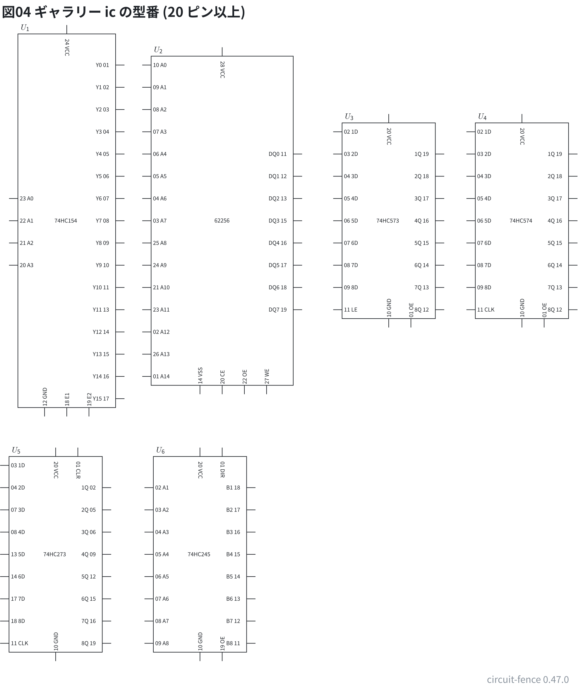

# 部品ギャラリー: 働きで並べた IC (`ic`)

`ic` で描ける**型番を全部**置いた (`U1: ic 番地 型番`)。電源が上・GND が下・入力が左・出力が右。
同じ型番を DIP の並びで描いた図は [21-gallery-chips.md](21-gallery-chips.md)。配線はしていない。

**このファイルは書き出した物** — 直すときは `src/gallery/gallery.ts` を直して `npm run gallery`。

## 16 ピンまで

8〜16 ピンの型番。

```circuit
# 回路図 (tommie-fence の circuit フェンス)
title: 図01 ギャラリー ic の型番 (1/3)
parts:
  U1: ic 2.25,3.5 NE555
  U2: ic 5.5,3.5 TLC555
  U3: ic 8.5,3.5 CD4511B
  U4: ic 11.75,3.5 74HC163
  U5: ic 15,3.5 74HC161
  U6: ic 2.5,9 74HC595
  U7: ic 5.5,9 74HC164
  U8: ic 8.75,9 74HC165
  U9: ic 11.75,9 74HC194
  U10: ic 15,9 74HC138
  U11: ic 2.5,15.5 74HC139
  U12: ic 5.5,15.5 74HC157
  U13: ic 8.75,15.5 74HC153
  U14: ic 11.75,15.5 74HC151
  U15: ic 14.75,15.5 CD74HC283
```



```circuit
# 回路図 (tommie-fence の circuit フェンス)
title: 図02 ギャラリー ic の型番 (2/3)
parts:
  U1: ic 2.25,5 74HC85
  U2: ic 5.5,5 74HC393
  U3: ic 8.75,5 74HC4040
  U4: ic 12,5 74HC4060
  U5: ic 3,11.5 74HC74
  U6: ic 6.75,11.5 74HC174
  U7: ic 9.75,11.5 74HC193
  U8: ic 14,11.5 74HC4051
```



```circuit
# 回路図 (tommie-fence の circuit フェンス)
title: 図03 ギャラリー ic の型番 (3/3)
parts:
  U1: ic 2.25,5 CD4040B
  U2: ic 5.25,5 CD4013B
  U3: ic 8.75,5 74HC4052
  U4: ic 12.25,5 SA612
  U5: ic 2.5,10.5 LM386
```



## 20 ピン以上

20〜28 ピンの型番。

```circuit
# 回路図 (tommie-fence の circuit フェンス)
title: 図04 ギャラリー ic の型番 (20 ピン以上)
parts:
  U1: ic 2.5,6 74HC154
  U2: ic 6,6 62256
  U3: ic 9.75,6 74HC573
  U4: ic 12.75,6 74HC574
  U5: ic 2.25,13.5 74HC273
  U6: ic 5.5,13.5 74HC245
```


