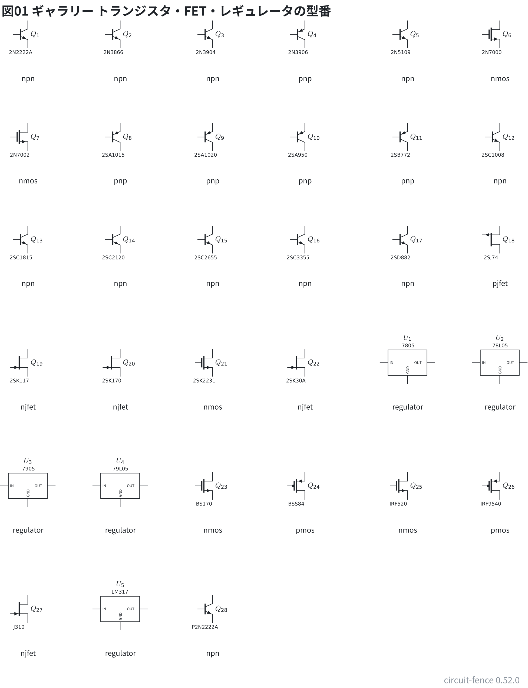
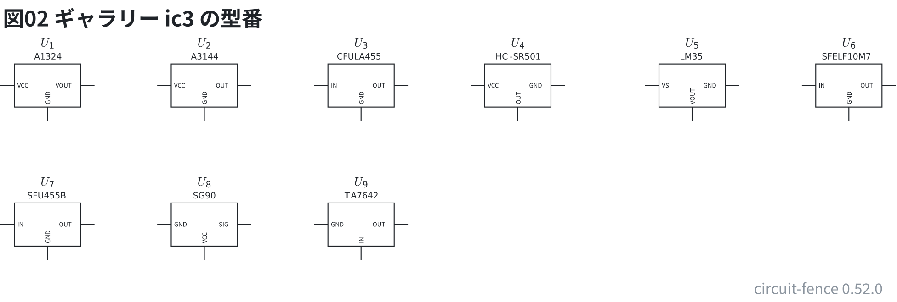
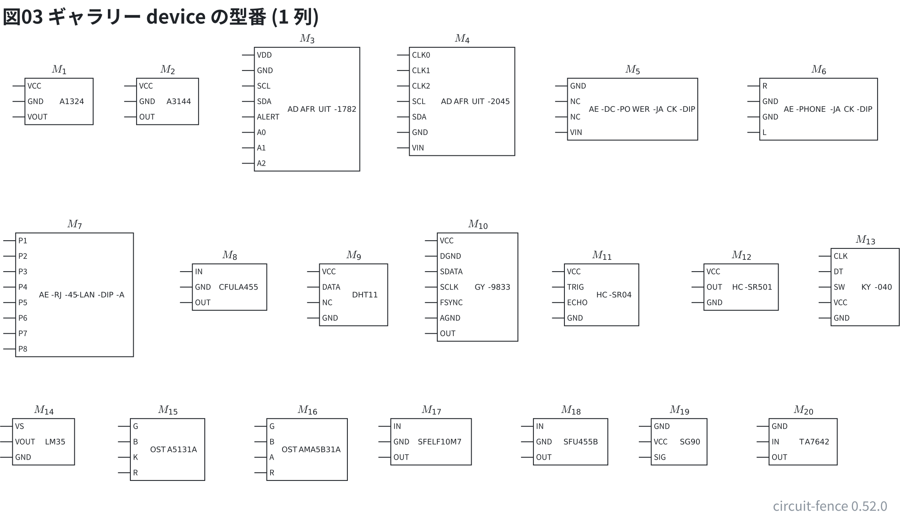
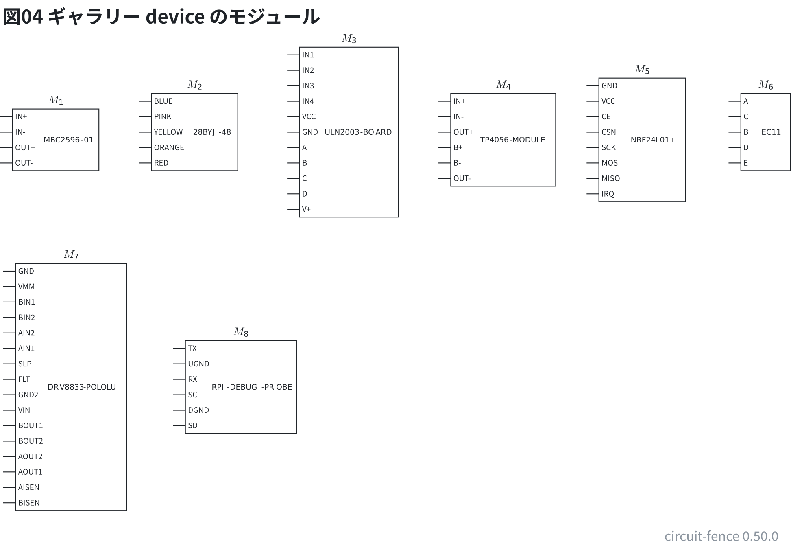

# 部品ギャラリー: 型番のあるトランジスタ・レギュレータ・機器

型番の表のうち、DIP の箱で描かない物を**全部**置いた。配線はしていない。

- 3 ピンのトランジスタ・FET・レギュレータは記号に型番を添えた (`Q1: npn 番地 2SC1815`)
- 3 ピンの IC は `type: ic3` + `model:` (ピンの名前が表から出る)
- 1 列のヘッダの型番とモジュールは `type: device` + `model:`

**このファイルは書き出した物** — 直すときは `src/gallery/gallery.ts` を直して `npm run gallery`。

## トランジスタ・FET・レギュレータの型番

早見表の「3 ピンのトランジスタ・FET・レギュレータ」の表の型番。下の字は記号の種類。

```circuit
# 回路図 (tommie-fence の circuit フェンス)
title: 図01 ギャラリー トランジスタ・FET・レギュレータの型番
parts:
  Q1: npn 2,2 2N2222A
  Q2: npn 4.25,2 2N3866
  Q3: npn 6.5,2 2N3904
  Q4: pnp 8.75,2 2N3906
  Q5: npn 11.25,2 2N5109
  Q6: nmos 13.5,2 2N7000
  Q7: nmos 2,4.5 2N7002
  Q8: pnp 4.25,4.5 2SA1015
  Q9: pnp 6.5,4.5 2SA1020
  Q10: pnp 8.75,4.5 2SA950
  Q11: pnp 11.25,4.5 2SB772
  Q12: npn 13.5,4.5 2SC1008
  Q13: npn 2,7 2SC1815
  Q14: npn 4.25,7 2SC2120
  Q15: npn 6.5,7 2SC2655
  Q16: npn 8.75,7 2SC3355
  Q17: npn 11.25,7 2SD882
  Q18: pjfet 13.5,7 2SJ74
  Q19: njfet 2,10 2SK117
  Q20: njfet 4.25,10 2SK170
  Q21: nmos 6.5,10 2SK2231
  Q22: njfet 8.75,10 2SK30A
  U1: regulator 11.25,10 7805
  U2: regulator 13.5,10 78L05
  U3: regulator 2,13 7905
  U4: regulator 4.25,13 79L05
  Q23: nmos 6.5,13 BS170
  Q24: pmos 8.75,13 BSS84
  Q25: nmos 11.25,13 IRF520
  Q26: pmos 13.5,13 IRF9540
  Q27: njfet 2,16 J310
  U5: regulator 4.25,16 LM317
  Q28: npn 6.5,16 P2N2222A
notes:
  - text 2,3.08 small center: npn
  - text 4.25,3.08 small center: npn
  - text 6.5,3.08 small center: npn
  - text 8.75,3.08 small center: pnp
  - text 11.25,3.08 small center: npn
  - text 13.5,3.08 small center: nmos
  - text 2,5.57 small center: nmos
  - text 4.25,5.57 small center: pnp
  - text 6.5,5.57 small center: pnp
  - text 8.75,5.57 small center: pnp
  - text 11.25,5.57 small center: pnp
  - text 13.5,5.57 small center: npn
  - text 2,8.07 small center: npn
  - text 4.25,8.07 small center: npn
  - text 6.5,8.07 small center: npn
  - text 8.75,8.07 small center: npn
  - text 11.25,8.07 small center: npn
  - text 13.5,8.07 small center: pjfet
  - text 2,11.08 small center: njfet
  - text 4.25,11.08 small center: njfet
  - text 6.5,11.08 small center: nmos
  - text 8.75,11.08 small center: njfet
  - text 11.25,11.08 small center: regulator
  - text 13.5,11.08 small center: regulator
  - text 2,14.08 small center: regulator
  - text 4.25,14.08 small center: regulator
  - text 6.5,14.08 small center: nmos
  - text 8.75,14.08 small center: pmos
  - text 11.25,14.08 small center: nmos
  - text 13.5,14.08 small center: pmos
  - text 2,17.08 small center: njfet
  - text 4.25,17.08 small center: regulator
  - text 6.5,17.08 small center: npn
```



## 3 ピンの IC (`ic3`)

ピンの名前の表にある 3 ピンの型番。箱は三端子レギュレータと同じ (1 = 左、2 = 下、3 = 右)。

```circuit
# 回路図 (tommie-fence の circuit フェンス)
title: 図02 ギャラリー ic3 の型番
parts:
  U1:
      type: ic3
      at: 2,2
      model: A1324
  U2:
      type: ic3
      at: 4.25,2
      model: A3144
  U3:
      type: ic3
      at: 6.5,2
      model: CFULA455
  U4:
      type: ic3
      at: 8.75,2
      model: HC-SR501
  U5:
      type: ic3
      at: 11.25,2
      model: LM35
  U6:
      type: ic3
      at: 13.5,2
      model: SFELF10M7
  U7:
      type: ic3
      at: 2,4
      model: SFU455B
  U8:
      type: ic3
      at: 4.25,4
      model: SG90
  U9:
      type: ic3
      at: 6.5,4
      model: TA7642
```



## 1 列の型番 (`device`)

ピンの名前の表のうち、センサ・モジュール・フィルタ・DIP 化キットなど 1 列で描く型番。

```circuit
# 回路図 (tommie-fence の circuit フェンス)
title: 図03 ギャラリー device の型番 (1 列)
parts:
  M1:
      type: device
      at: 2,2.5
      model: A1324
  M2:
      type: device
      at: 3.75,2.5
      model: A3144
  M3:
      type: device
      at: 6,2.5
      model: ADAFRUIT-1782
  M4:
      type: device
      at: 8.5,2.5
      model: ADAFRUIT-2045
  M5:
      type: device
      at: 11.25,2.5
      model: AE-DC-POWER-JACK-DIP
  M6:
      type: device
      at: 14.25,2.5
      model: AE-PHONE-JACK-DIP
  M7:
      type: device
      at: 2.25,5.5
      model: AE-RJ-45-LAN-DIP-A
  M8:
      type: device
      at: 4.75,5.5
      model: CFULA455
  M9:
      type: device
      at: 6.75,5.5
      model: DHT11
  M10:
      type: device
      at: 8.75,5.5
      model: GY-9833
  M11:
      type: device
      at: 10.75,5.5
      model: HC-SR04
  M12:
      type: device
      at: 13,5.5
      model: HC-SR501
  M13:
      type: device
      at: 15,5.5
      model: KY-040
  M14:
      type: device
      at: 1.75,8
      model: LM35
  M15:
      type: device
      at: 3.75,8
      model: OSTA5131A
  M16:
      type: device
      at: 6,8
      model: OSTAMA5B31A
  M17:
      type: device
      at: 8,8
      model: SFELF10M7
  M18:
      type: device
      at: 10.25,8
      model: SFU455B
  M19:
      type: device
      at: 12,8
      model: SG90
  M20:
      type: device
      at: 14,8
      model: TA7642
```



## モジュール (`device`)

文法リファレンスの「モジュールの表」の型番。

```circuit
# 回路図 (tommie-fence の circuit フェンス)
title: 図04 ギャラリー device のモジュール
parts:
  M1:
      type: device
      at: 2.25,3.5
      model: RPI-DEBUG-PROBE
  M2:
      type: device
      at: 4.75,3.5
      model: 28BYJ-48
  M3:
      type: device
      at: 7.25,3.5
      model: DRV8833-POLOLU
  M4:
      type: device
      at: 9.25,3.5
      model: EC11
  M5:
      type: device
      at: 11.25,3.5
      model: MBC2596-01
  M6:
      type: device
      at: 13.5,3.5
      model: NRF24L01+
  M7:
      type: device
      at: 2.25,8
      model: TP4056-MODULE
  M8:
      type: device
      at: 4.75,8
      model: ULN2003-BOARD
```


