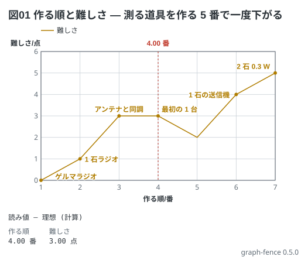

# 作る順と難しさ — 点の名札

測った値ではなく、**並べた物に名前を付けて見せる**グラフ。点列の点の後ろにコロンと字を書くと、
その点に ● が付き、名札が周りの空いた所に置かれる (線と枠に掛からない所を自動で選ぶ)。
名札を付けない点 (下の 5 番) は線の角になるだけ。

```graph
# グラフ (tommie-fence の graph フェンス)
title: 図01 作る順と難しさ — 測る道具を作る 5 番で一度下がる
x: 作る順 番 1..7
y: 難しさ 点 0..6
lines:
  難しさ 点:
    - 1 0: ゲルマラジオ
    - 2 1: 1 石ラジオ
    - 3 3: アンテナと同調
    - 4 3: 最初の 1 台
    - 5 2
    - 6 4: 1 石の送信機
    - 7 5: 2 石 0.3 W
notes:
  - mark 4
```


