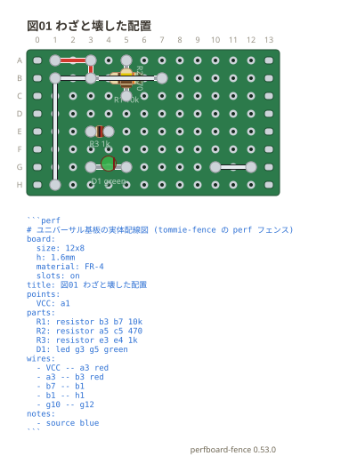

# 図のとおりに組むと動かないところ

**ユニバーサル基板は全穴が独立している。** 部品を挿しただけでは何にも
つながらないので、**つなぎ忘れが図の上で沈黙する**。そこを見張るのが ERC。

読めなかった行と違って、**図は描ける**。言っているのは「そのとおりに組むと
動かない」ことなので、お知らせとして出る。

```perf
# ユニバーサル基板の実体配線図 (tommie-fence の perf フェンス)
board:
  size: 12x8
  h: 1.6mm
  material: FR-4
  slots: on
title: 図01 わざと壊した配置
points:
  VCC: a1
parts:
  R1: resistor b3 b7 10k
  R2: resistor a5 c5 470
  R3: resistor e3 e4 1k
  D1: led g3 g5 green
wires:
  - VCC -- a3 red
  - a3 -- b3 red
  - b7 -- b1
  - b1 -- h1
  - g10 -- g12
notes:
  - source blue
expect:
  - match: 胴が重なって
    why: 見本としてわざと重ねた
  - match: ピンの間隔が狭すぎます
    why: 見本としてわざと詰めた
  - match: どこにもつながっていません
    why: 見本としてわざと配線を書かなかった
  - match: 1 つもつないでいません
    why: 見本としてわざと何もつながない線を引いた
```



この図はこう言われる (`expect:` が無ければ、各行の `[想定どおり: …]` の無い形で出る)。

```text
perf: 21 行目: [想定どおり: 見本としてわざと重ねた] R1 と R2 の胴が重なっています (実物では両方を挿せません)
perf: 22 行目: [想定どおり: 見本としてわざと詰めた] R3 (resistor) のピンの間隔が狭すぎます (e3 と e4)。…
perf: 20 行目: [想定どおり: 見本としてわざと配線を書かなかった] R1 の 1 本のピンがどこにもつながっていません (R1.2 (b7))。…
perf: 21 行目: [想定どおり: 見本としてわざと配線を書かなかった] R2 の 2 本のピンがどこにもつながっていません (R2.1 (a5)、R2.2 (c5))。…
perf: 22 行目: [想定どおり: 見本としてわざと配線を書かなかった] R3 の 2 本のピンがどこにもつながっていません (R3.1 (e3)、R3.2 (e4))。…
perf: 23 行目: [想定どおり: 見本としてわざと配線を書かなかった] D1 の 2 本のピンがどこにもつながっていません (D1.1 (g3)、D1.2 (g5))。…
perf: 29 行目: [想定どおり: 見本としてわざと何もつながない線を引いた] g10 -- g12 は部品のピンを 1 つもつないでいません
```

この図は**わざと壊してある**ので、お知らせが出るのが正しい。そこで末尾の `expect:` で
1 つずつ理由を添えて承知してある (下の「想定どおりと承知する」)。CLI の `check` と
Release の図の焼き直しでは毎回出るが、行の頭の `[想定どおり: …]` で直し忘れと見分けられる。

見ているのは 5 つ。

| 見るもの | なぜ |
| --- | --- |
| どこにもつながっていないピン | 全穴独立なので、挿しただけでは何にもつながらない |
| 配線で短絡した部品 | 抵抗を入れたつもりが線でまたいでいた、という取り違え |
| 部品のピンを 1 つもつないでいない配線 | ネットリストから落ちるので、言わないと黙って消える |
| 胴の重なり | ピンの穴が別でも胴は重なる。実物では両方を挿せない |
| ピンの間隔が狭すぎる | 胴の両端からピンが出る部品は、胴より狭い間隔に入らない |

**読めなかったところがあるうちは掛けない。** 落ちた配線を勘定に入れないまま
「つながっていません」と言うと、書いた配線について書き忘れを指摘することになる。

## 想定どおりと承知する

わざと壊した見本のように、**お知らせが出るのが正しい**図では `expect:` に理由を添えて並べる。
黙らせるのではなく、ログで `[想定どおり: 理由]` と言い分ける。

```yaml
expect:
  - match: 胴が重なって           # お知らせの文の一部 (部分一致)
    why: 見本としてわざと重ねた    # 必須
```

- 当たらない `expect:` はお知らせで言う (`expect: の「…」に当たるお知らせが出ていません (直ったなら消します)`)。
  図を直したのに承知だけが残る、ということが起きない
- 読めなかった行 (エラー) には効かない

## 外したいとき

回路の一部だけを描いた図など、**未結線が承知のうえ**のときは `style:` で外せる。

```yaml
style:
  check: off
```

**既定は掛ける** (`on`)。全穴独立の基板では繋ぎ忘れが図の上で沈黙するので、
見張りを外すのは書いた人がそう言ったときだけにする。

`debug: off` との違いは、**伏せるか、そもそも見ないか**。`debug: off` は
見つけたものを帯に出さないだけで、呼び出し側にはお知らせが渡る。
`check: off` は検査を掛けないので、どこにも出てこない。図はどちらも同じで、
変わるのは言うことだけ。**読めなかった行はどちらの対象でもない。**
