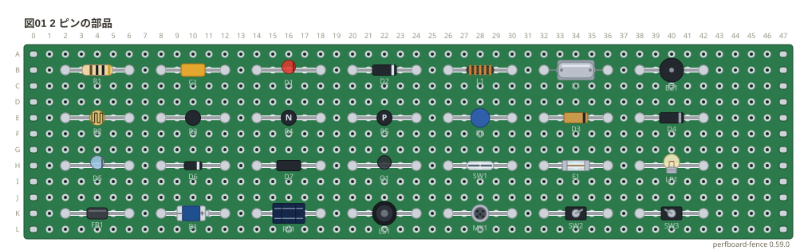
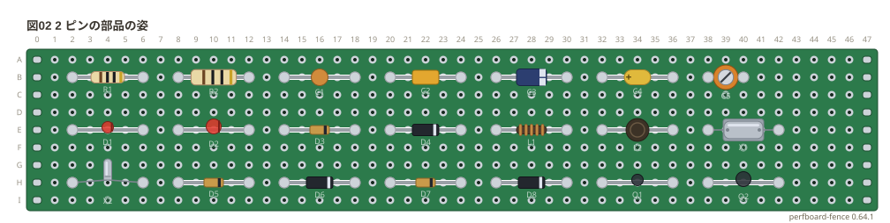
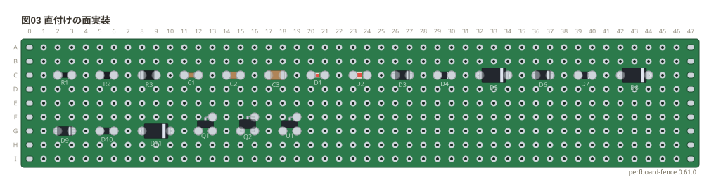
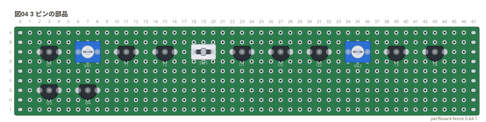
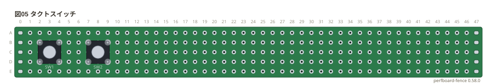
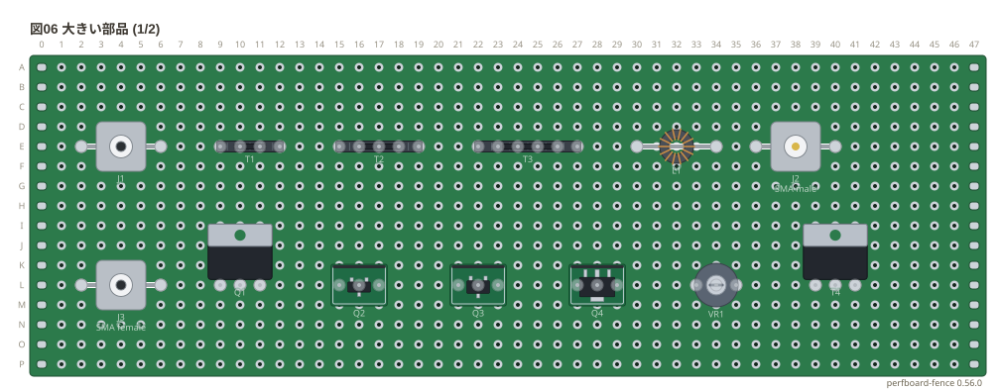
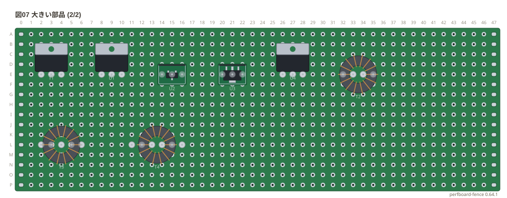
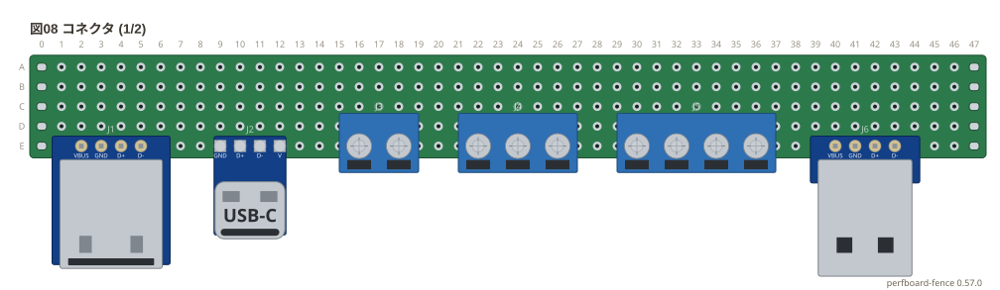
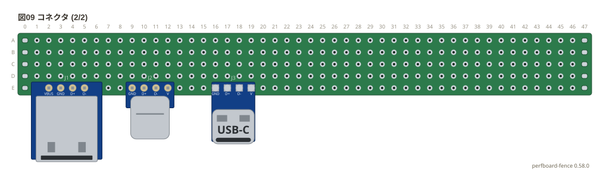
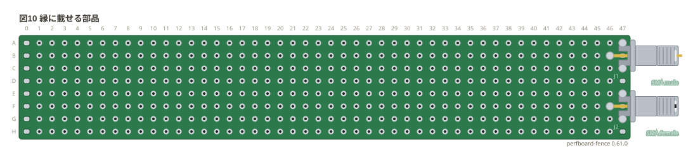

# 部品ギャラリー: 穴を並べて置く部品

ユニバーサル基板に**穴を並べて書く部品** (2 ピン・3 ピン・巻き物・スイッチ・USB・端子台・SMA) を、
種類ごとに 1 つずつ、姿 (`種類/姿`) ごとに 1 つずつ置いた。この基板に直付けする面実装の姿と、
基板の縁に載せる端面実装の SMA も置いた。
基板は 46 列の穴数で書いた、縁にパッドのある標準 (`slots: on`、1.6 mm の FR-4)。配線はしていないので `style: check: off` で検査を外した。

**このファイルは書き出した物** — 直すときは `src/gallery/gallery.ts` を直して `npm run gallery`。

## 2 ピンの部品

姿を書かないときの姿。4 穴の間に置いた。

```perf
# ユニバーサル基板の実体配線図 (tommie-fence の perf フェンス)
title: 図01 2 ピンの部品
board:
  size: 46x12
  h: 1.6mm
  material: FR-4
  slots: on
style:
  check: off
parts:
  R1: resistor b2 b6
  C1: capacitor b8 b12
  D1: led b14 b18
  D2: diode b20 b24
  L1: inductor b26 b30
  X1: crystal b32 b36
  BZ1: buzzer b38 b42
  R2: photoresistor e2 e6
  R3: thermistor e8 e12
  R4: thermistor-ntc e14 e18
  R5: thermistor-ptc e20 e24
  R6: varistor e26 e30
  D3: zener e32 e36
  D4: schottky e38 e42
  D5: photodiode h2 h6
  D6: varicap h8 h12
  D7: diac h14 h18
  Q1: phototransistor h20 h24
  SW1: reed h26 h30
  F1: fuse h32 h36
  LP1: lamp h38 h42
  FB1: ferrite-bead k2 k6
  B1: battery k8 k12
  PV1: solar k14 k18
  LS1: speaker k20 k24
  MK1: mic k26 k30
  SW2: switch k32 k36
  SW3: switch-nc k38 k42
```



## 2 ピンの部品の姿

`種類/姿` で選べる差し込みの姿。

```perf
# ユニバーサル基板の実体配線図 (tommie-fence の perf フェンス)
title: 図02 2 ピンの部品の姿
board:
  size: 46x9
  h: 1.6mm
  material: FR-4
  slots: on
style:
  check: off
parts:
  R1: resistor/quarter b2 b6
  R2: resistor/half b8 b12
  C1: capacitor/ceramic b14 b18
  C2: capacitor/film b20 b24
  C3: capacitor/electrolytic b26 b30
  C4: capacitor/tantalum b32 b36
  C5: capacitor/trimmer b38 b40
  D1: led/3mm e2 e6
  D2: led/5mm e8 e12
  D3: diode/do35 e14 e18
  D4: diode/do41 e20 e24
  L1: inductor/axial e26 e30
  L2: inductor/radial e32 e36
  X1: crystal/hc49 e38 e42
  X2: crystal/cylinder h2 h6
  D5: zener/do35 h8 h12
  D6: zener/do41 h14 h18
  D7: schottky/do35 h20 h24
  D8: schottky/do41 h26 h30
  Q1: phototransistor/3mm h32 h36
  Q2: phototransistor/5mm h38 h42
```



## 直付けの面実装

この基板に直付けする姿 (ブレッドボードには挿せない)。チップと SOD は隣の穴、`do214ac` は 2 穴離し、SOT は三角に置いた。

```perf
# ユニバーサル基板の実体配線図 (tommie-fence の perf フェンス)
title: 図03 直付けの面実装
board:
  size: 46x9
  h: 1.6mm
  material: FR-4
  slots: on
style:
  check: off
parts:
  R1: resistor/1608 c2 c3
  R2: resistor/2012 c5 c6
  R3: resistor/3216 c8 c9
  C1: capacitor/1608 c11 c12
  C2: capacitor/2012 c14 c15
  C3: capacitor/3216 c17 c18
  D1: led/1608 c20 c21
  D2: led/2012 c23 c24
  D3: diode/sod123 c26 c27
  D4: diode/sod323 c29 c30
  D5: diode/do214ac c32 c34
  D6: zener/sod123 c36 c37
  D7: zener/sod323 c39 c40
  D8: zener/do214ac c42 c44
  D9: schottky/sod123 g2 g3
  D10: schottky/sod323 g5 g6
  D11: schottky/do214ac g8 g10
  Q1: transistor/sot23 g12 g13 f13
  Q2: transistor/sot346 g15 g16 f16
  U1: regulator/sot23 g18 g19 f19
```



## 3 ピンの部品

姿を書かないときの姿と、`種類/姿` で選べる小さい姿。隣どうしの 3 穴に置いた。

```perf
# ユニバーサル基板の実体配線図 (tommie-fence の perf フェンス)
title: 図04 3 ピンの部品
board:
  size: 46x9
  h: 1.6mm
  material: FR-4
  slots: on
style:
  check: off
parts:
  Q1: transistor c2 c3 c4
  VR1: potentiometer c6 c7 c8
  T1: thyristor c10 c11 c12
  T2: triac c14 c15 c16
  SW1: slide-switch c18 c19 c20
  U1: regulator c22 c23 c24
  U2: ic3 c26 c27 c28
  Q2: transistor/to92 c30 c31 c32
  VR2: potentiometer/trimmer c34 c35 c36
  T3: thyristor/to92 c38 c39 c40
  T4: triac/to92 c42 c43 c44
  U3: regulator/to92 g2 g3 g4
  U4: ic3/to92 g6 g7 g8
```



## タクトスイッチ

アンカー 1 つ (左上のピン) で置く (a 接点の `button` と b 接点の `button-nc` は同じ形)。

```perf
# ユニバーサル基板の実体配線図 (tommie-fence の perf フェンス)
title: 図05 タクトスイッチ
board:
  size: 46x5
  h: 1.6mm
  material: FR-4
  slots: on
style:
  check: off
parts:
  SW1: button b2
  SW2: button-nc b7
```



## 大きい部品

巻き物・SMA と、胴の大きい姿 (TO-220・トロイダル・ボリューム・面実装の変換基板など)。

```perf
# ユニバーサル基板の実体配線図 (tommie-fence の perf フェンス)
title: 図06 大きい部品 (1/2)
board:
  size: 46x16
  h: 1.6mm
  material: FR-4
  slots: on
style:
  check: off
parts:
  J1: sma e2 e6
  T1: transformer e9 e10 e11 e12
  T2: transformer-ct e15 e16 e17 e18 e19
  T3: transformer-ct2 e22 e23 e24 e25 e26 e27
  L1: inductor/toroid e30 e34
  J2: sma/male e36 e40
  J3: sma/female l2 l6
  Q1: transistor/to220 l9 l10 l11
  Q2: transistor/sot23-dip l15 l16 l17
  Q3: transistor/sot346-dip l21 l22 l23
  Q4: transistor/sot89-dip l27 l28 l29
  VR1: potentiometer/knob l33 l34 l35
  T4: thyristor/to220 l39 l40 l41
```



```perf
# ユニバーサル基板の実体配線図 (tommie-fence の perf フェンス)
title: 図07 大きい部品 (2/2)
board:
  size: 46x16
  h: 1.6mm
  material: FR-4
  slots: on
style:
  check: off
parts:
  T1: triac/to220 e2 e3 e4
  U1: regulator/to220 e8 e9 e10
  U2: regulator/sot23-dip e14 e15 e16
  U3: regulator/sot89-dip e20 e21 e22
  U4: ic3/to220 e26 e27 e28
  T2: transformer/toroid e32 e33 e34 e35
  T3: transformer-ct/toroid l2 l3 l4 l5 l6
  T4: transformer-ct2/toroid l11 l12 l13 l14 l15 l16
```



## コネクタ

USB と端子台。差し込み口は基板の中心から遠い側を向くので、下の縁に置いた。

```perf
# ユニバーサル基板の実体配線図 (tommie-fence の perf フェンス)
title: 図08 コネクタ (1/2)
board:
  size: 46x5
  h: 1.6mm
  material: FR-4
  slots: on
style:
  check: off
parts:
  J1: usb-a e2 e3 e4 e5
  J2: usb-c e9 e10 e11 e12
  J3: terminal2 e16 e18
  J4: terminal3 e22 e24 e26
  J5: terminal4 e30 e32 e34 e36
  J6: usb-a/male e40 e41 e42 e43
```



```perf
# ユニバーサル基板の実体配線図 (tommie-fence の perf フェンス)
title: 図09 コネクタ (2/2)
board:
  size: 46x5
  h: 1.6mm
  material: FR-4
  slots: on
style:
  check: off
parts:
  J1: usb-a/female e2 e3 e4 e5
  J2: usb-c/male e9 e10 e11 e12
  J3: usb-c/female e16 e17 e18 e19
```



## 縁に載せる部品

端面実装の SMA (`sma/male-edge` `sma/female-edge`)。中心導体を右端の列に、凹の先端をその外の縁の銅箔に書いた。

```perf
# ユニバーサル基板の実体配線図 (tommie-fence の perf フェンス)
title: 図10 縁に載せる部品
board:
  size: 46x8
  h: 1.6mm
  material: FR-4
  slots: on
style:
  check: off
parts:
  J1: sma/male-edge b46 c47
  J2: sma/female-edge f46 g47
```


