# 部品ギャラリー: 型番のある IC とモジュール

[書き方](../docs/01-syntax.md#dip-のピンの名前) の「DIP のピンの名前」の表にある**型番を全部**置いた。
型番を書くと、胴にピンの番号と名前が出る。
基板は 46 列の穴数で書いた、縁にパッドのある標準 (`slots: on`、1.6 mm の FR-4)。配線はしていないので `style: check: off` で検査を外した。

**このファイルは書き出した物** — 直すときは `src/gallery/gallery.ts` を直して `npm run gallery`。

## DIP4

型番の表にある 4 ピンの型番。胴の縁にピンの番号、その内側にピンの名前が出る。

```perf
# ユニバーサル基板の実体配線図 (tommie-fence の perf フェンス)
title: 図01 DIP4 の型番
board:
  size: 46x5
  h: 1.6mm
  material: FR-4
  slots: on
style:
  check: off
parts:
  U1: dip4 b2 3SK291
```

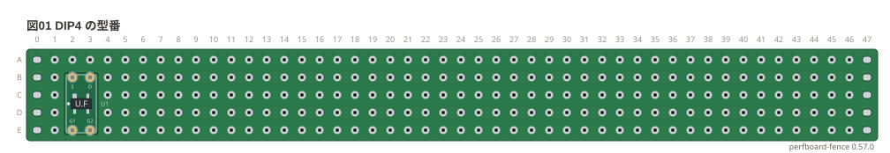

## DIP8

型番の表にある 8 ピンの型番。胴の縁にピンの番号、その内側にピンの名前が出る。

```perf
# ユニバーサル基板の実体配線図 (tommie-fence の perf フェンス)
title: 図02 DIP8 の型番
board:
  size: 46x15
  h: 1.6mm
  material: FR-4
  slots: on
style:
  check: off
parts:
  U1: dip8 b2 NE555
  U2: dip8 b8 TLC555
  U3: dip8 b14 LM358
  U4: dip8 b20 TL071
  U5: dip8 b26 TL072
  U6: dip8 b32 LM393
  U7: dip8 b38 SA612
  U8: dip8 g2 MCP6002
  U9: dip8 g8 LM386
  U10: dip8 g14 NE5532
  U11: dip8 g20 NJM4556A
  U12: dip8 g26 LM741
  U13: dip8 g32 ATtiny85
  U14: dip8 g38 PIC12F683
  U15: dip8 l2 PIC12F1822
  U16: dip8 l8 AE-SI5351A-B
  U17: dip8 l14 LM75
  U18: dip8 l20 MCP9808
```

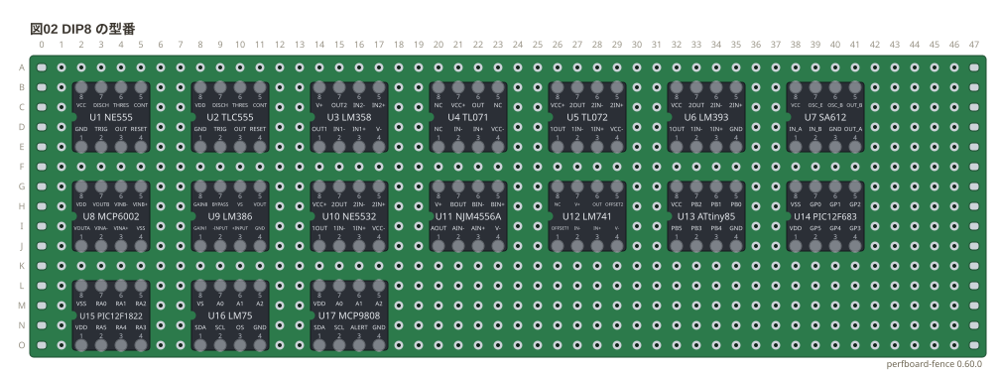

## DIP14

型番の表にある 14 ピンの型番。胴の縁にピンの番号、その内側にピンの名前が出る。

```perf
# ユニバーサル基板の実体配線図 (tommie-fence の perf フェンス)
title: 図03 DIP14 の型番 (1/2)
board:
  size: 46x20
  h: 1.6mm
  material: FR-4
  slots: on
style:
  check: off
parts:
  U1: dip14 b2 CD4069UB
  U2: dip14 b11 CD4071B
  U3: dip14 b20 CD4081B
  U4: dip14 b29 CD4011B
  U5: dip14 b38 CD4001B
  U6: dip14 g2 CD4013B
  U7: dip14 g11 CD4070B
  U8: dip14 g20 CD40106B
  U9: dip14 g29 74HC04
  U10: dip14 g38 74HC08
  U11: dip14 l2 74HC32
  U12: dip14 l11 74HC86
  U13: dip14 l20 74HC02
  U14: dip14 l29 74HC74
  U15: dip14 l38 74HC14
  U16: dip14 q2 74HC00
  U17: dip14 q11 74HC10
  U18: dip14 q20 74HC11
  U19: dip14 q29 74HC27
  U20: dip14 q38 74HC20
```

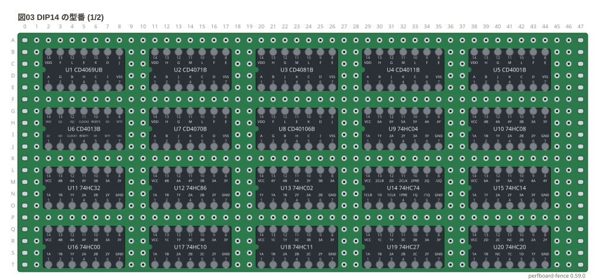

```perf
# ユニバーサル基板の実体配線図 (tommie-fence の perf フェンス)
title: 図04 DIP14 の型番 (2/2)
board:
  size: 46x10
  h: 1.6mm
  material: FR-4
  slots: on
style:
  check: off
parts:
  U1: dip14 b2 74HC30
  U2: dip14 b11 74HC132
  U3: dip14 b20 74HC125
  U4: dip14 b29 74HC126
  U5: dip14 b38 74HC393
  U6: dip14 g2 74HC164
  U7: dip14 g11 74HC4066
  U8: dip14 g20 LM324
  U9: dip14 g29 74LS00
```

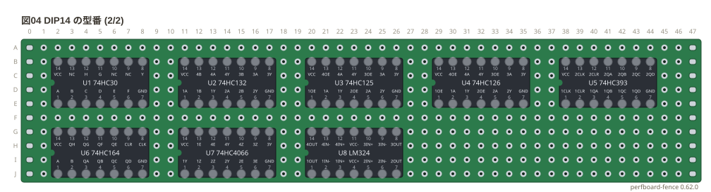

## DIP16

型番の表にある 16 ピンの型番。胴の縁にピンの番号、その内側にピンの名前が出る。

```perf
# ユニバーサル基板の実体配線図 (tommie-fence の perf フェンス)
title: 図05 DIP16 の型番 (1/2)
board:
  size: 46x20
  h: 1.6mm
  material: FR-4
  slots: on
style:
  check: off
parts:
  U1: dip16 b2 CD4017B
  U2: dip16 b12 CD4040B
  U3: dip16 b22 L293D
  U4: dip16 b32 MCP3008
  U5: dip16 g2 74HC595
  U6: dip16 g12 CD4511B
  U7: dip16 g22 CD74HC283
  U8: dip16 g32 74HC163
  U9: dip16 l2 74HC161
  U10: dip16 l12 74HC194
  U11: dip16 l22 74HC138
  U12: dip16 l32 74HC139
  U13: dip16 q2 74HC157
  U14: dip16 q12 74HC153
  U15: dip16 q22 74HC151
  U16: dip16 q32 74HC175
```

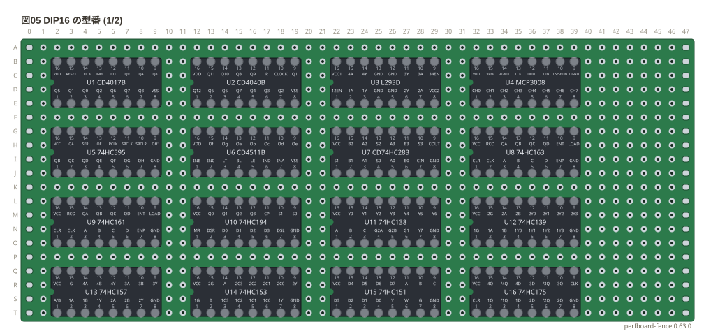

```perf
# ユニバーサル基板の実体配線図 (tommie-fence の perf フェンス)
title: 図06 DIP16 の型番 (2/2)
board:
  size: 46x20
  h: 1.6mm
  material: FR-4
  slots: on
style:
  check: off
parts:
  U1: dip16 b2 74HC174
  U2: dip16 b12 74HC112
  U3: dip16 b22 74HC390
  U4: dip16 b32 74HC4040
  U5: dip16 g2 74HC4060
  U6: dip16 g12 74HC193
  U7: dip16 g22 74HC165
  U8: dip16 g32 74HC85
  U9: dip16 l2 74HC123
  U10: dip16 l12 74HC4051
  U11: dip16 l22 74HC4052
  U12: dip16 l32 74HC4053
  U13: dip16 q2 ULN2003A
```

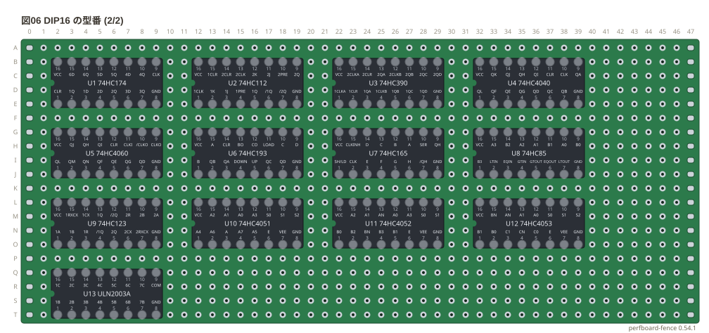

## DIP18

型番の表にある 18 ピンの型番。胴の縁にピンの番号、その内側にピンの名前が出る。

```perf
# ユニバーサル基板の実体配線図 (tommie-fence の perf フェンス)
title: 図07 DIP18 の型番
board:
  size: 46x5
  h: 1.6mm
  material: FR-4
  slots: on
style:
  check: off
parts:
  U1: dip18 b2 PIC16F84A
  U2: dip18 b13 PIC16F628A
```

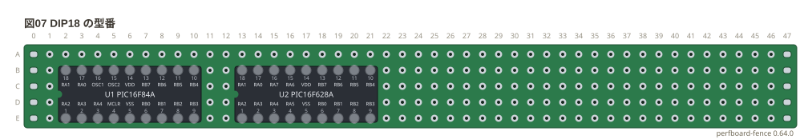

## DIP20

型番の表にある 20 ピンの型番。胴の縁にピンの番号、その内側にピンの名前が出る。

```perf
# ユニバーサル基板の実体配線図 (tommie-fence の perf フェンス)
title: 図08 DIP20 の型番
board:
  size: 46x15
  h: 1.6mm
  material: FR-4
  slots: on
style:
  check: off
parts:
  U1: dip20 b2 74HC245
  U2: dip20 b14 74HC273
  U3: dip20 b26 74HC244
  U4: dip20 g2 74HC541
  U5: dip20 g14 74HC240
  U6: dip20 g26 74HC573
  U7: dip20 l2 74HC574
```

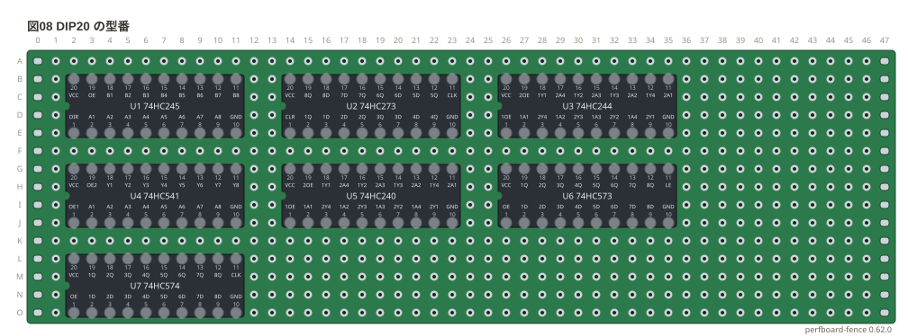

## DIP24

型番の表にある 24 ピンの型番。胴の縁にピンの番号、その内側にピンの名前が出る。

```perf
# ユニバーサル基板の実体配線図 (tommie-fence の perf フェンス)
title: 図09 DIP24 の型番
board:
  size: 46x5
  h: 1.6mm
  material: FR-4
  slots: on
style:
  check: off
parts:
  U1: dip24 b2 74HC154
  U2: dip24 b16 6116
```

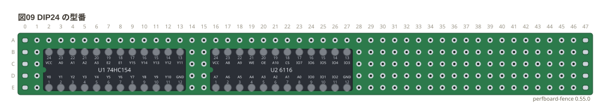

## DIP28

型番の表にある 28 ピンの型番。胴の縁にピンの番号、その内側にピンの名前が出る。

```perf
# ユニバーサル基板の実体配線図 (tommie-fence の perf フェンス)
title: 図10 DIP28 の型番
board:
  size: 46x10
  h: 1.6mm
  material: FR-4
  slots: on
style:
  check: off
parts:
  U1: dip28 b2 62256
  U2: dip28 b18 ATmega328P
  U3: dip28 g2 PIC16F886
  U4: dip28 g18 PIC16F57
```

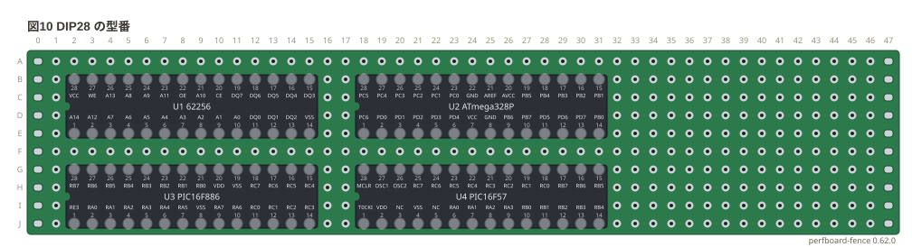

## 1 列の型番

1 列 (`sipN`) で描く型番 (センサ・フィルタ・モジュールのヘッダ・フルカラー LED など)。

```perf
# ユニバーサル基板の実体配線図 (tommie-fence の perf フェンス)
title: 図11 1 列の型番
board:
  size: 46x11
  h: 1.6mm
  material: FR-4
  slots: on
style:
  check: off
parts:
  U1: sip3 c2 SFU455B
  U2: sip5 c8 KY-040
  U3: sip4 c15 HC-SR04
  U4: sip3 c21 SG90
  U5: sip4 c26 DHT11
  U6: sip3 c32 HC-SR501
  U7: sip7 c38 GY-9833
  U8: sip8 g2 ADAFRUIT-1782
  U9: sip7 g12 ADAFRUIT-2045
  U10: sip3 g21 TA7642
  U11: sip3 g26 A3144
  U12: sip3 g31 A1324
  U13: sip3 g36 LM35
  U14: sip3 g41 SFELF10M7
  U15: sip3 k2 CFULA455
  U16: sip4 k8 OSTA5131A
  U17: sip4 k14 OSTAMA5B31A
```

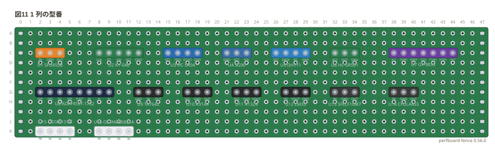

## DIP 化キット

基板とジャックの外形を帯の脇 (基板の縁に近い側) に描く型番。下の縁に置いた。

```perf
# ユニバーサル基板の実体配線図 (tommie-fence の perf フェンス)
title: 図12 DIP 化キット
board:
  size: 46x6
  h: 1.6mm
  material: FR-4
  slots: on
style:
  check: off
parts:
  U1: sip8 f2 AE-RJ-45-LAN-DIP-A
  U2: sip4 f13 AE-DC-POWER-JACK-DIP
  U3: sip4 f24 AE-PHONE-JACK-DIP
```

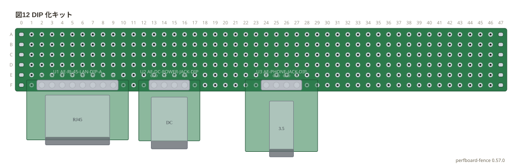

## DIP の姿

`dipN/sop` `dipN/tssop` (面実装の IC を DIP 化した変換基板に載せた姿) と `dipN/socket` (IC ソケットに挿した姿。この基板だけ)。

```perf
# ユニバーサル基板の実体配線図 (tommie-fence の perf フェンス)
title: 図13 DIP の姿
board:
  size: 46x5
  h: 1.6mm
  material: FR-4
  slots: on
style:
  check: off
parts:
  U1: dip8/sop b2
  U2: dip8/tssop b9
  U3: dip8/socket b16
```

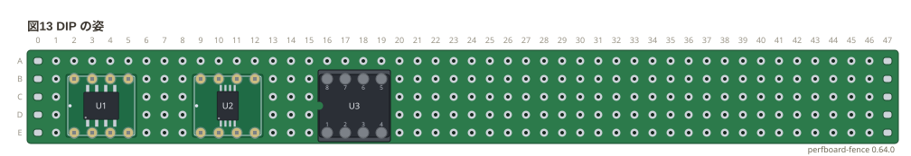

## 型番を書かない DIP と 1 列

パレットに並ぶピンの数の `dipN` と `sipN`。型番を書かなければ胴にピンの番号だけが出る。

```perf
# ユニバーサル基板の実体配線図 (tommie-fence の perf フェンス)
title: 図14 型番を書かない DIP と 1 列 (1/2)
board:
  size: 46x20
  h: 1.6mm
  material: FR-4
  slots: on
style:
  check: off
parts:
  U1: dip4 b2
  U2: dip6 b6
  U3: dip8 b11
  U4: dip14 b17
  U5: dip16 b26
  U6: dip18 b36
  U7: dip20 g2
  U8: dip24 g14
  U9: dip28 g28
  U10: dip40 l2
  J1: sip2 l24
  J2: sip3 l28
  J3: sip4 l33
  J4: sip5 l39
  J5: sip6 q2
  J6: sip8 q10
  J7: sip10 q20
```

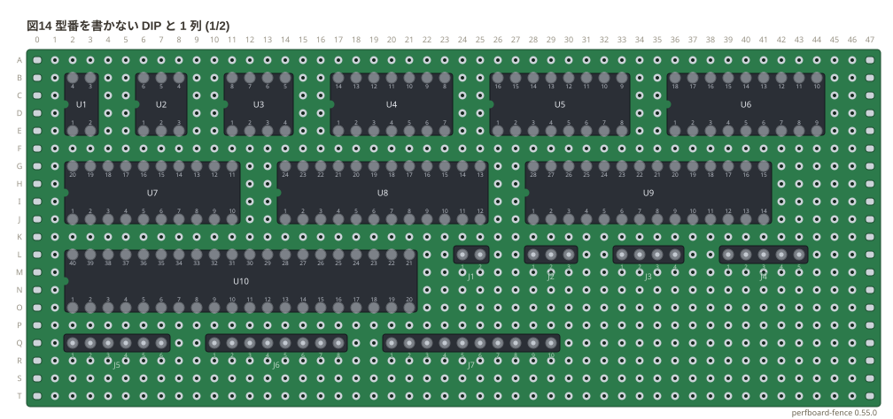

```perf
# ユニバーサル基板の実体配線図 (tommie-fence の perf フェンス)
title: 図15 型番を書かない DIP と 1 列 (2/2)
board:
  size: 46x10
  h: 1.6mm
  material: FR-4
  slots: on
style:
  check: off
parts:
  J1: sip20 b2
  J2: sip40 g2
```

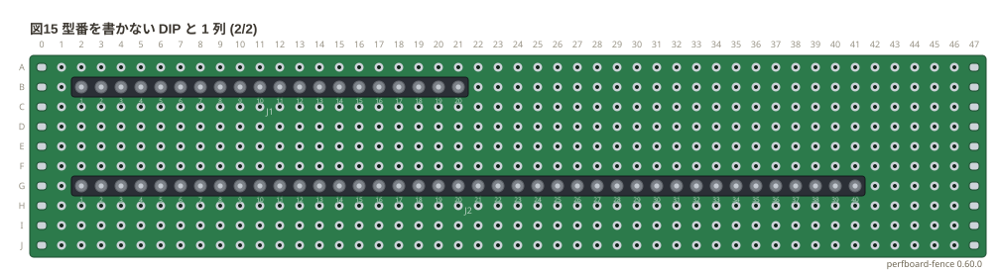
