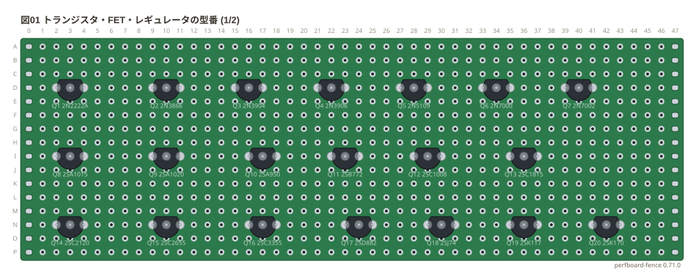
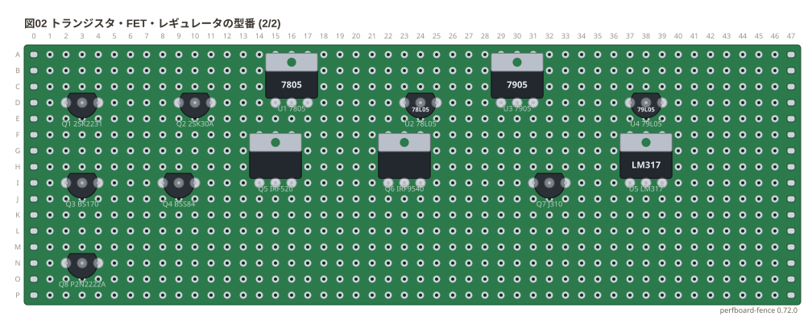

# 部品ギャラリー: 型番のあるトランジスタ・FET・レギュレータ

[書き方](../docs/01-syntax.md#3-ピンのトランジスタfetレギュレータの穴の順) の「3 ピンのトランジスタ・FET・レギュレータの穴の順」の表にある**型番を全部**置いた。
型番を書くと、穴の順に表のピンの名前が付く。TO-220 の型番は `/to220` の姿で、ほかは TO-92 の姿で置いた。
基板は 46 列の穴数で書いた、縁にパッドのある標準 (`slots: on`、1.6 mm の FR-4)。配線はしていないので `style: check: off` で検査を外した。

**このファイルは書き出した物** — 直すときは `src/gallery/gallery.ts` を直して `npm run gallery`。

## 型番

印字面を手前、ピンを下にして左から右の並び。

```perf
# ユニバーサル基板の実体配線図 (tommie-fence の perf フェンス)
title: 図01 トランジスタ・FET・レギュレータの型番 (1/2)
board:
  size: 46x16
  h: 1.6mm
  material: FR-4
  slots: on
style:
  check: off
parts:
  Q1: transistor d2 d3 d4 2N2222A
  Q2: transistor d9 d10 d11 2N3866
  Q3: transistor d15 d16 d17 2N3904
  Q4: transistor d21 d22 d23 2N3906
  Q5: transistor d27 d28 d29 2N5109
  Q6: transistor d33 d34 d35 2N7000
  Q7: transistor d39 d40 d41 2N7002
  Q8: transistor i2 i3 i4 2SA1015
  Q9: transistor i9 i10 i11 2SA1020
  Q10: transistor i16 i17 i18 2SA950
  Q11: transistor i22 i23 i24 2SB772
  Q12: transistor i28 i29 i30 2SC1008
  Q13: transistor i35 i36 i37 2SC1815
  Q14: transistor n2 n3 n4 2SC2120
  Q15: transistor n9 n10 n11 2SC2655
  Q16: transistor n16 n17 n18 2SC3355
  Q17: transistor n23 n24 n25 2SD882
  Q18: transistor n29 n30 n31 2SJ74
  Q19: transistor n35 n36 n37 2SK117
  Q20: transistor n41 n42 n43 2SK170
```



```perf
# ユニバーサル基板の実体配線図 (tommie-fence の perf フェンス)
title: 図02 トランジスタ・FET・レギュレータの型番 (2/2)
board:
  size: 46x16
  h: 1.6mm
  material: FR-4
  slots: on
style:
  check: off
parts:
  Q1: transistor d2 d3 d4 2SK2231
  Q2: transistor d9 d10 d11 2SK30A
  U1: regulator/to220 d15 d16 d17 7805
  U2: regulator d23 d24 d25 78L05
  U3: regulator/to220 d29 d30 d31 7905
  U4: regulator d37 d38 d39 79L05
  Q3: transistor i2 i3 i4 BS170
  Q4: transistor i8 i9 i10 BSS84
  Q5: transistor/to220 i14 i15 i16 IRF520
  Q6: transistor/to220 i22 i23 i24 IRF9540
  Q7: transistor i31 i32 i33 J310
  U5: regulator/to220 i37 i38 i39 LM317
  Q8: transistor n2 n3 n4 P2N2222A
```


