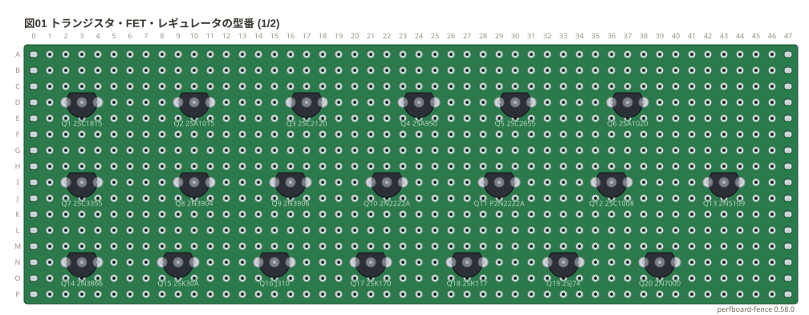
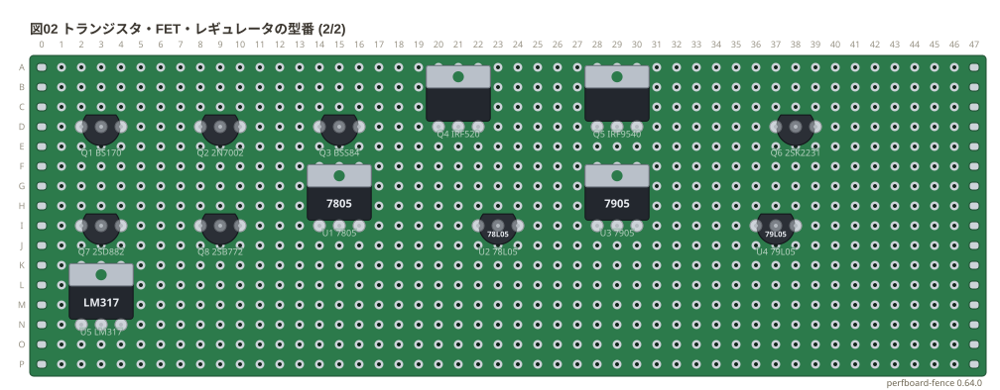

# 部品ギャラリー: 型番のあるトランジスタ・FET・レギュレータ

[書き方](../docs/01-syntax.md#3-ピンのトランジスタfetレギュレータの穴の順) の「3 ピンのトランジスタ・FET・レギュレータの穴の順」の表にある**型番を全部**置いた。
型番を書くと、穴の順に表のピンの名前が付く。TO-220 の型番は `/to220` の姿で、ほかは TO-92 の姿で置いた。
基板は 46 列の穴数で書いた、縁にパッドのある標準 (`slots: on`、1.6 mm の FR-4)。配線はしていないので `style: check: off` で検査を外した。

**このファイルは書き出した物** — 直すときは `src/gallery/gallery.ts` を直して `npm run gallery`。

## 型番

印字面を手前、ピンを下にして左から右の並び。

```perf
# ユニバーサル基板の実体配線図 (tommie-fence の perf フェンス)
title: 図01 トランジスタ・FET・レギュレータの型番 (1/2)
board:
  size: 46x16
  h: 1.6mm
  material: FR-4
  slots: on
style:
  check: off
parts:
  Q1: transistor d2 d3 d4 2SC1815
  Q2: transistor d9 d10 d11 2SA1015
  Q3: transistor d16 d17 d18 2SC2120
  Q4: transistor d23 d24 d25 2SA950
  Q5: transistor d29 d30 d31 2SC2655
  Q6: transistor d36 d37 d38 2SA1020
  Q7: transistor i2 i3 i4 2SC3355
  Q8: transistor i9 i10 i11 2N3904
  Q9: transistor i15 i16 i17 2N3906
  Q10: transistor i21 i22 i23 2N2222A
  Q11: transistor i28 i29 i30 P2N2222A
  Q12: transistor i35 i36 i37 2SC1008
  Q13: transistor i42 i43 i44 2N5109
  Q14: transistor n2 n3 n4 2N3866
  Q15: transistor n8 n9 n10 2SK30A
  Q16: transistor n14 n15 n16 J310
  Q17: transistor n20 n21 n22 2SK170
  Q18: transistor n26 n27 n28 2SK117
  Q19: transistor n32 n33 n34 2SJ74
  Q20: transistor n38 n39 n40 2N7000
```



```perf
# ユニバーサル基板の実体配線図 (tommie-fence の perf フェンス)
title: 図02 トランジスタ・FET・レギュレータの型番 (2/2)
board:
  size: 46x16
  h: 1.6mm
  material: FR-4
  slots: on
style:
  check: off
parts:
  Q1: transistor d2 d3 d4 BS170
  Q2: transistor d8 d9 d10 2N7002
  Q3: transistor d14 d15 d16 BSS84
  Q4: transistor/to220 d20 d21 d22 IRF520
  Q5: transistor/to220 d28 d29 d30 IRF9540
  Q6: transistor d37 d38 d39 2SK2231
  Q7: transistor i2 i3 i4 2SD882
  Q8: transistor i8 i9 i10 2SB772
  U1: regulator/to220 i14 i15 i16 7805
  U2: regulator i22 i23 i24 78L05
  U3: regulator/to220 i28 i29 i30 7905
  U4: regulator i36 i37 i38 79L05
  U5: regulator/to220 n2 n3 n4 LM317
```


