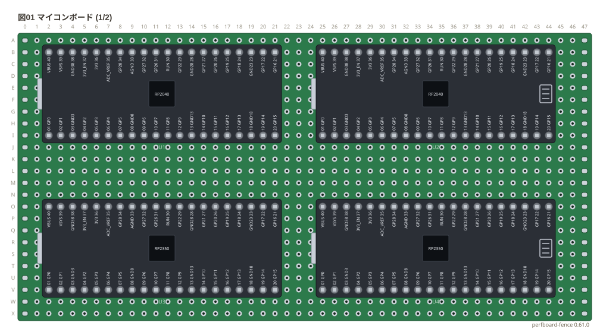
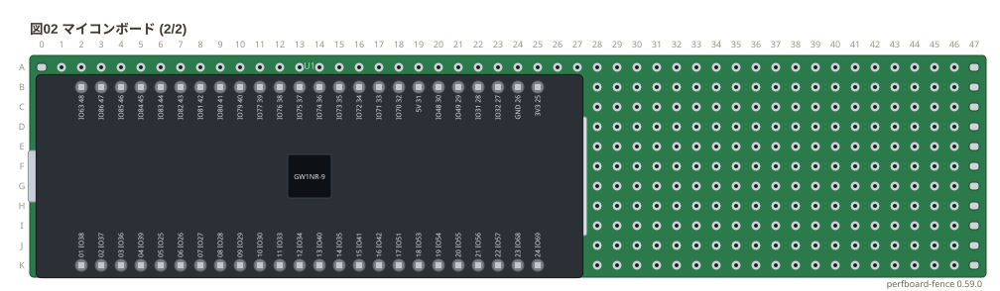
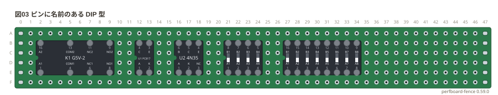
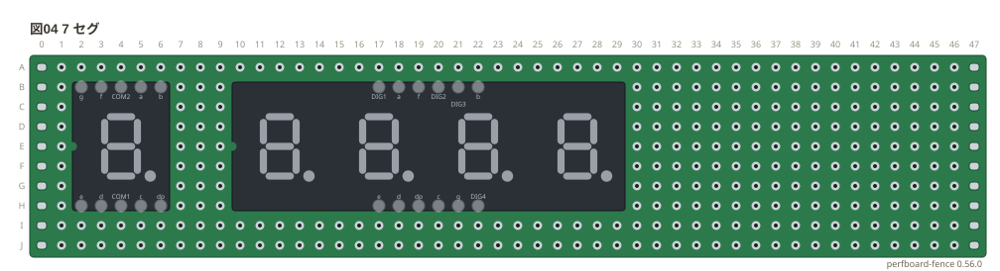
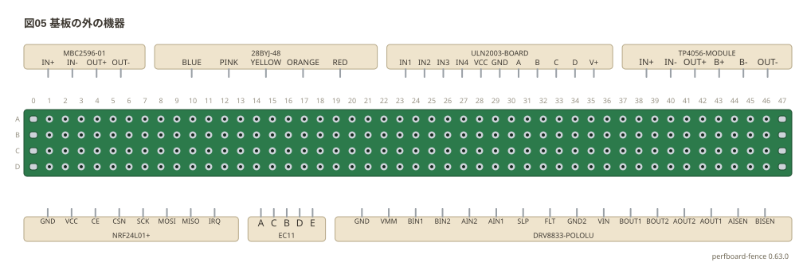

# 部品ギャラリー: マイコンボード・名前つきの部品・基板の外の機器

マイコンボード、ピンに名前のある DIP 型 (リレー・フォトカプラ・7 セグ・DIP スイッチ)、
型番で書く基板の外の機器 (`type: device` の `model:`) を全部置いた。
基板は 46 列の穴数で書いた、縁にパッドのある標準 (`slots: on`、1.6 mm の FR-4)。配線はしていないので `style: check: off` で検査を外した。

**このファイルは書き出した物** — 直すときは `src/gallery/gallery.ts` を直して `npm run gallery`。

## マイコンボード

アンカー 1 つ (胴の左上) で置くボード。

```perf
# ユニバーサル基板の実体配線図 (tommie-fence の perf フェンス)
title: 図01 マイコンボード (1/2)
board:
  size: 46x24
  h: 1.6mm
  material: FR-4
  slots: on
style:
  check: off
parts:
  U1: pico b2
  U2: pico-w b25
  U3: pico2 o2
  U4: pico2-w o25
```



```perf
# ユニバーサル基板の実体配線図 (tommie-fence の perf フェンス)
title: 図02 マイコンボード (2/2)
board:
  size: 46x11
  h: 1.6mm
  material: FR-4
  slots: on
style:
  check: off
parts:
  U1: tang-nano-9k b2
```



## ピンに名前のある DIP 型

ピンは名前でも番号でも呼べる。

```perf
# ユニバーサル基板の実体配線図 (tommie-fence の perf フェンス)
title: 図03 ピンに名前のある DIP 型
board:
  size: 46x6
  h: 1.6mm
  material: FR-4
  slots: on
style:
  check: off
parts:
  K1: relay/g5v-2 b2
  U1: photocoupler/pc817 b12
  U2: photocoupler6/4n35 b16
  SW1: dip-switch4/slide b21
  SW2: dip-switch8/slide b27
```



## 7 セグ

列の間が 6 穴。4 桁の胴は外形どおり横長。

```perf
# ユニバーサル基板の実体配線図 (tommie-fence の perf フェンス)
title: 図04 7 セグ
board:
  size: 46x10
  h: 1.6mm
  material: FR-4
  slots: on
style:
  check: off
parts:
  DS1: seg7/5161as b2
  DS2: seg7x4/osl40562 b17
```



## 基板の外の機器

`model:` に型番を書くと、ピンの名前が表から出る。基板の上と下の帯に並べた。

```perf
# ユニバーサル基板の実体配線図 (tommie-fence の perf フェンス)
title: 図05 基板の外の機器
board:
  size: 46x4
  h: 1.6mm
  material: FR-4
  slots: on
style:
  check: off
parts:
  M1:
      type: device
      at: top
      model: MBC2596-01
  M2:
      type: device
      at: top
      model: 28BYJ-48
  M3:
      type: device
      at: top
      model: ULN2003-BOARD
  M4:
      type: device
      at: top
      model: TP4056-MODULE
  M5:
      type: device
      at: bottom
      model: NRF24L01+
  M6:
      type: device
      at: bottom
      model: EC11
  M7:
      type: device
      at: bottom
      model: DRV8833-POLOLU
```


